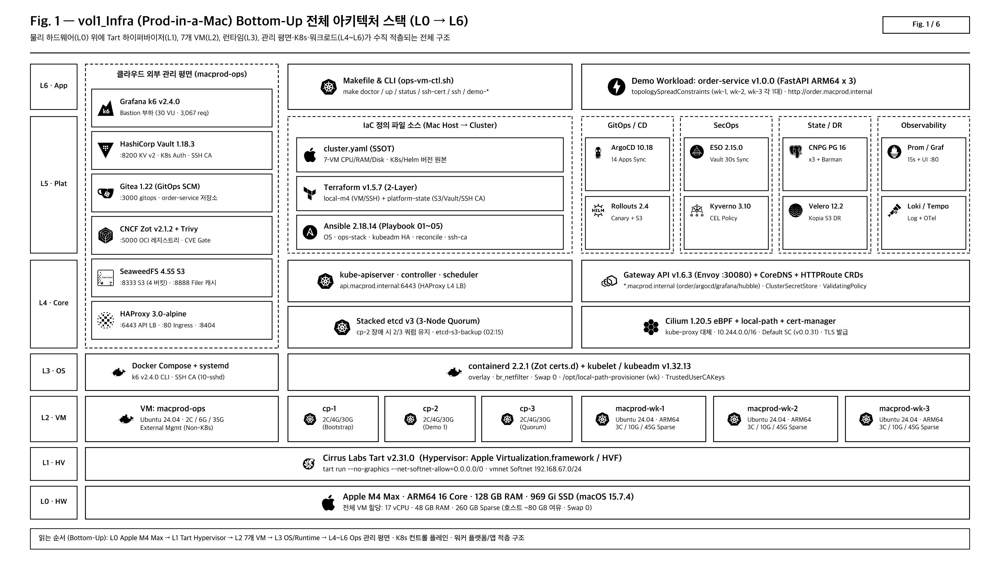

# vol1_Infra — Prod-in-a-Mac (단일 HA 코어 DevOps 플랫폼)

Apple Silicon Mac (`Apple M4 Max`, 16코어, `128 GB` RAM) 위에서 **클라우드 비용 `$0/월`** 으로 실제 프로덕션급 3-Master HA Kubernetes 플랫폼과 GitOps · 시크릿 · Zero-Trust SSH · 정책 · DB HA · DR · 관측성 스택을 IaC로 구축·운영·검증하는 저장소이다.

> **처음 인계받으셨나요?** 👉 **[00. 인프라 인수인계 & 운영 가이드](./docs/00-handover-guide.md)** 부터 읽으면 **최하위 하드웨어(L0) → 하이퍼바이저(L1 Tart) → 7개 VM 개별 스펙/역할/정의 파일 위치(L2) → 호스트 런타임/외부 평면(L3) → 컨트롤 플레인·네트워크(L4) → 플랫폼 4대 스택(L5) → 워크로드·운영(L6)** 순으로 차근차근 이해하고 실행할 수 있다.

---

## 1. Bottom-Up 계층 아키텍처 (논문 스타일 흑백 모노크롬 PPT 16:9 슬라이드 6종)



* **L0 · 물리 하드웨어**: `Apple M4 Max` (16C, `128 GB` RAM, NVMe SSD `969 Gi` 여유) — VM 총 할당 `17 vCPU · 48 GB RAM · 260 GB Sparse`
* **L1 · 하이퍼바이저**: `Tart v2.31.0` (`Apple Virtualization.framework / HVF`, `vmnet Softnet 192.168.67.0/24`) — [ops-vm-ctl.sh](./scripts/ops-vm-ctl.sh)
* **L2~L3 · `macprod-ops` (`2C / 6 GB / 35 GB`)**: 클러스터 외부 관리 평면 — `HAProxy 3.0` (`:6443/:80/:8404`), `SeaweedFS 4.55` S3/Filer (`:8333/:8888`), `CNCF Zot v2.1.2` (`:5000`), `Gitea 1.22` (`:3000`), `Vault 1.18.3` (`:8200`, KV + SSH CA), `k6 v2.4.0`
* **L2~L4 · `macprod-cp-1..3` (각 `2C / 4 GB / 30 GB`)**: `kubeadm v1.32.13` Stacked `etcd` HA (`cp-1` Bootstrap Leader 및 초기/데모 S3 백업, `cp-2`/`cp-3` HA + 전 노드 `02:15` cron)
* **L2~L6 · `macprod-wk-1..3` (각 `3C / 10 GB / 45 GB`)**: `Cilium 1.20.5` + `Gateway API v1.6.3` Envoy `:30080`, `ArgoCD 10.18.2` + `Argo Rollouts 2.43.12`, `External Secrets 2.15.0` + `Kyverno 3.10.0` CEL, `CloudNativePG 0.29.2`/`1.30.2` (`PG 16.6` × 3), `Velero 12.2.5`, `Prometheus/Loki/Tempo/OTel/Grafana`, `order-service` × 3

### 계층별 PPT 슬라이드 덱 ([docs/diagrams/](./docs/diagrams/))
1. [Fig. 1 — L0→L6 Bottom-Up 전체 아키텍처 스택 한눈에 보기](./docs/diagrams/slide-01-full-stack-architecture.png)
2. [Fig. 2 — 계층 분할 [하부]: L0~L4 하드웨어 · Tart · IaC 정의 파일 · macprod-ops · macprod-cp-1..3](./docs/diagrams/slide-02-l0-l4-ops-cp-iac-stack.png)
3. [Fig. 3 — 계층 분할 [상부]: L4~L6 Cilium/Gateway 경계 · 4대 플랫폼 스택 · macprod-wk-1..3](./docs/diagrams/slide-03-l5-l6-network-workers.png)
4. [Fig. 4 — 일상 운영 라이프사이클 & 6대 자동 검증 데모](./docs/diagrams/slide-04-ops-lifecycle-and-demos.png)
5. [Fig. 5 — 기술 스택별 역할 총람 [1/2]: L0~L4 하드웨어 · 하이퍼바이저 · 외부 평면 · K8s 코어](./docs/diagrams/slide-05-tech-stack-roles-infra-core.png)
6. [Fig. 6 — 기술 스택별 역할 총람 [2/2]: L5~L6 GitOps · 보안 · DB/DR · 관측성 · 워크로드](./docs/diagrams/slide-06-tech-stack-roles-platform-app.png)

---

## 2. 문서 체계

1. **[00. 인프라 인수인계 & 운영 가이드](./docs/00-handover-guide.md)** — **Bottom-Up 마스터 가이드** (L0→L6 계층 해설, VM별 스펙·상주 스택·정의 파일 매핑, 기술스택 역할 총람, `make doctor -> make up`, 재부팅 복구, Vault SSH CA, 접속 치트시트)
2. **[01. 아키텍처 및 기술 스택 선정 근거 (ADR)](./docs/01-architecture-and-stack-adr.md)** — 계층별 기술 스택 선택 이유, 대안 비교(Tart, SeaweedFS, Zot, `k6`, Vault SSH CA, Kyverno CEL), AWS EKS Cloud Parity 매핑
3. **[02. Demo 실행 가이드 (Runbook)](./docs/02-demo-runbook.md)** — `make up` 구축, **6대 실전 장애·배포·보안·복구·SSH CA 데모**, `k6` 부하, 관측성 API 조회 절차
4. **[03. 트러블슈팅 & 버그 로그](./docs/03-troubleshooting-buglog.md)** — 구축·콜드 부팅 복구·SSH CA 검증 중 실제로 만나 해결한 **25건**의 버그·환경 제약 전수 기록
5. **[04. 실측 검증 & 실시간 웹 UI·CLI 캡처 증빙](./docs/04-verification-evidence.md)** — `make reconcile` → `Demo 1`~`Demo 6` → `k6` 부하 → **8개 웹 UI 브라우저 실물 캡처 + 8개 CLI 실행 캡처** 전수 모음 ([docs/captures/](./docs/captures/))

---

## 3. 빠른 시작 (`Makefile`)

단일 SSOT 설정은 [infra/config/cluster.yaml](./infra/config/cluster.yaml)에서 관리한다.

```bash
# 1) 호스트 사전 요구사항 점검 (CPU/RAM/필수 CLI 10종 + pyyaml)
make doctor

# 2) 전체 Zero-to-Ready 구축 (7 VMs -> Ops -> 3-Master HA K8s -> Cilium/ArgoCD -> S3/Vault/GitOps/SSH CA)
make up

# 3) 클러스터 및 파드 상태 확인
make status

# 4) 6대 실전 데모 실행
make demo-ha        # Demo 1: CP 1대 강제 정지 무중단 & etcd S3 백업
make demo-canary    # Demo 2: 5xx 오류 v2.0.0-bad 카나리 -> Prometheus 감지 자동 롤백
make demo-db        # Demo 3: CloudNativePG Primary 강제 삭제 -> 자동 승격 & S3 백업
make demo-security  # Demo 4: Vault->ESO 시크릿 회전 & Kyverno CEL 정책 차단
make demo-velero    # Demo 5: 네임스페이스 삭제 후 SeaweedFS S3 기반 Velero 복구
make demo-ssh       # Demo 6: Vault SSH CA 단기 인증서 발급 & 비등록 키·패스워드 차단 검증

# 5) SSH 단기 인증서 발급 & VM 접속 (Vault SSH CA)
make ssh-cert       # ~/.ssh/macprod_user_ed25519-cert.pub 발급 (기본 1h, 최대 8h)
make ssh VM=macprod-wk-1

# 6) 일상 운영 (안전 정지 & Mac 재부팅 복구 & 파기)
make stop           # K8s VM 먼저 정지 -> ops Flush -> 안전 종료
make reconcile      # Mac 재부팅/DHCP IP 드리프트·Vault Unseal·S3·SSH CA 복구 멱등 치유
make destroy        # macprod-* VM 및 로컬 런타임 상태 삭제
```

---

## 4. 실측 검증 요약 (Apple M4 Max `128 GB` 기준 · [실물 캡처 모음](./docs/04-verification-evidence.md))

* **ArgoCD 애플리케이션 (`14/14` `Synced / Healthy`)**: `cert-manager`, `external-secrets`, `kyverno`, `cloudnative-pg`, `cnpg-cluster`, `velero`, `kube-prometheus-stack`, `loki`, `promtail`, `tempo`, `otel-collector`, `platform-configs`, `order-service`, `macprod-root`
* **콜드 재부팅 복구 검증 (`make stop && make reconcile`)**: 7개 VM 순차 정지/Flush 후 재기동 시 Vault 자동 Unseal(`sealed: false`), SeaweedFS S3 무결성(`empty_sdx=0`), 전 파드 `Ready`(`non_ready=0`), `order-service` `HTTP 200` 확인
* **Zero-Trust SSH (`Demo 6`)**: `PasswordAuthentication no` + `authorized_keys` 미등록 일회용 키 차단 후 Vault `ssh-client-signer/sign/macprod-admin` 5분 단기 인증서(`ed25519` CA)만으로 `macprod-wk-1`, `macprod-cp-1`, `macprod-ops` 로그인 성공 확인
* **3-Master HA 내성 (`Demo 1`)**: `macprod-cp-2` 강제 정지 시 `/healthz` 40회 프로브 중 장애 감지 2초(`Non-200=2`) 외 `200 OK=38` 유지, 쓰기 쿼럼 정상, `69 MB` `etcd` 스냅샷 S3 업로드 완료
* **카나리 자동 롤백 (`Demo 2`)**: `v2.0.0-bad` (`75%` 5xx) 푸시 → `AnalysisRun` 실패 감지 후 즉시 `RolloutAborted` + Gateway `100/0` 복귀 + Git Revert 자동 수렴
* **PostgreSQL HA Failover (`Demo 3`)**: `order-db-1` Primary 강제 삭제 후 `order-db-2` 자동 승격 `RTO=4s`, 센티넬 레코드 무손실 & Barman S3 백업 완료
* **Velero 재해 복구 (`Demo 5`)**: `dr-drill` 네임스페이스 + `local-path` PVC 삭제 후 SeaweedFS S3 복원(`proof='macprod-dr-verified'`) 통과
* **`k6` 부하 테스트 (`tests/k6/canary-load.js`)**: `30 VUs · 45s`, `3,796 req (83.77 req/s)`, 에러율 `0.00%`, `p(95)=297.35ms` (`avg=196.35ms`)
* **실시간 웹 UI 관측 검증**: HAProxy(`:8404`), ArgoCD, Grafana(`Cluster` 대시보드 CPU/Mem), Cilium Hubble(`418.5 flows/s · 6/6 nodes`), Gitea, FastAPI Swagger, SeaweedFS Filer, Vault UI 전체 실물 캡처 완료 ([04-verification-evidence.md](./docs/04-verification-evidence.md))

---

## 5. 아카이브

* **v1 통합 제안서 (4개 레포 통합 + LearingGCP 하이브리드)**: [archive/v1-integration-proposal/README.md](./archive/v1-integration-proposal/README.md)
