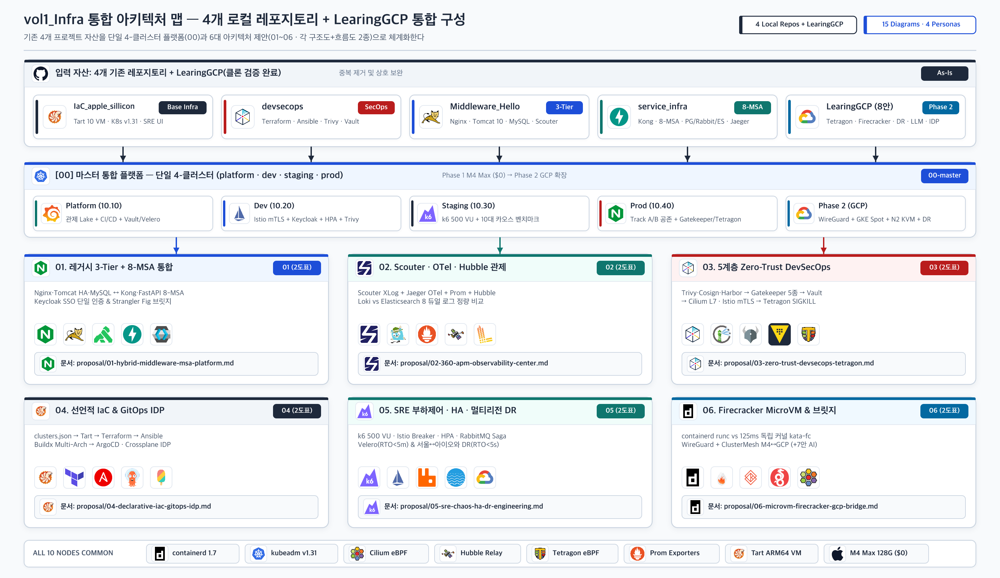

# vol1_Infra — 4개 프로젝트 통합 Kubernetes · DevSecOps · Observability 플랫폼 제안서

Apple Silicon M4 Max(128GB RAM) 환경에서 별도로 구축했던 4개 프로젝트(`IaC_apple_sillicon`, `devsecops`, `Middleware_Hello`, `service_infra`)의 중복 요소를 제거하고 **단일 4-클러스터 Kubernetes 플랫폼(Phase 1, 클라우드 비용 `\$0`)** 으로 통합하며, 추후 **`LearingGCP` 8대 안건**을 연결해 GCP 하이브리드(Phase 2)로 확장하는 아키텍처 제안 저장소이다.



---

## 1. 기존 4개 레포지토리 + `LearingGCP` 결합 구조 (As-Is → To-Be)

| 기존 프로젝트 | 원래 보유 자산 (As-Is) | 통합 시 제거·정리되는 중복 | `vol1_Infra` 통합 후 역할 (To-Be) |
|---|---|---|---|
| **[IaC_apple_sillicon](https://github.com/iamywl/IaC_apple_sillicon)** | Tart 10 VM(`10.10`~`10.40`), `kubeadm v1.31`, Cilium/Hubble, Istio, Prom/Grafana/Loki, Jenkins/ArgoCD, Gatekeeper, Velero, Harbor, React 19 SRE UI, k6 16종 | Helm CLI `07~17` Bash 수동성, Harbor 포트 불일치(`values:30400` vs `sh:30500`) 정리 | **기반 4-클러스터 플랫폼 골격**: Stage 1 VM/K8s/Cilium 부트스트랩, IP 드리프트 복구, SRE Dashboard & k6 벤치마크 |
| **[devsecops](https://github.com/iamywl/devsecops)** | Terraform(`>=1.5.0` 멀티클러스터), Ansible(`setup-cluster.yml`), Trivy CLI/Operator, Gatekeeper 3종, Vault(`:8200`), Harbor(`:30400`) | `IaC`와 겹치는 `clusters.json` VM/대시보드 코드 중복 제거 | **선언적 보안 자동화 계층**: Stage 2 Terraform(NS/RBAC/Quota) + Stage 3 Ansible + Trivy·Vault·Gatekeeper 5종 통합 |
| **[Middleware_Hello](https://github.com/iamywl/Middleware_Hello)** | Nginx 1.24, Apache Tomcat 10 HA + Spring Boot 3.x, MySQL 8.0, Keycloak 24.0, OpenSSL CA, Scouter 2.20.0, 자체 Prom/Grafana, 튜닝·장애 훈련 | Docker Compose 단일 호스트 제약 및 중복 Prometheus/Grafana 제거 | **Track A (레거시 3-Tier) + WAS APM**: K8s StatefulSet 이식, Scouter XLog 중앙 적재, Keycloak OIDC 통합 |
| **[service_infra](https://github.com/iamywl/service_infra)** | Kong GW, FastAPI 0.115.6 8-MSA, PostgreSQL 16.6, Redis 7.4.2, RabbitMQ 4.0.5 Saga, Elasticsearch 8.17(Nori), Jaeger(OTel 1.29), 자체 Loki/Prom | 중복 Prometheus/Loki/Harbor 제거 후 `platform-worker1` 일원화 | **Track B (클라우드 네이티브 8-MSA) + 분산 트레이싱**: RabbitMQ Strangler Fig 연동, OTel→Jaeger, ES vs Loki 비교 |
| **[LearingGCP](https://github.com/iamywl/LearingGCP)** | 8대 클라우드 안건 (Bursting · Edge×Lake · Firecracker `kata-fc` · 서울×아이오와 DR · Ephemeral 랩 · Tetragon SIEM · Hybrid AI GW · Crossplane IDP) | *(로컬 클론 검증 완료 · Phase 2 확장 기준 스택)* | **Phase 2 클라우드 브릿지**: 월 `\$10` 크레딧 기반 Spot 버스팅, `Firecracker 1.9` 격리, Tetragon SIEM, Crossplane, GCS DR |

---

## 2. 엔터프라이즈 4대 페르소나 기반 다중 다이어그램 체계

모든 제안서는 현업 리뷰어 4대 페르소나(**수석 클라우드 아키텍트 · 시니어 SRE · 테크니컬 디자이너 · DevSecOps 리드**) 검수 기준(`>= 10.5pt` 타이포그래피, 공식 풀컬러 오픈소스 로고, 배치 구조도 + 동작 흐름도 2도표 분리)으로 구성되어 있다. 전체 목록 및 포트 맵은 [`proposal/README.md`](./proposal/README.md)를 참고한다.

- **[00. 마스터 통합 로드맵](./proposal/00-master-integration-roadmap.md)** — Layer 7~0 기술 스택, 컴포넌트 관계 매트릭스, `LearingGCP` 8안 매핑 ([구조도](./proposal/assets/diagrams/00-master-integration-architecture.png) · [중복제거도](./proposal/assets/diagrams/00b-as-is-to-be-consolidation.png))
- **[01. 레거시 3-Tier + 8-MSA 통합 플랫폼](./proposal/01-hybrid-middleware-msa-platform.md)** — `/legacy/*` vs `/api/v1/*` 경로 분기, Keycloak OIDC 단일 인증, Strangler Fig RabbitMQ 브릿지 ([구조도](./proposal/assets/diagrams/01-proposal1-hybrid-middleware-msa.png) · [흐름도](./proposal/assets/diagrams/01b-proposal1-request-sso-strangler-flow.png))
- **[02. Scouter × OTel × Hubble 통합 관제 데이터레이크](./proposal/02-360-apm-observability-center.md)** — Scouter `:6100` + Jaeger `:4317` + Hubble + Loki vs Elasticsearch 8 정량 비교 ([구조도](./proposal/assets/diagrams/02-proposal2-360-apm-observability.png) · [상관분석 흐름도](./proposal/assets/diagrams/02b-proposal2-mttr-correlation-pipeline.png))
- **[03. 5계층 Zero-Trust DevSecOps & Tetragon SIEM](./proposal/03-zero-trust-devsecops-tetragon.md)** — Trivy·Cosign·Harbor(`:30400`) → Gatekeeper 5종 → Vault/SealedSecret → Cilium/Istio mTLS → Tetragon `SIGKILL` ([구조도](./proposal/assets/diagrams/03-proposal3-zero-trust-devsecops.png) · [차단 시퀀스](./proposal/assets/diagrams/03b-proposal3-attack-block-sequence.png))
- **[04. 선언적 IaC 4단계 & Multi-Arch GitOps IDP](./proposal/04-declarative-iac-gitops-idp.md)** — `clusters.json` SSOT → Tart → Terraform → Ansible → Buildx Multi-Arch → ArgoCD · Crossplane ([구조도](./proposal/assets/diagrams/04-proposal4-declarative-iac-gitops.png) · [승격·IDP 흐름도](./proposal/assets/diagrams/04b-proposal4-env-promotion-crossplane-idp.png))
- **[05. SRE 트래픽 제어 · 카오스 · HA/DR & 멀티리전](./proposal/05-sre-chaos-ha-dr-engineering.md)** — k6 500 VU 16종, Istio Breaker, HPA/PDB, RabbitMQ Saga, Velero(`RTO<5m`) & 서울↔아이오와(`RTO<5s`) ([구조도](./proposal/assets/diagrams/05-proposal5-sre-chaos-ha-dr.png) · [Burst·DR 흐름도](./proposal/assets/diagrams/05b-proposal5-bursting-multiregion-failover.png))
- **[06. Firecracker MicroVM & M4 ↔ GCP 브릿지 (+ AI 7안)](./proposal/06-microvm-firecracker-gcp-bridge.md)** — `containerd 1.7` CRI (`runc` vs 125ms 독립 커널 `kata-fc`), `tc-redirect-tap`, WireGuard(`:51871`), 로컬 LLM 연계 ([구조도](./proposal/assets/diagrams/06-proposal6-microvm-gcp-bridge.png) · [CRI 내부 구조도](./proposal/assets/diagrams/06b-proposal6-runc-vs-kata-firecracker-internals.png))

---

## 3. 다이어그램 재생성 (FigCraft MCP)

모든 아키텍처 다이어그램(15종)은 [`storytold/figcraft`](https://github.com/storytold/figcraft) (`v0.18.1`) CLI MCP 서버와 [build_diagrams_via_figcraft_mcp.py](./proposal/scripts/build_diagrams_via_figcraft_mcp.py) 스크립트로 생성한다.

```bash
# 전체 15종 다이어그램 재생성 (.figcraft + 15 PNG scale=2 + 14 SVG)
python3 proposal/scripts/build_diagrams_via_figcraft_mcp.py

# 원본 파일 정보 확인
.tools/bin/figcraft-cli info proposal/assets/diagrams/vol1-infra-proposals.figcraft
```
