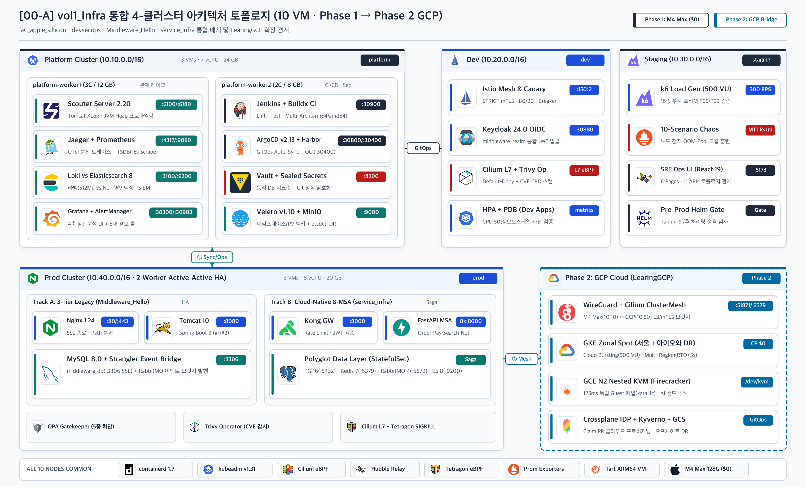
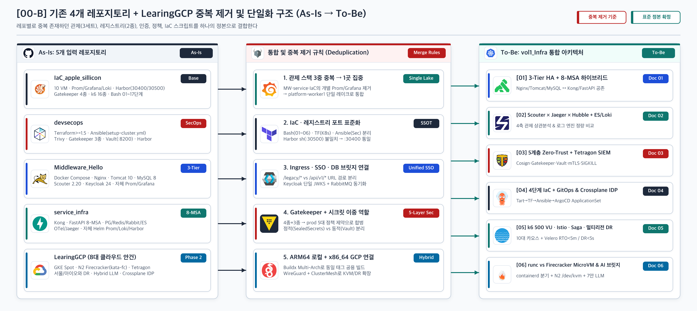
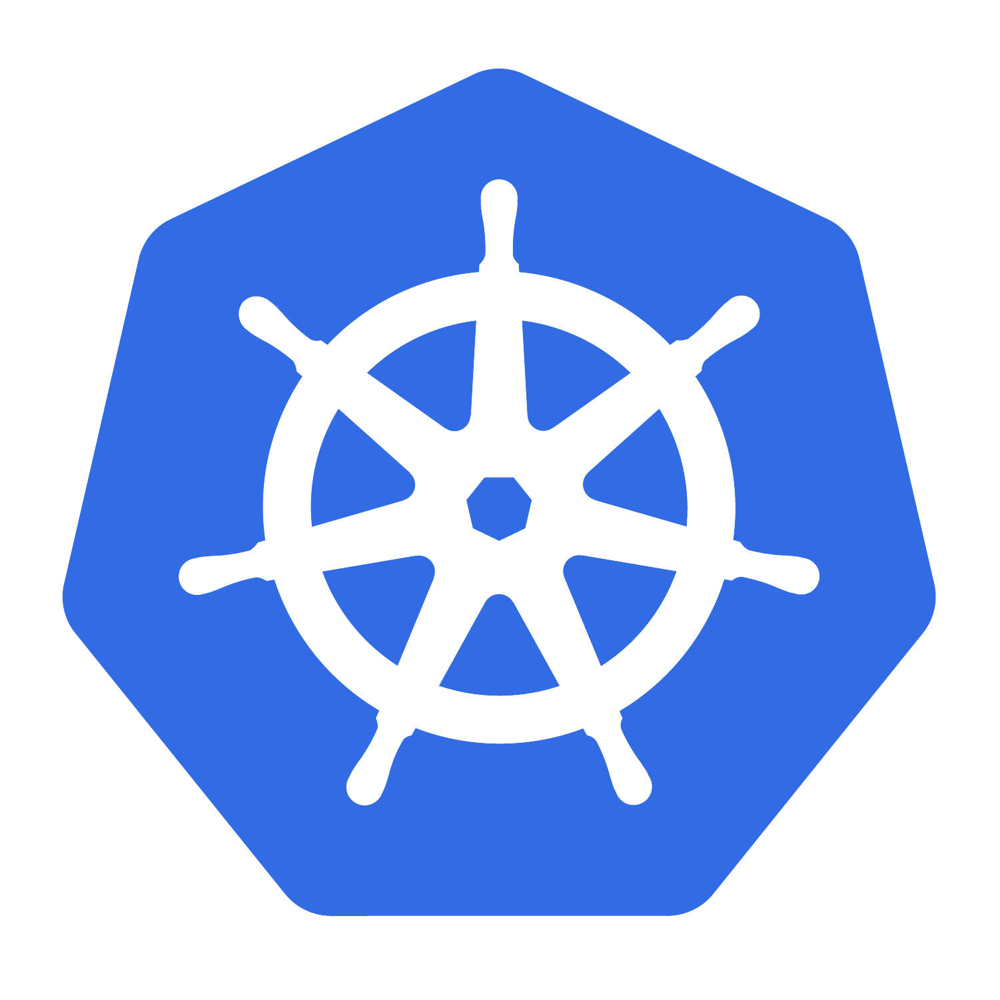
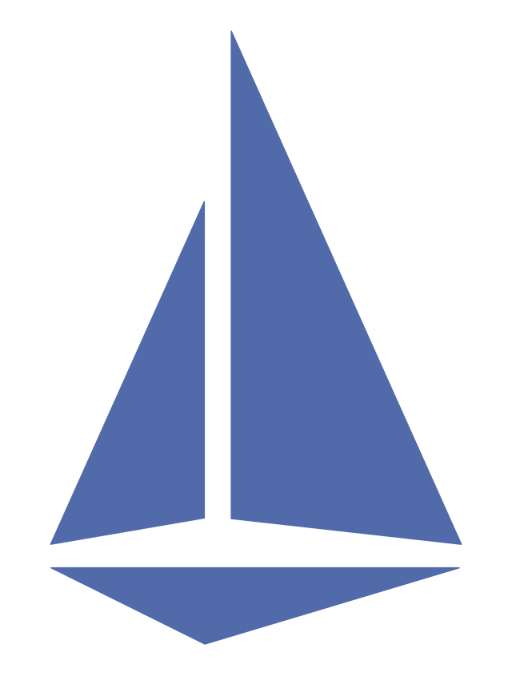
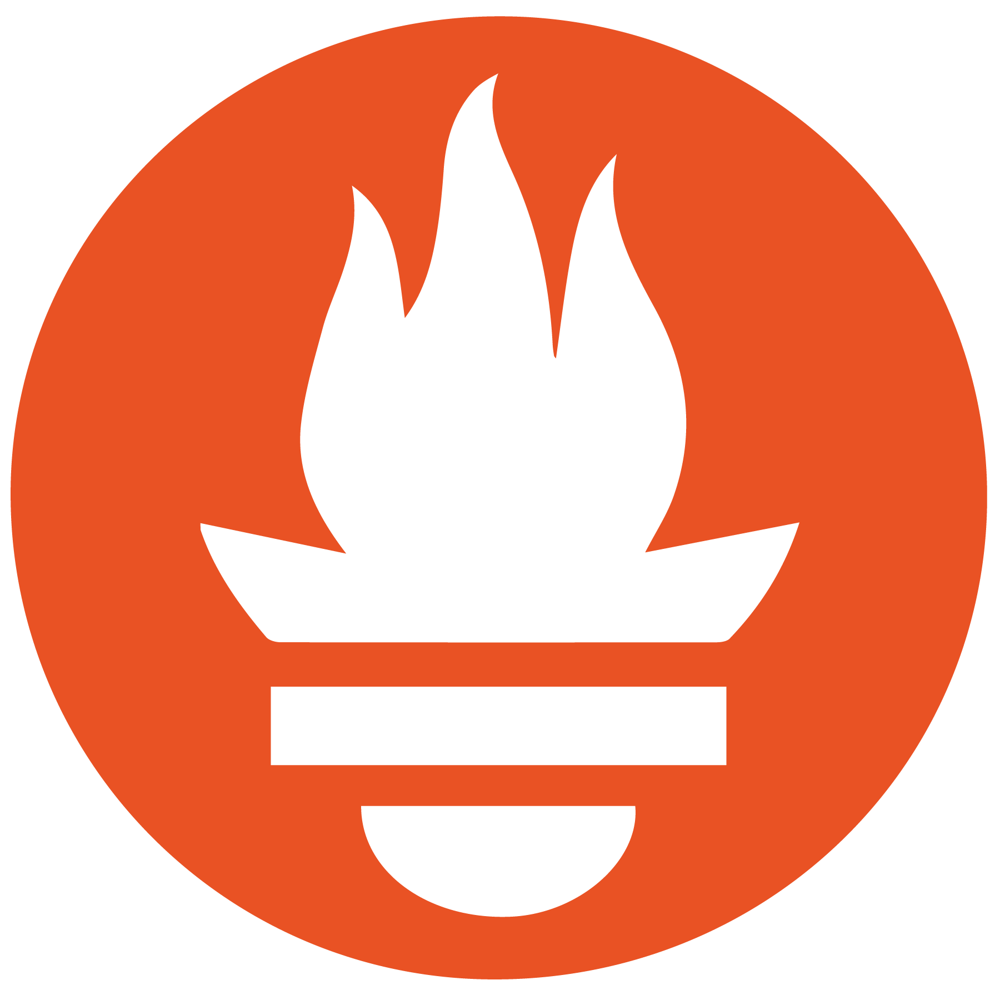
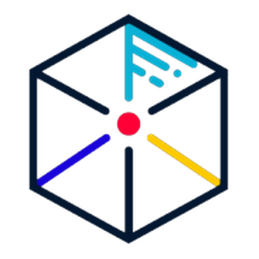
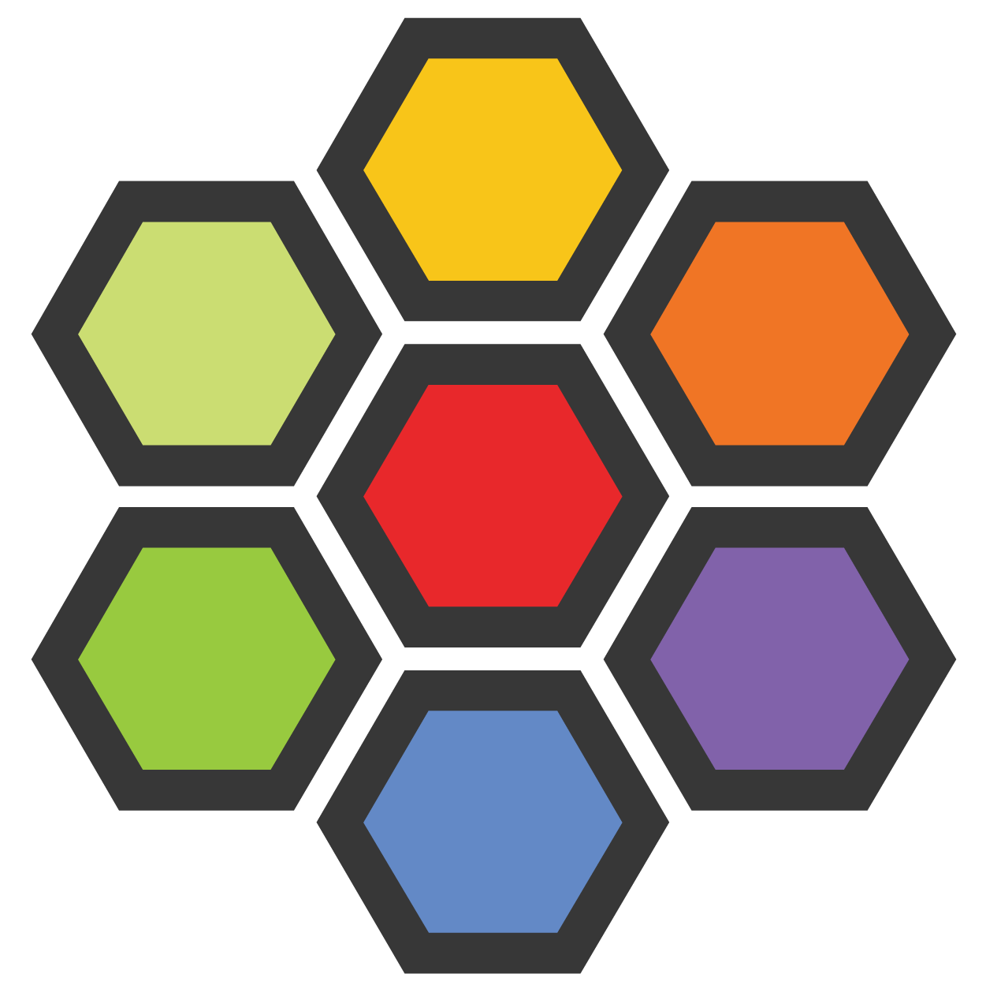

# [00] 마스터 통합 로드맵 — 4-클러스터 단일 플랫폼 & `LearingGCP` 8대 안건 확장 청사진

> **목적**: `IaC_apple_sillicon`, `devsecops`, `Middleware_Hello`, `service_infra` 4개 로컬 프로젝트와 클론 검증된 [`LearingGCP`](https://github.com/iamywl/LearingGCP) 8대 클라우드 안건을 단일 4-클러스터 Kubernetes 플랫폼으로 통합하는 마스터 설계서이다.

---

## 1. 레포지토리 결합 구조 (As-Is → To-Be)

각 기존 레포지토리에서 중복되는 구성 요소(관제 3세트, 레지스트리 2종, Ingress/Gateway 이중화, Bash/Terraform 경합, Gatekeeper 중복 정책)를 제거하고 정본 아키텍처 하나로 일원화한다.

| 도메인 | 기존 As-Is (개별 레포 상태) | 문제점 (중복·단절) | To-Be 통합 결정 (`vol1_Infra`) | 세부 제안 |
|---|---|---|---|---|
| **VM & K8s 부트스트랩** | `IaC`: `clusters.json` + 17단계 Bash `devsecops`: `clusters.json` + TF/Ansible 재참조 | 부트스트랩과 앱 보안 인프라 코드 혼재 | Stage 1(`IaC` Bash 01~06)은 VM·`kubeadm v1.31`·Cilium만 전담하고, `devsecops` TF/Ansible이 K8s 리소스·보안 도구를 선언 | [04번](./04-declarative-iac-gitops-idp.md) |
| **워크로드 런타임** | `MW`: Docker Compose 3-Tier WAS `service`: K8s 8-MSA (`ecommerce`) | Compose 로컬 전용 WAS와 K8s MSA가 별도 네트워크에 고립 | `prod` 클러스터에서 `legacy-was`(Track A)와 `ecommerce`(Track B) 공존 배치 | [01번](./01-hybrid-middleware-msa-platform.md) |
| **SSO & 게이트웨이** | `MW`: `Nginx 1.24` + `Keycloak 24.0` `service`: `NGINX Ingress` + `Kong` | 로그인 세션을 3-Tier와 MSA 간 공유 불가 | 앞단 `NGINX Ingress(:443)` 경로 분기(`/legacy/*` vs `/api/v1/*`) + `Keycloak 24.0` JWKS 공동 검증 | [01번](./01-hybrid-middleware-msa-platform.md) |
| **관제 데이터레이크** | `IaC`: Prom+Loki+Grafana `MW`: Scouter+Prom+Grafana `service`: Prom+Loki+Jaeger | 3개의 Prometheus/Grafana가 따로 동작해 상관분석 불가 | `platform-worker1` 1곳으로 데이터레이크 일원화 (`Scouter` + `Jaeger` + `Prom` + `Loki` + `ES 8` + `Hubble`) | [02번](./02-360-apm-observability-center.md) |
| **레지스트리 & Multi-Arch** | `IaC`: Harbor NodePort(`30400` yaml vs `30500` sh) `devsecops`/`service`: Harbor `:30400` | 스크립트 출력 포트 불일치 및 ARM64 단독 빌드 한계 | 로컬 Harbor `:30400` 단일화 + `docker buildx`(`arm64,amd64`) Docker Hub 이중 푸시로 GCP x86_64 대비 | [03번](./03-zero-trust-devsecops-tetragon.md), [04번](./04-declarative-iac-gitops-idp.md) |
| **보안 · 시크릿 · 런타임** | `IaC`: Gatekeeper 4종, Sealed Secrets `devsecops`: Gatekeeper 3종, Trivy, Vault | 정책 중복 및 커널 런타임 악성 행위(`execve`) 방어 부재 | Gatekeeper 5종 통합 + `Sealed Secrets`(정적) / `Vault`(동적) 분리 + `Tetragon` eBPF SIEM 추가 | [03번](./03-zero-trust-devsecops-tetragon.md) |
| **부하 · HA · DR · Burst** | `IaC`: k6 16종, HPA/PDB, Velero/etcd `MW`: 튜닝·장애 훈련 / `service`: Saga | 부하·튜닝·보상·오프사이트 백업이 단절됨 | `k6 500 VU` → `Istio/HPA/RabbitMQ Saga` 통합 검증 + `MinIO → GCS` 및 GCP 서울↔아이오와 멀티리전 DR | [05번](./05-sre-chaos-ha-dr-engineering.md) |
| **하드웨어 격리 & AI 브릿지** | 로컬 M4 Max ARM64 VM (`runc` 단독) | ARM64 VM 내부 x86_64 `/dev/kvm` Nested KVM 제약 | 로컬은 `seccomp`/`Tetragon` 베이스라인 + 128GB Metal LLM(`Ollama`), Phase 2에서 GCP N2 `kata-fc` 연결 | [06번](./06-microvm-firecracker-gcp-bridge.md) |

---

## 2. 명시적 기술 스택 명세 (Layer 7 → Layer 0 + Phase 2 Cloud)

| 계층 | 아이콘 | 기술 및 버전 | 원본 레포 | 실행 위치 (Cluster/VM) | 포트 / 프로토콜 | 역할 및 플랫폼 내 기능 |
|---|:---:|---|---|---|---|---|
| **L7: Observability UI** |  | **Grafana** (`kube-prometheus-stack`) | `IaC` + `MW` + `service` | `platform-worker1` | `:30300` (HTTP) | Metrics, Logs(Loki/ES), Traces(Jaeger), XLog(Scouter) 4축 상관분석 대시보드 |
| **L7: SRE Dashboard** |  | **React 19.2 · Vite 7.3 · Express 5.2 · TypeScript 5.9** | `IaC_apple_sillicon` | macOS Host | `:5173` (UI) / `:3000` (API) | 6 Pages / 11 REST APIs, Hubble SVG 토폴로지, k6/stress-ng 16종 테스트 제어(`ssh2`) |
| **L7: Track A (WEB/WAS)** |  | **Nginx 1.24** + **Apache Tomcat 10** + **Spring Boot 3.x** | `Middleware_Hello` | `prod` (`worker1`, `worker2`) | `:80`, `:443`, `:8080` | Round Robin 로드밸런싱, WAS 이중화(`-Xms256m -Xmx512m`), Scouter Java Agent 탑재 |
| **L7: Track B (8-MSA)** |  | **Python 3.12 · FastAPI 0.115.6 · SQLAlchemy 2.0.36** | `service_infra` | `prod` / `dev` / `staging` | `:8000` (`pf :8001~:8008`) | 이커머스 8개 서비스(`Alembic 1.14.0`, `Pydantic 2.10.3`, `aio-pika 9.5.1`) |
| **L6: Edge & Mesh** |  | **NGINX Ingress** · **Kong** · **Istio (Envoy)** · **MetalLB** | `service` + `IaC` | `prod` / `dev` | `:443`, `:8000`, `:15443` | Path 분기(`/legacy` vs `/api`), Rate Limit, Canary `80/20`, `STRICT mTLS`, `3x 5xx Breaker` |
| **L6: SSO / Auth** |  | **Keycloak 24.0** (`middleware-realm`) | `MW` + `IaC` | `dev` / `platform` | `:8080` (`NodePort :30880`) | OIDC 통합 로그인 및 JWKS 공개키 발급(Tomcat · 8-MSA 공동 검증) |
| **L5: RDBMS & Messaging** |  | **MySQL 8.0** · **PostgreSQL 16.6.0** · **Redis 7.4.2** · **RabbitMQ 4.0.5** | `MW` + `service` | `prod` StatefulSet | `:3306`, `:5432`, `:6379`, `:5672` | Track A(`middleware_db`), Track B(서비스별 DB), 장바구니 캐시, Saga 보상 및 Strangler 브릿지 |
| **L5: Search / SIEM** |  | **Elasticsearch 8.17.0** + **Nori** | `service` + `LearingGCP` | `platform` / `prod` | `:9200` (HTTP) | 한국어 상품 형태소 검색, 듀얼 로그 벤치마크 및 Tetragon 보안 SIEM 저장소 |
| **L4: APM & Tracing** |  | **Scouter 2.20.0** (`temurin:11`) · **Jaeger** · **OTel 1.29.0** | `MW` + `service` | `platform-worker1` | `:6100/:6180`, `:4317/:16686` | WAS XLog·SQL·GC 프로파일링(`:6100`)과 MSA 분산 트레이스(`:4317`) 상호 참조 |
| **L4: Metrics / Logs** |  | **Prometheus** · **AlertManager** · **Loki** · **Fluent-Bit / Promtail** | `IaC` + `LearingGCP` | `platform-worker1` | `:9090`, `:30903`, `:3100` | 15s Scrape + Remote Write 수신, 8대 PrometheusRule, 라벨 기반 로그(`512Mi`) vs ES8 비교 |
| **L3: CI/CD & GitOps** |  | **ArgoCD v2.13.2** · **Jenkins** · **Harbor** · **Docker Buildx** | `IaC` + `devsecops` | `platform-worker2` + Host | `:30800`, `:30900`, `:30400` | `arm64+amd64` Multi-Arch 빌드 → Harbor(`:30400`)/Docker Hub 푸시 및 ApplicationSet 승격 |
| **L3: Security & Policy** |  | **Trivy** · **Cosign** · **OPA Gatekeeper** · **Kyverno** · **Vault** | `devsecops` + `LearingGCP` | `platform-worker2` + `prod` | `:8200` (Vault), Webhook | 취약점 차단, 이미지 서명, Admission 5대 정책, 동적/정적 시크릿 이중 관리 |
| **L2: CNI & eBPF** |  | **Cilium eBPF** · **Hubble (`:31235`)** · **Tetragon** | `IaC` + `LearingGCP` | 전 클러스터 10대 VM | eBPF Kernel / `:2379` | `kube-proxy` 대체, L3/L4/L7 Default-Deny, 플로우 추적 및 커널 즉시 `SIGKILL` 방어 |
| **L1: K8s, CRI & DR** |  | **kubeadm v1.31** · **containerd 1.7 CRI** · **Velero v1.10** | `IaC_apple_sillicon` | 전 클러스터 10대 VM | `:6443` (API), `:9000` (MinIO) | `runc`(로컬) / Phase 2 `kata-fc` 분기, `etcdctl` 일 1회 스냅샷 + Velero `RTO < 5m` DR |
| **L0: Hypervisor & IaC** |  | **Tart Hypervisor** · **Ubuntu 24.04 ARM64** · **Terraform ≥1.5** · **Ansible** | `IaC` + `devsecops` | macOS Host (`M4 Max 128G`) | softnet / SSH(`:22`) | 10대 VM 구동, `fix-cluster-ip-drift.sh` IP 복구, 4단계 선언적 프로비저닝 |
| **Phase 2: GCP Cloud** |  | **GKE Zonal Spot** · **GCE N2 Nested KVM** · **WireGuard** · **Crossplane** | `LearingGCP` (1~8안) | `asia-northeast3-a` / `us-central1` | `:51871`, `:2379`, `:15443` | Firecracker `1.9` (`kata-fc`), 3각 멀티리전 DR, Crossplane IDP, Local LLM(`:11434`) 연동 |

---

## 3. 컴포넌트 간 관계 및 제어/데이터 흐름 매트릭스

| Caller (송신) | Callee (수신) | 프로토콜 / 포트 | 통신 방식 | 연결 설정 / K8s 리소스 | 동작 설명 및 장애 시 영향 |
|---|---|---|---|---|---|
| **macOS Host (`tart`/`TF`/`ansible`)** | **4개 K8s API Server** | HTTPS (`:6443`), SSH (`:22`) | 동기 Push | `kubeconfig/*.yaml` | 원격 IaC 프로비저닝. 재부팅 시 `fix-cluster-ip-drift.sh`로 SAN·Cilium 복구 필수 |
| **Jenkins / GH Actions (Buildx)** | **Harbor (`:30400`) & Docker Hub** | OCI HTTPS | 비동기 Push | `Jenkinsfile`, `.github/workflows` | `Trivy`+`Cosign` 통과 후 `arm64+amd64` 멀티아키텍처 이미지 푸시. CVE 차단 시 파이프라인 중단 |
| **ArgoCD v2.13.2** | **dev / staging / prod K8s API** | HTTPS (`:6443`) | Reconcile | `ApplicationSet` | Git 정본 동기화. Gatekeeper 5대 규칙 위반 시 `OutOfSync` 차단 |
| **NGINX Ingress** | **Nginx 1.24** / **Kong GW** | HTTP (`:80`, `:8000`) | 동기 Reverse Proxy | Ingress Path Rules | `/legacy/*`는 Track A, `/api/v1/*`는 Track B로 무중단 분기 |
| **Tomcat 10 & FastAPI** | **Keycloak 24.0 (`:30880`)** | OIDC HTTP (`:8080`) | 동기 Verify (JWKS) | `middleware-realm` | 동일 Bearer JWT/JWKS 검증. Keycloak 중단 시에도 JWKS 캐시로 기존 세션 유지 |
| **Tomcat 10 (Track A)** | **RabbitMQ 4.0.5** (Track B) | AMQP (`:5672`) | 비동기 Event Push | Spring AMQP Producer | 레거시 회원·상품 변경을 Track B `search-service`(ES Nori)와 `notification`에 동기화 |
| **Scouter/OTel Agents** | **Scouter (`:6100`) & Jaeger (`:4317`)** | UDP/TCP & gRPC | 비동기 Stream | `-javaagent`, `OTLPExporter` | 앱 비즈니스 스레드와 비동기 분리되어 Collector 장애 시에도 서비스 영향 0 |
| **Cilium & Tetragon Agents** | **Hubble (`:31235`) & ES 8 (`:9200`)** | gRPC / HTTP JSON | 커널 Hook Stream | `CiliumNetworkPolicy`, `TracingPolicy` | 비인가 소켓 DROP 및 침해 시스템콜 커널 즉시 `SIGKILL` 후 SIEM 기록 |
| **Phase 2 GCP Agents (`<800MB`)** | **M4 Max `platform-worker1`** | WireGuard(`:51871`) + HTTPS/UDP | 역방향 Push | `--web.enable-remote-write-receiver` | 클라우드의 Prom WAL·Fluent-Bit·Scouter·Tetragon 데이터를 로컬 M4 Max로 무료 집중 |

---

## 4. `LearingGCP` 8대 안건 ↔ `vol1_Infra` 통합 매핑 (Phase 2 확장 청사진)

클론한 `.tools/LearingGCP` (`docs/00-finops-and-architecture-guide.md` 및 `docs/proposals/01~08.md`)의 8대 클라우드 안건은 Phase 1 로컬 플랫폼 완성 후 아래 표와 같이 연계한다.

| `LearingGCP` 원 안건 | `vol1_Infra` 대응 제안서 | 핵심 연동 아키텍처 | 월 총비용 | **실지출 (\$10 크레딧 차감)** |
|---|---|---|---:|---:|
| **안건 1. Cloud Bursting** | [01번](./01-hybrid-middleware-msa-platform.md) · [05번](./05-sre-chaos-ha-dr-engineering.md) | 평시 M4 Max(`100 VU`, `\$0`) + 피크(`500 VU`) 시 서울 GKE Spot `1→3` Bursting (`ClusterMesh`) | `\$42` | **`\$32` (약 4.5만 원)** |
| **안건 2. Edge × Data Lake** | [01번](./01-hybrid-middleware-msa-platform.md) · [02번](./02-360-apm-observability-center.md) | GCP 24/7 Edge(`Nginx/Tomcat/MSA` + Agent `<800MB`) → M4 Max(`Scouter/ES8/Loki/Prom`) 오프로딩 | `\$55` | **`\$45` (약 6.3만 원)** |
| **안건 3. Firecracker KVM** | [06번](./06-microvm-firecracker-gcp-bridge.md) | GCE Cascade Lake `n2-standard-4` Spot(`/dev/kvm`) 위 `runc` vs `125ms` `kata-fc` 혼합 K8s | `\$52` | **`\$42` (약 5.8만 원)** |
| **안건 4. 서울×아이오와 DR** | [05번](./05-sre-chaos-ha-dr-engineering.md) | 서울(`asia-northeast3`, ~8ms) 장애 시 `1초 내` 아이오와(`us-central1`, ~140ms) `Failover (RTO<5s)` | `\$49` | **`\$39` (약 5.4만 원)** |
| **안건 5. Ephemeral 8분 랩** | [04번](./04-declarative-iac-gitops-idp.md) | `make gcp-up`(8분 구축) ↔ `make gcp-down`(유휴 과금 `\$0`) 주 25h 고사양(`48GB`) 랩 | `\$38` | **`\$28` (약 3.9만 원)** |
| **안건 6. DevSecOps SIEM** | [03번](./03-zero-trust-devsecops-tetragon.md) | `Trivy`+`Cosign`+`Kyverno`+`Istio mTLS`+`Tetragon SIGKILL` → M4 Max `ES 8 SIEM` | `\$40` | **`\$30` (약 4.2만 원)** |
| **안건 7. Hybrid AI Gateway** | [06번](./06-microvm-firecracker-gcp-bridge.md) | M4 Max `128GB GPU` 로컬 LLM(`Ollama :11434`) ↔ GCP AI Gateway & `Firecracker` 코드 실행기 | `\$42` | **`\$32` (약 4.5만 원)** |
| **안건 8. Crossplane IDP** | [04번](./04-declarative-iac-gitops-idp.md) | Git Claim PR(`team-order.yaml`) → ArgoCD → Crossplane(`GCS/PubSub/IAM`) + DORA 지표 | `\$44` | **`\$34` (약 4.8만 원)** |
