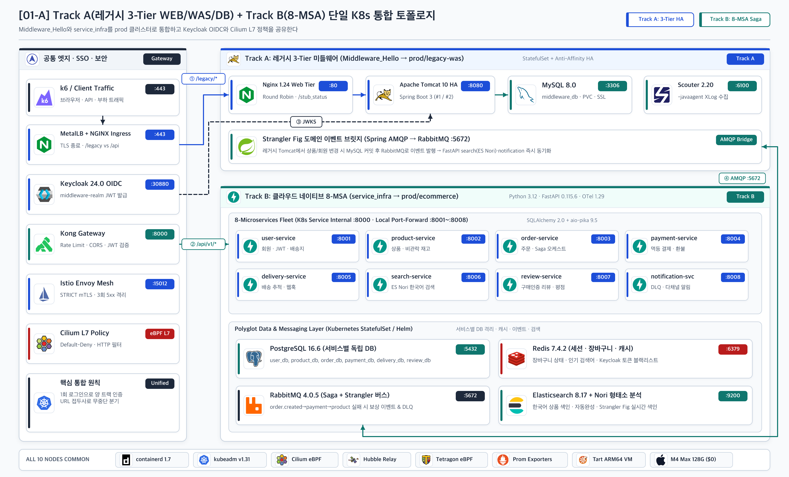
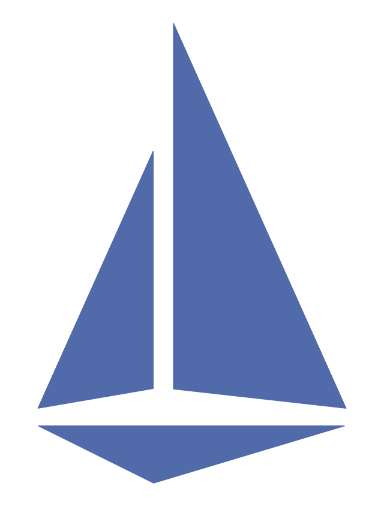
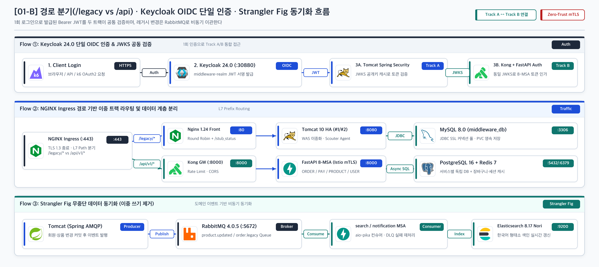

# [제안 1안] 레거시 3-Tier(WEB/WAS/DB) + 클라우드 네이티브 8-MSA 통합 플랫폼

> **결합 대상**: `Middleware_Hello` (3-Tier WEB/WAS/DB) + `service_infra` (FastAPI 8-MSA + Kong + Saga) + `IaC_apple_sillicon` (4-Cluster K8s · Istio · Cilium L7) + `LearingGCP` 제1·2안  
> **배치 클러스터**: `prod` (`prod-worker1`, `prod-worker2` HA 분산) 및 `dev` (실험·카나리)



---

## 1. 레포지토리 결합 구조 (As-Is → To-Be)

레거시 엔터프라이즈 3-Tier 미들웨어(`Middleware_Hello`)와 클라우드 네이티브 이커머스 마이크로서비스(`service_infra`)는 각각 Docker Compose와 독립 `dev` 클러스터에 분리되어 있었다. 이를 단일 Kubernetes 클러스터(`prod`) 내에서 두 트랙이 공존하며 하나의 인증 체계와 이벤트 버스를 공유하도록 통합한다.

| 통합 항목 | As-Is (`Middleware_Hello`) | As-Is (`service_infra`) | To-Be (`vol1_Infra` 통합 구조) |
|---|---|---|---|
| **런타임 환경** | Docker Compose (`mw-network` 브리지 10개 컨테이너) | K8s `ecommerce` 네임스페이스 (`Helm` + `Kong`) | K8s `legacy-was`와 `ecommerce` 네임스페이스로 단일 `prod` 클러스터 통합 배치 |
| **진입점 (Ingress)** | `Nginx 1.24` (`:80/:443` 직접 노출, TLS 종료) | `NGINX Ingress` → `Kong API Gateway` (`:8000`) | 앞단 `NGINX Ingress(:443)`에서 `/legacy/*` (Track A)와 `/api/v1/*` (Track B) 경로 분기 |
| **인증 / SSO** | `Keycloak 24.0` (`middleware-realm`, Spring Security) | `user-service` 자체 JWT + `Kong` 검증 | `Keycloak 24.0` 단일 ID Provider 통일, Tomcat과 FastAPI가 동일 JWKS로 Bearer JWT 검증 |
| **데이터 동기화** | `MySQL 8.0` 단독 (`middleware_db`) | `PostgreSQL 16` 서비스별 DB + `RabbitMQ 4.0` + `ES 8` | Track A(`Tomcat 10`)의 변경 이벤트를 **Strangler Fig Bridge**(`RabbitMQ :5672`)로 발행해 Track B(`search`/`notification`)와 실시간 연동 |
| **보안·트래픽 정책** | Docker 내부 평문 통신 (`Nginx` ↔ `Tomcat`) | 기본 K8s Service 통신 | `Cilium L7 NetworkPolicy`(Default-Deny + 화이트리스트) 및 `Istio PeerAuthentication STRICT` mTLS 적용 |

---

## 2. 명시적 기술 스택 명세

| 계층 | 아이콘 | 기술 및 버전 | 원본 레포 | 실행 위치 (Cluster/Node) | 포트 / 프로토콜 | 역할 및 설정 상세 |
|---|:---:|---|---|---|---|---|
| **Edge Ingress** |  | **MetalLB + NGINX Ingress Controller** | `IaC` + `service` | `prod` / `dev` Ingress | `:80`, `:443` (HTTPS) | 자체 CA(`server-chain.crt`) TLS 1.2/1.3 종료, URL Path 기반 트래픽 분기 |
| **Auth / SSO** |  | **Keycloak 24.0** (`middleware-realm`) | `Middleware_Hello` | `dev` / `platform` | `:8080` (`NodePort :30880`) | OIDC 토큰 발급 및 `/.well-known/openid-configuration` JWKS 제공 |
| **Track A: WEB** |  | **Nginx 1.24** (`nginx:1.24`) | `Middleware_Hello` | `prod` (`legacy-was`) | `:80`, `/stub_status` | `upstream was_backend` Round Robin 분산(`tomcat1:8080`, `tomcat2:8080`) |
| **Track A: WAS** |  | **Apache Tomcat 10** + **Spring Boot 3.x** | `Middleware_Hello` | `prod-worker1`, `worker2` | `:8080` (HTTP) | `-Xms256m -Xmx512m -DjvmRoute=tomcat1\|2`, Scouter Agent 부착, PDB 이중화 |
| **Track A: DB** |  | **MySQL 8.0** (`mysql:8.0`) | `Middleware_Hello` | `prod` StatefulSet | `:3306` (TCP/SSL) | `middleware_db` 저장소, `mysqladmin ping` Readiness Probe 및 PVC 영속화 |
| **Track B: GW** |  | **Kong API Gateway** (`kong/kong`) | `service_infra` | `prod` (`ecommerce`) | `:8000` (Proxy), `:8001` (Admin) | Rate Limit, CORS, JWT 검증 후 8개 FastAPI 서비스(`*:8000`)로 라우팅 |
| **Track B: Mesh** |  | **Istio Service Mesh** (`istiod` + `Envoy`) | `IaC_apple_sillicon` | `dev` (사전 검증) → `prod` | `:15012` / mTLS | `PeerAuthentication STRICT`, `VirtualService`(Canary `80/20`), `OutlierDetection` |
| **Track B: 8-MSA** |  | **Python 3.12 · FastAPI 0.115.6 · SQLAlchemy 2.0.36** | `service_infra` | `prod-worker1`, `worker2` | K8s `:8000` (`pf :8001~:8008`) | `user`, `product`, `order`, `payment`, `delivery`, `search`, `review`, `notification` 8종 (`Pydantic 2.10.3`, `Alembic 1.14.0`, `aio-pika 9.5.1`) |
| **Track B: RDBMS** |  | **PostgreSQL 16.6.0** (`bitnami/postgresql`) | `service_infra` | `prod` StatefulSet | `:5432` (TCP) | `user_db`, `product_db`, `order_db`, `payment_db`, `delivery_db`, `review_db` 격리 |
| **Track B: Cache** |  | **Redis 7.4.2** (`bitnami/redis`) | `service_infra` | `prod` StatefulSet | `:6379` (TCP) | 장바구니, 인기 검색어, 실시간 평점 집계, Keycloak 토큰 블랙리스트 |
| **Event Bus** |  | **RabbitMQ 4.0.5** (`bitnami/rabbitmq`) | `service_infra` | `prod` StatefulSet | `:5672` (AMQP), `:15672` (UI) | 8-MSA Saga 이벤트(`order.created` 등) 및 Track A Strangler Fig 브릿지 큐 |
| **Search Engine** |  | **Elasticsearch 8.17.0** + **Nori** | `service_infra` | `prod` / `platform` | `:9200` (HTTP) | 한국어 상품명 형태소 색인, 자동완성(Completion Suggester) |
| **L7 Policy** |  | **CiliumNetworkPolicy** (eBPF) | `IaC` + `service` | 전 노드 커널 | L3/L4/L7 eBPF | Default-Deny + 최소 허용(`Nginx→Tomcat`, `Tomcat→MySQL:3306`, `MSA→PG:5432`) |
| **Observability** |  | **Scouter 2.20.0** + **Jaeger** + **Grafana** | `MW` + `service` | `platform-worker1` | `:6100` (UDP/TCP), `:4317` (gRPC), `:30300` | Tomcat XLog와 FastAPI OTel(`1.29.0`) 트레이스 동시 수집·조회 |

> **포트 표기 참고**: `service_infra/services/api-gateway/kong-config.yaml` 정의에 따라 8개 FastAPI 마이크로서비스의 클러스터 내부 Service 포트는 모두 `:8000`(`http://<svc>.ecommerce:8000`)이며, 아키텍처 다이어그램의 `:8001`~`:8008`은 macOS 로컬 디버깅/포트포워딩 식별용 논리 슬롯 번호를 나타낸다.

---

## 3. 컴포넌트 간 관계 및 트래픽 · SSO · Strangler Fig 흐름도



| 번호 | Caller (송신) | Callee (수신) | 프로토콜 / 포트 | 동기성 | K8s / 설정 리소스 | 동작 상세 및 장애 시 영향 |
|---|---|---|---|:---:|---|---|
| **①** | **NGINX Ingress** | **Nginx 1.24 (Track A)** | HTTP (`:80`) | 동기 | `Ingress` (`/legacy/*`) | 외부 HTTPS(`:443`) 종료 후 `/legacy/*` 요청 전달. Nginx 장애 시 502 발생 |
| **②** | **NGINX Ingress** → **Kong** | **FastAPI 8-MSA** (`*:8000`) | HTTP (`:8000`) / mTLS | 동기 Proxy | `kong-config.yaml`, Istio Envoy Sidecar | Rate Limit·CORS·JWT 검증 후 각 마이크로서비스 호출 |
| **③** | **Tomcat 10** & **Kong/FastAPI** | **Keycloak 24.0** | OIDC / HTTP (`:8080`) | 동기 (JWKS 캐시) | `keycloak-app.yaml`, `realm-export.json` | 로그인 시 Token 발급, API 호출 시 JWKS 공개키로 JWT 서명 공통 검증 |
| **④** | **Tomcat (Strangler Bridge)** | **RabbitMQ 4.0.5** | AMQP (`:5672`) | 비동기 Publish | Spring AMQP Producer (`aio-pika` 소비) | 레거시 회원·주문 변경 시 `product.updated` / `order.legacy.synced` 발행 → `search`/`notification` 동기화 |
| **⑤** | **Nginx 1.24** | **Tomcat #1 / #2 HA** | HTTP (`:8080`) | 동기 LB | `upstream was_backend`, Pod Anti-Affinity | `worker1`/`worker2` 분산. 한 노드 중단 시 Nginx가 자동 제외해 무중단 처리 |
| **⑥** | **Tomcat #1 / #2** | **MySQL 8.0** | JDBC / TCP (`:3306`) | 동기 Pool | `middleware_db`, `app_user` | HikariCP 커넥션 풀 사용. 풀 고갈 시 504 Timeout 발생(제안 5안 시나리오 대상) |
| **⑦** | **FastAPI 8-MSA** | **PG / Redis / RabbitMQ / ES** | TCP `:5432/:6379/:5672/:9200` | 혼합 | 서비스별 논리 DB + `aio-pika` + Nori | `order→payment→product` Saga는 비동기 큐, 재고 차감은 `SELECT FOR UPDATE` 비관적 락 |

1. **초기 공존 단계**: 기존 ERP/어드민 화면은 `/legacy/*`(Tomcat HA + MySQL 8.0)가 유지 처리하고, 대용량 상품 검색 및 체크아웃 API(`/api/v1/*`)는 `Kong` + `8-MSA`가 처리한다.
2. **이중 쓰기 방지 (Strangler Fig Bridge)**: 레거시 Tomcat이 `MySQL 8.0`에 신규 상품을 등록하거나 회원 주소를 변경하면 동일 트랜잭션 직후 `RabbitMQ 4.0.5`로 이벤트를 발행한다. `search-service`가 이를 구독하여 `Elasticsearch 8.17.0` Nori 인덱스를 즉시 갱신한다.
3. **Cilium L7 최소 권한 경계**: `prod` 네임스페이스 간 기본 통신을 `Default-Deny`로 차단하고, 허용된 서비스 계정·포트·HTTP 메서드(`Nginx → Tomcat:8080`, `Tomcat → MySQL:3306`, `Kong → FastAPI:8000`, `search → ES:9200`)만 화이트리스트로 연다.

---

## 4. 클러스터 배치 및 구현 검증 절차

### 4.1 `prod` 클러스터 멀티워커 배치

- `prod-worker1` (2 vCPU / 8 GB): `nginx-ingress`, `tomcat1`, `kong`, `user-service`, `order-service`, `search-service`, `notification-service`, `postgresql`, `rabbitmq`
- `prod-worker2` (2 vCPU / 8 GB): `tomcat2` (Pod Anti-Affinity), `product-service`, `payment-service`, `delivery-service`, `review-service`, `mysql`, `redis`, `elasticsearch`

### 4.2 검증 명령어 (macOS 호스트 실행)

```bash
# 1. Track A (Tomcat HA) + Track B (8-MSA) Pod 분산 배치 확인
kubectl --kubeconfig kubeconfig/prod.yaml get pods -n legacy-was -o wide
kubectl --kubeconfig kubeconfig/prod.yaml get pods -n ecommerce -o wide

# 2. Keycloak OIDC JWKS 엔드포인트 및 Nginx stub_status 확인
DEV_IP=$(tart ip dev-worker1)
curl -sk "http://${DEV_IP}:30880/realms/middleware-realm/.well-known/openid-configuration" | jq .jwks_uri

# 3. Cilium L7 정책 및 Istio mTLS 검증
kubectl --kubeconfig kubeconfig/prod.yaml get ciliumnetworkpolicies -A
kubectl --kubeconfig kubeconfig/dev.yaml get peerauthentication,virtualservice,destinationrule -A
```

---

## 5. 추후 GCP 확장 연계 (`LearingGCP` 제1안 · 제2안)

- **Stateless GKE Edge 확장 (`LearingGCP` 1·2안)**: `GCP Cloud Load Balancing (:443)` → `NGINX Ingress` → `Tomcat Stateless Pod` + `FastAPI 8-MSA Pod`를 서울(`asia-northeast3-a`) GKE Zonal Spot(`e2-standard-2`, CP `\$0`)에 배치한다.
- **Stateful DB 로컬 유지 (FinOps)**: 고사양 `MySQL 8.0`, `PostgreSQL 16.6`, `Elasticsearch 8.17`은 M4 Max(128GB RAM, `\$0`)에 고정하고, `WireGuard(:51871)` + `Cilium ClusterMesh(:2379)` Global Service(`service.cilium.io/global: "true"`)를 통해 GCP 파드가 로컬 DB·RabbitMQ로 통신한다.
