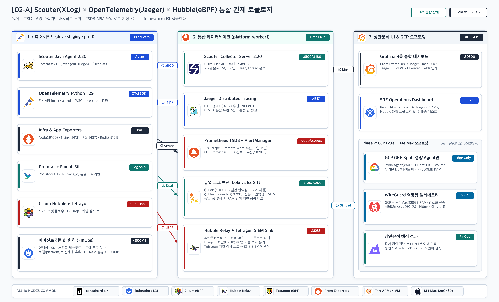
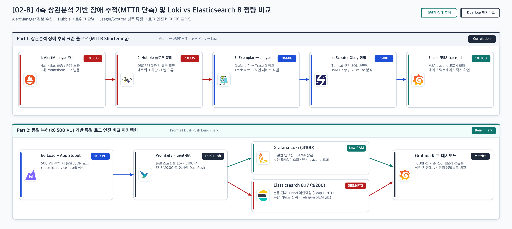

# [제안 2안] Scouter(XLog) × OpenTelemetry(Jaeger) × Hubble(eBPF) 통합 관제 데이터레이크

> **결합 대상**: `Middleware_Hello` (`Scouter 2.20.0`, `Node/Nginx Exporter`) + `service_infra` (`OpenTelemetry 1.29`, `Jaeger`, `Loki`, `ES 8`) + `IaC_apple_sillicon` (`kube-prometheus-stack`, `Hubble`, `SRE Dashboard`) + `LearingGCP` 제2안  
> **배치 클러스터**: 전 워커 에이전트 수집 → `platform-worker1` (3 vCPU / 12 GB RAM) 중앙 데이터레이크



---

## 1. 레포지토리 결합 구조 (As-Is → To-Be)

기존 3개 레포지토리는 서로 다른 수집 도구와 독립적인 Grafana/Prometheus 인스턴스를 포함하고 있어 장애 시 3개 대시보드를 따로 조회해야 했다. 본 통합 설계는 수집 에이전트는 워크로드 노드에, 무거운 저장·인덱싱 엔진은 `platform-worker1` 단일 노드에 집중 배치하여 요청 추적의 전 계층을 연결한다.

| 관제 계층 | As-Is (`Middleware_Hello`) | As-Is (`service_infra`) | As-Is (`IaC_apple_sillicon`) | To-Be 통합 구성 (`vol1_Infra`) |
|---|---|---|---|---|
| **애플리케이션 APM** | `Scouter 2.20.0` Server + Java Agent (Tomcat XLog) | `OpenTelemetry 1.29` SDK → `Jaeger` (FastAPI Trace) | 없음 (HTTP 메트릭 중심) | Tomcat은 `Scouter(:6100)`, FastAPI 8-MSA는 `Jaeger(:4317)`으로 수집 후 `Grafana`·`TraceID`로 상호 참조 |
| **메트릭 TSDB** | `Prometheus` (15일, Docker) + `Node`/`Nginx Exporter` | Helm `Prometheus` (중복 배포) | `kube-prometheus-stack` (`platform-worker1`) | `platform`의 단일 Prometheus TSDB(15s Scrape + `--web.enable-remote-write-receiver`)로 통합 |
| **로그 수집/저장** | 컨테이너 stdout 수동 분석 (`log-analyzer.sh`) | `Loki` + `Promtail` + `ES 8` | `Loki (512Mi)` + `Promtail (256Mi)` | `Loki (:3100)`(라벨 인덱싱)과 `Elasticsearch 8.17 (:9200)`(전문 색인+SIEM)을 병렬 적재해 부하별 성능 정량 비교 |
| **네트워크/커널 관측** | Docker bridge 패킷 미관측 | `Cilium` + `Hubble` | `Hubble UI (:31235)` + `SRE Dashboard` (10s 폴링) | 4개 클러스터 `Hubble Relay(:31235)` + `Tetragon` eBPF 감사 이벤트를 `ES 8` 및 `SRE UI`와 통합 |
| **대시보드 UI** | `Grafana (:3000)` + `Scouter Client (:6180)` | `Grafana` + `Jaeger UI (:16686)` | `Grafana (:30300)` + `AlertManager (:30903)` + `React 19 SRE UI (:5173)` | `Grafana (:30300)`(기술 상관분석) + `SRE Operations Dashboard (:5173)`(인프라·k6 토폴로지) 이원 운영 |

---

## 2. 명시적 기술 스택 명세

| 계층 | 아이콘 | 기술 및 버전 | 원본 레포 | 실행 위치 (Cluster/Node) | 포트 / 프로토콜 | 역할 및 주요 설정 값 |
|---|:---:|---|---|---|---|---|
| **L7 WAS Agent** |  | **Scouter Java Agent 2.20.0** | `Middleware_Hello` | `prod` (`Tomcat #1, #2`) | UDP/TCP `:6100` 송신 | `-javaagent:/opt/scouter/agent.java/scouter.agent.jar`, `profile_step_max_count=1024`, `X-Forwarded-For` IP 추적 |
| **L7 APM Server** |  | **Scouter Collector Server 2.20.0** (`temurin:11`) | `Middleware_Hello` | `platform-worker1` | `:6100` (Agent), `:6180` (HTTP) | `-Xmx512m`, Jennifer 호환 XLog 분포·SQL 지연·GC Pause·Active Service 저장 |
| **L7 MSA Tracing** |  | **OpenTelemetry Python 1.29.0** (`0.50b0` FastAPI) | `service_infra` | `prod`/`dev`/`staging` MSA | gRPC `:4317` 송신 | `httpx` 동기 및 `aio-pika` AMQP 비동기 헤더에 W3C `traceparent` 전파, SQL/Redis Span 계측 |
| **Tracing Store** |  | **Jaeger Distributed Tracing** | `service_infra` | `platform-worker1` | `:4317` (OTLP), `:16686` (UI) | `order→payment→product→delivery` 분산 트랜잭션 의존성 맵 생성 |
| **Metrics Agent** |  | **Node Exporter** · **Nginx Exporter** · **PG/Redis Exporter** | `MW` + `service` + `IaC` | 전 10대 VM / `prod` | `:9100`, `:9113`, `:9187`, `:9121` | CPU/Mem/Disk I/O, Nginx `/stub_status` Active Conn/RPS, DB 커넥션 풀 노출 |
| **Metrics TSDB** |  | **Prometheus TSDB** + **AlertManager** | `IaC_apple_sillicon` | `platform-worker1` | `:9090` (TSDB), `:30903` (Alert) | 15초 Scrape, 15일 보관, 8종 `PrometheusRule` (`HighCpuUsage`, `PodOOMKilled` 등) |
| **Log Collector** |  | **Promtail** · **Fluent-Bit** DaemonSet | `IaC` + `LearingGCP` | 전 노드 Agent | HTTP Dual Push | Pod stdout JSON(`trace_id`)을 Loki와 ES 8로 동시 전송 |
| **Log Store A** |  | **Grafana Loki** (`loki-values.yaml`) | `IaC` + `service` | `platform-worker1` | `:3100` (HTTP Push) | 메모리 상한 `512Mi` (`Promtail 256Mi`). 메타데이터 라벨 기반 경량 인덱싱 |
| **Log Store B** |  | **Elasticsearch 8.17.0** | `service` + `LearingGCP` | `platform-worker1` / `prod` | `:9200` (HTTP REST) | 전문 역인덱싱 + `trace_id` 필드 고속 필터링 + Tetragon SIEM 저장소 |
| **eBPF Flow/Sec** |  | **Cilium Hubble Relay** + **Tetragon Sink** | `IaC` + `LearingGCP` | 전 노드 Agent → `platform` | `:31235` (UI), `:4245` (gRPC) | 4개 클러스터 L3/L4/L7 패킷 플로우·DNS·Policy Drop 및 커널 감사 로그 집계 |
| **Visualization** |  | **Grafana** + **SRE Dashboard (`React 19 / Express 5`)** | `IaC_apple_sillicon` | `platform-worker1` / Host | `:30300` (Grafana), `:5173` (UI) | 4축 데이터소스 상관분석 + Hubble SVG 토폴로지 + k6 16종 테스트 제어(`ssh2`) |

---

## 3. 컴포넌트 간 관계 및 MTTR 상관분석 파이프라인



| 번호 | Caller (송신) | Callee (수신) | 프로토콜 / 포트 | 수집 방식 | 설정 및 연동 키 | 장애 분석 시 역할 |
|---|---|---|---|:---:|---|---|
| **①** | **Tomcat 10 (Scouter Agent)** | **Scouter Server 2.20** | UDP/TCP (`:6100`) | 비동기 Push | `net_collector_ip=scouter-server.observability.svc` | WAS 내부 SQL 병목, Tomcat Thread 풀 고갈, Full GC Stop-The-World 추적 |
| **②** | **8-MSA (OTel SDK 1.29)** | **Jaeger Collector** | OTLP gRPC (`:4317`) | 비동기 Batch | `OTEL_EXPORTER_OTLP_ENDPOINT` | RabbitMQ 비동기 구간을 포함한 MSA 간 Span Waterfall 및 HTTP 오류 지점 특정 |
| **③** | **Prometheus (`platform`)** | **4-Cluster Exporters** | HTTP (`:9100/:9113/:8080`) | Pull (15s) | `ServiceMonitor`, `metrics_path: /actuator/prometheus` | 인프라 임계치 초과 시 AlertManager(`:30903`) 발송 및 Exemplar `trace_id` 첨부 |
| **④** | **Promtail / Fluent-Bit** | **Loki (`:3100`) & ES 8 (`:9200`)** | HTTP JSON (`:3100/:9200`) | Dual Push | Pod stdout JSON (`trace_id`, `service`, `level`) | 동일 로그 스트림을 두 엔진에 동시 전송해 부하 시 RAM 점유율·검색 지연 벤치마크 |
| **⑤** | **Cilium Hubble & Tetragon** | **Hubble UI (`:31235`) & ES 8** | gRPC (`:4245`), JSON | Stream | DaemonSet → `hubble-relay` & SIEM Pipeline | L7 Policy Drop과 애플리케이션 타임아웃(504)을 1분 내 분리 판별 |
| **⑥** | **Grafana (`:30300`)** | **Prom · Jaeger · Loki · ES** | HTTP / PromQL / LogQL | Query Link | Derived Fields (`trace_id`), Exemplar Link | 지표 급등 스파이크 → Jaeger Trace 점프 → 해당 `trace_id`의 Pod 에러 로그 즉시 필터 |

### 상관분석 기반 장애 추적 표준 순서 (5단계)

1. `AlertManager (:30903)` 또는 `Grafana`가 Nginx/Kong 5xx 급증 또는 P99 지연 임계치 초과를 감지한다.
2. `Hubble UI (:31235)` / `SRE Dashboard (/traffic)`에서 해당 시점 `DROPPED` 플로우(L7 NetworkPolicy 오설정 등) 유무를 확인해 **네트워크 차단 vs 앱 지연**을 1분 내 분리한다.
3. 앱 지연으로 판별되면 Grafana Prometheus **Exemplar** 점을 클릭해 **Jaeger(`:16686`) TraceID**로 점프하여 어느 서비스(`Track A` vs `Track B`)에서 병목이 발생했는지 특정한다.
4. 지연 구간이 레거시 Tomcat이면 `Scouter Client (:6180)` **XLog**에서 SQL 바인딩/힙 덤프/쓰레드 덤프를 분석한다.
5. 지연 구간이 FastAPI 8-MSA이면 Jaeger Derived Field로 `Loki (:3100)` 또는 `Elasticsearch 8 (:9200)`의 해당 `trace_id` JSON 로그만 즉시 필터링한다.

---

## 4. 듀얼 로그 엔진(`Loki` vs `Elasticsearch 8`) 정량 비교 설계

| 비교 항목 | Grafana Loki (`:3100`) | Elasticsearch 8.17.0 (`:9200`) | 측정 대상 지표 (Grafana 비교 패널) |
|---|---|---|---|
| **인덱싱 방식** | 메타데이터 라벨(`namespace`, `pod`, `app`)만 색인, 본문 압축 청크 저장 | JSON 본문 전체 역인덱싱(Inverted Index) + Nori 분석기 | 동일 로그량(예: 100만 건) 적재 후 Pod RSS 메모리(`container_memory_working_set_bytes`) 비교 |
| **권장 자원 (로컬/클라우드)** | 메모리 상한 `512Mi` (`loki-values.yaml`) | JVM Heap 최소 `1~2GB` 이상 필요 | `k6 500 VU` 스파이크 시 색인 지연(Ingestion Lag) 및 OOM 발생 빈도 비교 |
| **검색 유연성** | LogQL + `{pod="..."} |= "trace_id"` | DSL 전문 검색, 집계(Aggregation), 보안 SIEM 룰 적합 | `trace_id` 단건 조회 vs 전체 에러 키워드 빈도 집계 응답 속도(ms) 비교 |

---

## 5. 검증 명령어 (macOS 호스트 실행)

```bash
# 1. platform-worker1 통합 관제 파드 리소스 점유 현황 확인
kubectl --kubeconfig kubeconfig/platform.yaml top pods -A --sort-by=memory

# 2. Scouter Collector 포트(6100/6180) 및 Jaeger OTLP(4317) 수신 확인
kubectl --kubeconfig kubeconfig/platform.yaml get svc -n monitoring -n observability -n tracing

# 3. Grafana / AlertManager / Hubble UI / SRE Dashboard 접속
PLAT_W1=$(tart ip platform-worker1)
echo "Grafana: http://${PLAT_W1}:30300  | AlertManager: http://${PLAT_W1}:30903"
echo "Hubble:  http://${PLAT_W1}:31235  | SRE UI: http://localhost:5173"
```

---

## 6. 추후 GCP 확장 연계 (`LearingGCP` 제2안: 엣지 × 데이터레이크 분리형)

Phase 2에서 GCP 서울(`asia-northeast3-a`) GKE Zonal Spot 클러스터를 24/7 대외 서비스 엣지로 운영할 때(월 총 `\$55` - 크레딧 `\$10` = 실지출 `\$45/월`), 무거운 관측 백엔드를 클라우드에 두지 않고 **M4 Max `platform-worker1`로 역방향 오프로딩**한다(`-\$120/월` 절감).

- **GCP GKE 워커 배치 (경량 Agent 전용, 총 RAM `< 800MB`)**: `Prometheus Agent Mode`(WAL 전용), `Promtail` / `Fluent-Bit`, `Scouter Java Agent` & `OTel SDK`
- **WireGuard (`:51871`) 역방향 텔레메트리**: GCP 에이전트가 암호화 터널을 통해 M4 Max `platform-worker1`의 `Prometheus (--web.enable-remote-write-receiver)`, `Scouter Server (:6100)`, `Loki (:3100)`, `Elasticsearch 8 (:9200)`으로 전송해 클라우드 RAM 비용 없이 전 계층 관제를 유지한다.
