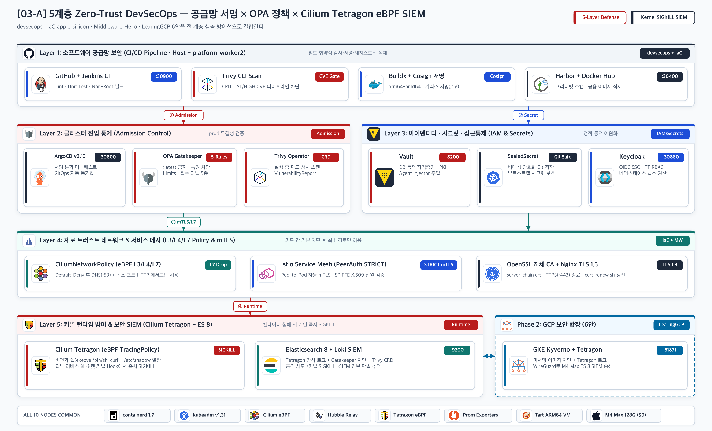
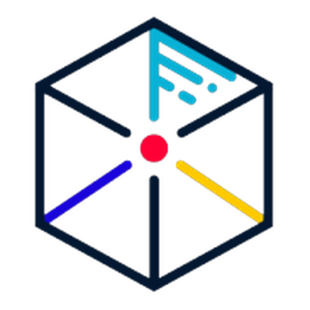
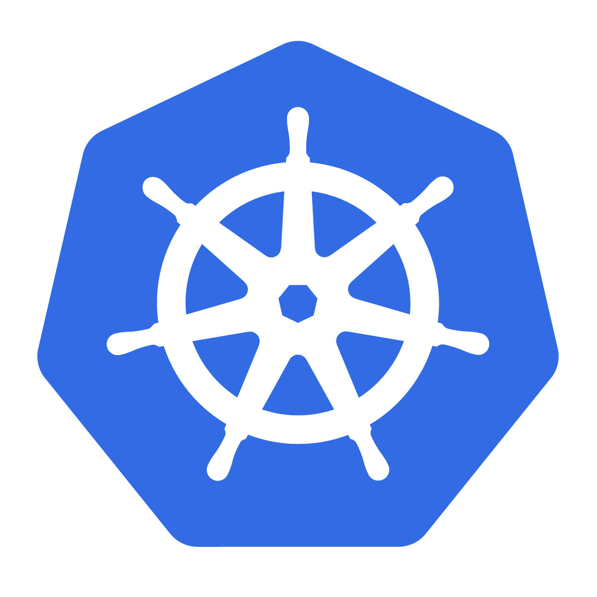
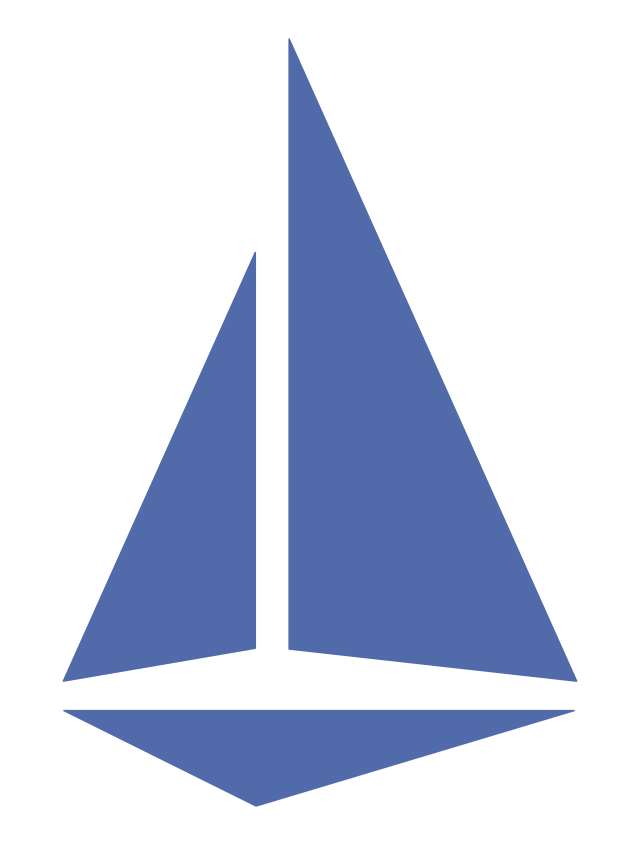
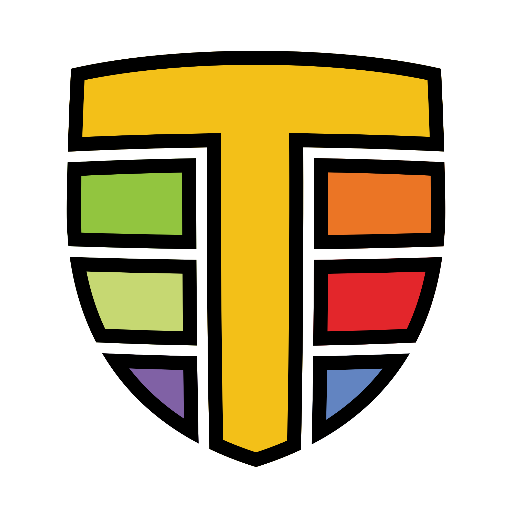
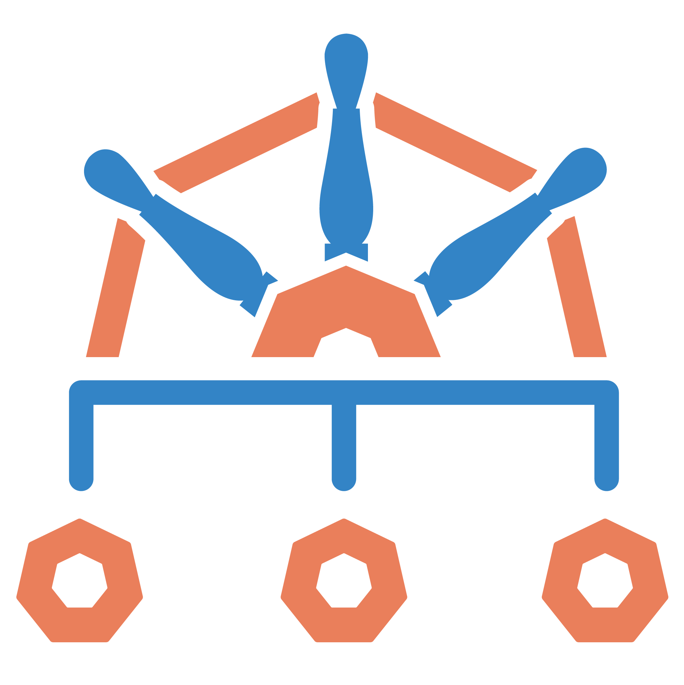
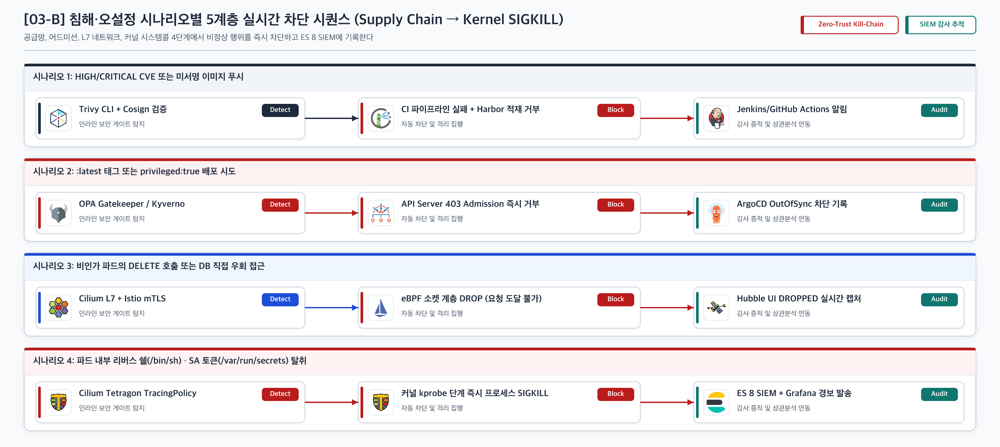

# [제안 3안] 5계층 Zero-Trust DevSecOps — 공급망 서명 × OPA 정책 × Cilium Tetragon eBPF SIEM

> **결합 대상**: `devsecops` (Trivy · Gatekeeper · Vault · Harbor · Terraform/Ansible) + `IaC_apple_sillicon` (Jenkins · ArgoCD · Sealed Secrets · Cilium L7 · Istio mTLS) + `Middleware_Hello` (Keycloak 24.0 · 자체 CA TLS) + `LearingGCP` 제6안  
> **적용 범위**: `platform-worker2` (CI/CD·Vault·Harbor) → `prod` / `dev` 클러스터 5계층 심층 방어



---

## 1. 레포지토리 결합 구조 (As-Is → To-Be)

`IaC_apple_sillicon`과 `devsecops`는 모두 `OPA Gatekeeper`, `Harbor`, `CiliumNetworkPolicy`를 다루고 있으나 정책 종류와 레지스트리 포트(`30400` vs `30500` 출력 불일치), 시크릿 관리 방식(`Sealed Secrets` vs `Vault`)이 나뉘어 있었다. 이를 5계층 심층 방어선(Defense-in-Depth) 모델로 통합한다.

| 보안 계층 | As-Is (`IaC_apple_sillicon` / `MW`) | As-Is (`devsecops`) | To-Be (`vol1_Infra` 통합 구성) |
|---|---|---|---|
| **Layer 1. 공급망 (CI/Build)** | `Jenkins(:30900)` + `ArgoCD(:30800)` + `Harbor` (`values: 30400` / `sh: 30500`) | `Trivy` 이미지 스캔 + `Harbor(:30400)` + `Dockerfile` non-root 빌드 | `Harbor :30400` 단일 표준화 + `Docker Buildx`(`arm64,amd64`) + `Trivy` CVE 차단 + `Cosign` 키리스 서명 & Docker Hub 이중 적재 |
| **Layer 2. 진입 통제 (Admission)** | Gatekeeper 4종 (`k8srequiredlabels`, `k8sblocknodeport`, `k8scontainerlimits`, `k8sdisallowprivileged`) | Gatekeeper 3종 (`block-latest-tag`, `require-labels`, `block-privileged`) + `Trivy Operator` | 중복 정책을 5대 Constraint로 통합(`:latest` 금지, 필수 라벨 `app`/`owner`, CPU/Mem Limits 필수, 특권 컨테이너 금지, NodePort 차단) + `Trivy Operator` 상시 재스캔 |
| **Layer 3. IAM · 시크릿** | `Sealed Secrets` (Git 정적 암호화) + `Keycloak(:30880)` + 자체 CA(`server-chain.crt`) | `HashiCorp Vault(:8200)` (Ansible 설치, Injector) + `Terraform RBAC` | **이원 역할 분리**: 배포용 정적 환경변수는 `Sealed Secrets`, DB/PKI 동적 자격증명은 `Vault` + `Keycloak 24.0 OIDC` |
| **Layer 4. 네트워크 · 메시** | `CiliumNetworkPolicy` (`default-deny.yaml` + L7 HTTP GET 필터) + `Istio mTLS` | Terraform `NetworkPolicy` (네임스페이스 기본 격리) | `Cilium L3/L4/L7 eBPF Default-Deny` + `Istio PeerAuthentication STRICT` SPIFFE mTLS + Nginx TLS 1.3 종료 |
| **Layer 5. 런타임 커널 (신규)** | 부재 (컨테이너 침해 후 악성 쉘 실행 탐지 불가) | 부재 | `LearingGCP` 제6안 기반 **`Cilium Tetragon`** `TracingPolicy` 커널 실시간 `SIGKILL` 차단 + `ES 8` SIEM 연동 |

---

## 2. 명시적 기술 스택 명세 (5계층별)

| 보안 계층 | 아이콘 | 기술 및 버전 | 원본 레포 | 실행 위치 (Cluster/Node) | 포트 / CRD | 역할 및 강제 규칙 |
|---|:---:|---|---|---|---|---|
| **L1: CI & Scan** |  | **Trivy CLI & Operator** + **Jenkins** | `devsecops` + `IaC` | Host + `platform-worker2` + `prod` | `:30900`, CRD `VulnerabilityReport` | CI 빌드 중 `CRITICAL`/`HIGH` CVE 실패 처리 + 클러스터 내 실행 파드 상시 스캔 |
| **L1: Sign & Registry** |  | **Harbor Registry** + **Docker Buildx** + **Cosign** | `devsecops` + `LearingGCP` | `platform-worker2` + Host | `:30400` (OCI/HTTP), Docker Hub | 프라이빗 Harbor(`:30400`) 내장 취약점 스캔 및 Cosign `.sig`·SBOM 생성 후 배포 허용 |
| **L2: GitOps Sync** |  | **ArgoCD v2.13.2** | `IaC` + `service` | `platform-worker2` | `:30800` (HTTPS/gRPC) | 서명 검증을 통과한 Helm/Kustomize 매니페스트만 `prod` 클러스터에 동기화 |
| **L2: Admission** |  | **OPA Gatekeeper** (`templates.gatekeeper.sh/v1`) | `IaC` + `devsecops` | `prod` (`gatekeeper-system`) | Webhook `:8443` | `:latest` 금지, `privileged: true` 차단, `limits` 미지정 거부, 필수 라벨 강제 |
| **L3: Dynamic Secret** |  | **HashiCorp Vault** + **Agent Injector** | `devsecops` | `platform-worker2` (`vault`) | `:8200` (HTTP/API) | K8s ServiceAccount JWT 인증 후 MySQL/PG 동적 시크릿 및 단기 PKI 인증서 주입 |
| **L3: Static Secret** |  | **Sealed Secrets Controller** | `IaC_apple_sillicon` | `platform` / `dev` / `prod` | CRD `SealedSecret` | 비대칭 공개키로 암호화해 Git 저장소 평문 시크릿 커밋 원천 차단 |
| **L3: Identity** |  | **Keycloak 24.0** + **Terraform RBAC** | `MW` + `devsecops` | `dev`/`platform` + 전체 클러스터 | `:30880`, K8s `RoleBinding` | 사용자 OIDC/JWT 통합 인증 + 네임스페이스별 최소 권한 `ServiceAccount` 선언 |
| **L4: Network/Mesh** |  | **Cilium L7 Policy** + **Istio mTLS (`Envoy`)** + **OpenSSL CA** | `IaC` + `MW` | 전 10대 VM / `dev`·`prod` | eBPF / `:15012` / `:443` | L3/L4/L7 Default-Deny + Pod-to-Pod STRICT mTLS + `cert-renew.sh` TLS 1.3 종료 |
| **L5: Runtime SIEM** |  | **Cilium Tetragon (eBPF)** + **Elasticsearch 8 SIEM** | `LearingGCP` | 전 노드 Kernel → `platform-worker1` | Kernel Hook → `:9200` / `:30300` | `execve`, `/etc/shadow`·SA 토큰 열람, 비인가 `tcp_connect` 커널 레벨 `SIGKILL` |
| **Phase 2: Cloud Admission** |  | **Kyverno Admission Policy** | `LearingGCP` (6안) | GCP GKE Spot | Admission Webhook | GCP 배포 파드의 `Cosign` 키리스 서명 강제 검증 및 M4 Max와 정책 일치 |

---

## 3. 컴포넌트 간 관계 및 침해 차단(Kill-Chain) 시퀀스



| 번호 | Caller / 감시 주체 | Callee / 통제 대상 | 프로토콜 / 메커니즘 | 제어 성격 | 설정 리소스 | 차단 동작 및 우회 불가 근거 |
|---|---|---|---|---|---|---|
| **①** | **Jenkins (`:30900`) / Trivy** | **K8s API** → **OPA Gatekeeper** | OCI HTTPS / Admission Webhook | 동기 Gate | `Jenkinsfile`, `ConstraintTemplate` | CVE 발견 이미지 빌드 실패; Git 반영 시 `:latest`·`privileged` 매니페스트 403 거부 |
| **②** | **Vault Agent Injector** / **Keycloak** | **Tomcat · FastAPI Pod** | Sidecar Init / OIDC JWKS | 런타임 주입 | `vault.hashicorp.com/agent-inject` | Git에 DB 비밀번호를 적지 않고 Pod 기동 시 메모리 파일(`/vault/secrets/`)로 동적 주입 |
| **③** | **Envoy Proxy & Cilium Agent** | **Pod 트래픽 (East-West / L7)** | mTLS + eBPF Filter | 인라인 강제 | `PeerAuthentication`, `CiliumNetworkPolicy` | 허용되지 않은 HTTP 메서드(`DELETE /admin` 등)나 비암호화 평문 연결 커널 소켓 단에서 DROP |
| **④** | **Cilium Tetragon (eBPF)** | **컨테이너 프로세스 → ES 8 SIEM** | Kernel `kprobe` / Tracepoint | 즉시 강제(`SIGKILL`) | `TracingPolicy` CRD | 컨테이너 탈출·권한 상승 시도(`/bin/sh`, `curl`, `/var/run/secrets/...` read) 시 커널이 프로세스를 즉시 종료 후 Pod명·UID·인자를 ES 8로 기록 |

---

## 4. `Vault` vs `Sealed Secrets` 역할 분담 기준

- **Sealed Secrets (`kubeseal`)**: GitOps 선언형 배포에 고정 포함되는 부트스트랩 시크릿(예: Harbor Pull Secret, Keycloak Admin 초기 비밀번호, Prometheus Alert Webhook URL)에 사용한다. 암호화된 `SealedSecret` YAML만 Git에 저장한다.
- **HashiCorp Vault (`:8200`)**: 주기적 로테이션이 필요한 `MySQL 8.0` / `PostgreSQL 16.6` DB 접속 계정 및 내부 TLS CA(`Middleware_Hello/scripts/cert-renew.sh` 연계) 인증서 발급에 사용한다. `prod` 파드는 K8s `ServiceAccount` JWT로 Vault에 인증해 메모리 상에서만 비밀값을 주입받는다.

---

## 5. 검증 명령어 및 침해 탐지 테스트 (macOS 호스트 실행)

```bash
# 1. Trivy CLI 이미지 스캔 & 클러스터 내 VulnerabilityReport 조회 (devsecops)
trivy image --severity HIGH,CRITICAL nginx:1.24
kubectl --kubeconfig kubeconfig/prod.yaml get vulnerabilityreports -A

# 2. OPA Gatekeeper 정책 위반 차단 테스트 (:latest 태그 / privileged 배포 거부 검증)
kubectl --kubeconfig kubeconfig/prod.yaml get constraints -A
kubectl --kubeconfig kubeconfig/prod.yaml run test-priv --image=nginx:latest --privileged=true 2>&1 || true

# 3. Harbor(:30400), Vault(:8200) 및 Cilium L7 Drop 확인
PLAT_W2=$(tart ip platform-worker2)
echo "Harbor: http://${PLAT_W2}:30400  | Jenkins: http://${PLAT_W2}:30900"
kubectl --kubeconfig kubeconfig/prod.yaml -n kube-system exec ds/cilium -- hubble observe --verdict DROPPED -n ecommerce
```

---

## 6. 추후 GCP 확장 연계 (`LearingGCP` 제6안: Zero-Trust & Tetragon SIEM)

- **공급망 & Admission 일치 (`\$40` - 크레딧 `\$10` = 실지출 `\$30/월`)**: M4 Max와 동일한 **Docker Hub `Cosign` 키리스 서명 이미지**만 GCP GKE `Kyverno` Policy에 의해 배포가 허용된다.
- **Tetragon eBPF → M4 Max SIEM 집계**: GCP GKE 노드의 `Cilium Tetragon` 커널 감사 로그와 차단 이벤트는 `Fluent-Bit`이 `WireGuard (:51871)` 터널을 통해 M4 Max `platform-worker1`의 **Elasticsearch 8 SIEM (`:9200`)** 으로 실시간 전송하여 로컬·클라우드 보안 감사 이력을 단일 Grafana에서 조회한다.
