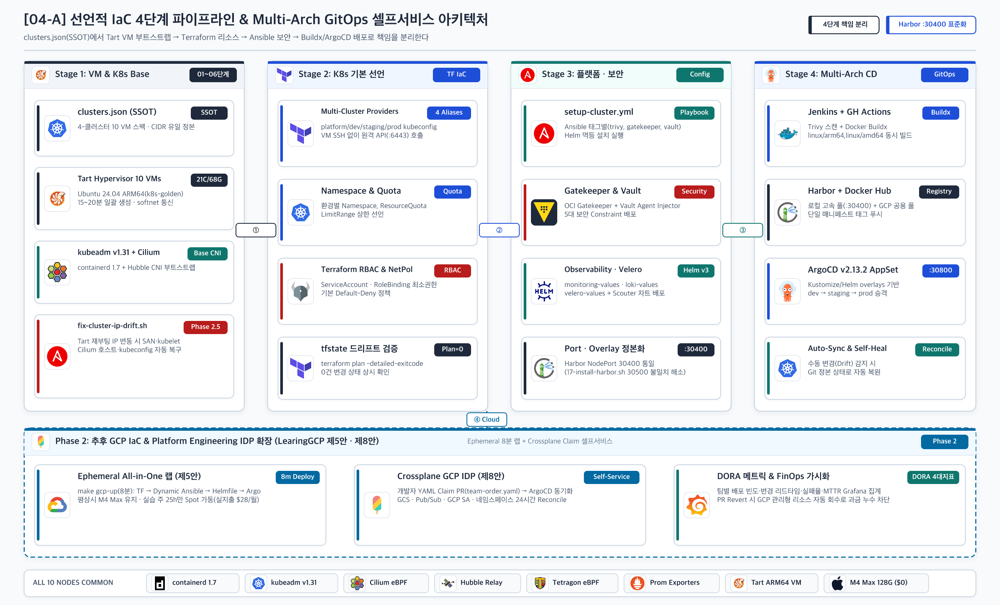
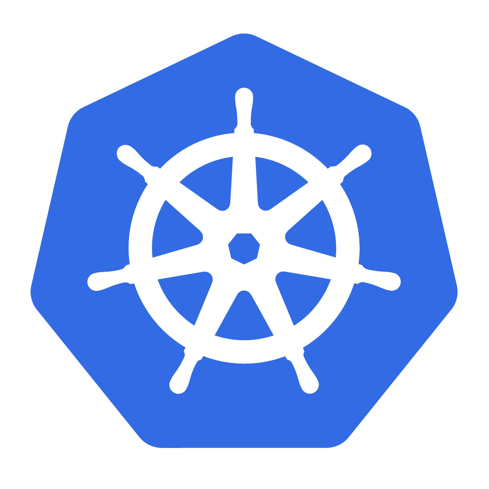
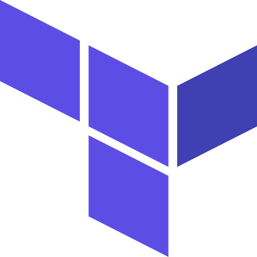
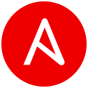
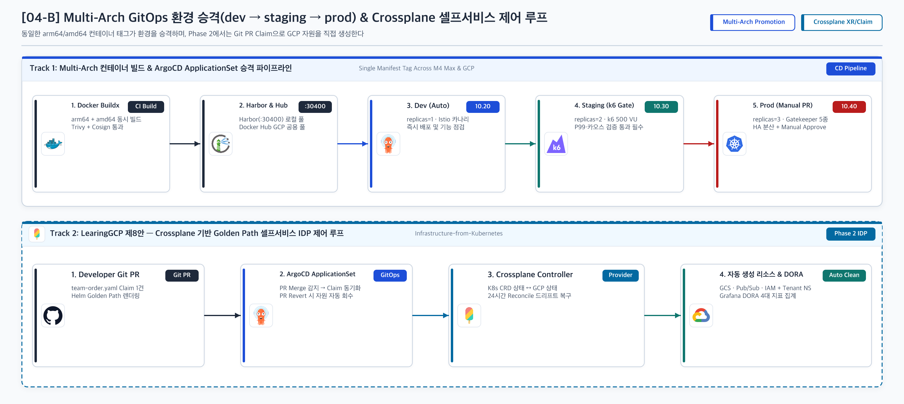

# [제안 4안] 선언적 IaC 4단계 파이프라인 & Multi-Arch GitOps 셀프서비스 IDP

> **결합 대상**: `IaC_apple_sillicon` (`clusters.json` + 17단계 Bash + `Terraform`) + `devsecops` (`Terraform >= 1.5.0` + `Ansible` + `ArgoCD`) + `service_infra` (`Helm` + `GitHub Actions` + `Makefile`) + `LearingGCP` 제5·8안  
> **실행 경계**: macOS Host(제어·빌드·프로비저닝) → `platform-worker2`(Jenkins · ArgoCD · Harbor) → `dev` / `staging` / `prod`



---

## 1. 레포지토리 결합 구조 (As-Is → To-Be)

기존 프로젝트들에서는 Tart VM 부트스트랩(Bash), K8s 리소스 선언(Terraform), OS/보안 패키지 설정(Ansible), 애플리케이션 빌드/배포(`Makefile`, GitHub Actions, Jenkins, ArgoCD)가 레포마다 별도 스크립트로 흩어져 있었다. 또한 Harbor NodePort가 `manifests/harbor-values.yaml`(`30400`)과 `scripts/install/17-install-harbor.sh` 안내 문구(`30500`) 간에 불일치가 존재했다. 본 제안서는 4단계 책임 분리와 단일 진실 공급원(`clusters.json`)으로 이를 통합한다.

| 파이프라인 단계 | As-Is (분산 상태) | 문제점 | To-Be 통합 파이프라인 (`vol1_Infra`) |
|---|---|---|---|
| **Stage 1. VM & K8s 부트스트랩** | `IaC`: `01~17-*.sh` Bash 일괄 실행<br>`devsecops`: `setup.sh` 재구현 | Bash로 Helm 앱까지 설치해 멱등성·변경 추적 어려움 | `IaC` Bash(`01~06` 단계)는 VM 생성·IP 드리프트 복구(`fix-cluster-ip-drift.sh`)·`kubeadm v1.31`·`Cilium`까지만 전담 |
| **Stage 2. K8s 기본 리소스** | `IaC/terraform/` vs `devsecops/infrastructure/terraform/` | 4-클러스터 `Namespace`·`RBAC`·`ResourceQuota` 정의 중복 | `Terraform >= 1.5.0` (`hashicorp/kubernetes ~> 2.25`)가 4개 kubeconfig 프로바이더로 `Namespace`/`RBAC`/`LimitRange` 일괄 선언 |
| **Stage 3. 플랫폼·보안 구성** | `IaC`: Helm Bash 07~17 vs `devsecops`: `setup-cluster.yml` Ansible | OS 커널 모듈, Vault, Gatekeeper 설치 방식 이원화 | `Ansible`(`setup-cluster.yml`) + 표준 `Helm v3` values가 Gatekeeper, Vault, Trivy, Velero, Scouter 멱등 배포 |
| **Stage 4. Multi-Arch 빌드 & 배포** | `IaC`: ARM64 전용, `service`: `Makefile`+GH Actions, Harbor `30400/30500` 혼재 | GCP(`amd64`) 이식 불가 및 레지스트리 포트 불일치 | Harbor NodePort `:30400` 단일화 + `docker buildx`(`linux/arm64,linux/amd64`) → `ArgoCD v2.13.2` ApplicationSet GitOps 자동 승격 |

---

## 2. 명시적 기술 스택 명세

| 파이프라인 계층 | 아이콘 | 기술 및 버전 | 원본 레포 | 실행 위치 | 엔드포인트 / 출력 | 역할 및 설계 근거 |
|---|:---:|---|---|---|---|---|
| **SSOT 정의** |  | **`config/clusters.json`** | `IaC` + `devsecops` | macOS Host | JSON 스키마 (`10 VMs`) | `platform`, `dev`, `staging`, `prod` 노드 스펙(21 vCPU/68 GB)·CIDR 단일 정의 |
| **Stage 1: VM/K8s** |  | **Tart Hypervisor** + **Ubuntu 24.04 ARM64** | `IaC_apple_sillicon` | macOS Host | `--net-softnet-allow=0.0.0.0/0` | `k8s-golden` 이미지 복제(`15~20분` 구축), 재부팅 IP 변동 자동 복구 |
| **Stage 2: K8s IaC** |  | **Terraform `>= 1.5.0`** (`kubernetes ~> 2.25`) | `devsecops` + `IaC` | macOS Host | `terraform.tfstate` | 4-클러스터 alias(`platform`, `dev`, `staging`, `prod`)별 기본 격리 리소스 선언 |
| **Stage 3: Config** |  | **Ansible Playbook** + **Helm v3** | `devsecops` + `service` | macOS Host → VM SSH/API | `hosts.yml`, `setup-cluster.yml` | Gatekeeper OCI Helm, Vault Injector, KVM/드라이버 등 OS·클러스터 멱등 구성 |
| **Stage 4: Multi-Arch CI** |  | **Docker Buildx** + **Jenkins (`:30900`)** + **GH Actions** | `IaC` + `service` + `GCP` | Host + `platform-worker2` | `:30900` (Jenkins) | `linux/arm64` + `linux/amd64` 동시 빌드, Trivy/Cosign 검증 |
| **Artifact Registry** |  | **Harbor Registry** + **Docker Hub** | `IaC` + `devsecops` + `GCP` | `platform-worker2` + Public | `NodePort :30400` / Hub | 로컬 고속 OCI 캐시(`Harbor :30400`) + 클라우드 공용 레지스트리 이중 푸시 |
| **GitOps Engine** |  | **ArgoCD `v2.13.2`** (`ApplicationSet`) | `service` + `IaC` | `platform-worker2` | `:30800` (UI/gRPC) | `dev` → `staging` → `prod` Kustomize/Helm 오버레이 선언형 승격 및 Drift 복구 |
| **Phase 2: IDP** |  | **Crossplane** (`GCP Provider`) | `LearingGCP` (8안) | `platform` / GKE Control Plane | K8s CRD (`Claim` / `XR`) | 개발자 Git PR Claim만으로 네임스페이스·GCS·Pub/Sub·IAM 자동 프로비저닝 |

---

## 3. 컴포넌트 간 관계 및 Multi-Arch 승격 · Crossplane 제어 루프



| 단계 | Caller (실행 주체) | Callee (대상) | 프로토콜 / 방식 | 설정 파일 / 매니페스트 | 동작 결과 및 장애 방어 |
|---|---|---|---|---|---|
| **①** | **Bash (`install.sh` / `boot.sh`)** | **Tart Hypervisor & 10 VM** | Apple Hypervisor / SSH | `config/clusters.json`, `scripts/lib/vm.sh` | 3초 간격 최대 60회 `tart ip` 폴링 후 SSH로 `kubeadm v1.31` 초기화 및 IP 드리프트 복구 |
| **②** | **Terraform (`main.tf`)** | **4개 K8s API Server (`:6443`)** | HTTPS API (kubeconfig) | `variables.tf`, `dev/staging/prod` alias | `vm_wait` 이후 kubeconfig만 참조해 네임스페이스·RBAC·Quota 상태 `plan/apply` |
| **③** | **Ansible (`setup-cluster.yml`)** | **platform / dev / prod 클러스터** | Helm v3 + SSH | `--tags "trivy,gatekeeper,vault"` | 태그별 선택 실행 가능. Helm OCI 레지스트리에서 Gatekeeper/Vault 멱등 설치 |
| **④** | **Docker Buildx (CI Pipeline)** | **Harbor (`:30400`) & Docker Hub** | HTTPS OCI Push | `.github/workflows`, `Jenkinsfile` | 단일 매니페스트 리스트 태그로 M4 Max(`arm64`)와 GCP(`amd64`) 동시 호환 이미지 적재 |
| **⑤** | **ArgoCD (`v2.13.2` `ApplicationSet`)** | **dev → staging → prod K8s API** | Git Pull + Reconcile | `environments/{dev,staging,prod}`, `overlays/` | 수동 `kubectl edit` 드리프트 발생 시 3분 내 Git 정본 상태로 자동 롤백 |
| **⑥** | **Crossplane Controller (Phase 2)** | **GCP API (GCS, Pub/Sub, IAM)** | Workload Identity API | `team-order.yaml` Claim (XR/XRD) | Terraform CLI 수동 실행 없이 K8s Reconcile 루프가 클라우드 리소스 생애주기 관리 |

---

## 4. 환경별 승격 구조 및 IP 드리프트 자동 복구

1. **Tart 재부팅 IP 드리프트 대응 (`fix-cluster-ip-drift.sh`)**:
   - macOS 호스트 재부팅 또는 슬립 후 Tart가 VM에 새 `192.168.64.x` IP를 할당하면 기존 `kube-apiserver` TLS 인증서 SAN과 Cilium 접속 주소가 불일치한다.
   - `boot.sh` 실행 시 Phase 2.5로 `fix-cluster-ip-drift.sh`를 자동 호출하여 ① kubeadm `apiserver.crt` SAN 재발급, ② static pod 매니페스트 수정, ③ worker `kubelet.conf` 갱신, ④ `cilium` ConfigMap `KUBERNETES_SERVICE_HOST` 교체, ⑤ 호스트 `kubeconfig/*.yaml` IP 치환을 무인 완료한다.
2. **GitOps 환경 승격 (`dev` → `staging` → `prod`)**:
   - `service_infra/services/*/helm/values-{dev,staging,prod}.yaml` 및 `devsecops/kubernetes/overlays/{dev,staging,prod}` 구조를 통합한다.
   - `dev`는 `replicas=1`(자동 Sync), `staging`은 `replicas=2` + k6 부하 검증 통과 후 태그 승격, `prod`는 `replicas=3` + OPA Gatekeeper 5종 검증 + 수동 PR 승인(Manual Approve) 게이트를 적용한다.

---

## 5. 검증 명령어 (macOS 호스트 실행)

```bash
# 1. Stage 1~3 전체 상태 및 4개 클러스터 노드 Ready 검증
./scripts/status.sh
for c in platform dev staging prod; do
  kubectl --kubeconfig "kubeconfig/${c}.yaml" get nodes
done

# 2. Stage 2 Terraform 드리프트 점검 (변경사항 0건 확인)
cd infrastructure/terraform && terraform plan -detailed-exitcode

# 3. Harbor(:30400) & ArgoCD(:30800) 접속 및 ApplicationSet 동기화 확인
PLAT_W2=$(tart ip platform-worker2)
echo "ArgoCD: http://${PLAT_W2}:30800  | Harbor: http://${PLAT_W2}:30400"
kubectl --kubeconfig kubeconfig/platform.yaml get applications -n argocd
```

---

## 6. 추후 GCP 확장 연계 (`LearingGCP` 제5안 · 제8안)

- **Ephemeral All-in-One 랩 (`LearingGCP` 제5안)**: 평소에는 M4 Max 로컬(`\$0`)에서 개발하다가 대규모 부하/통합 테스트가 필요한 주 25시간만 `make gcp-up` (`Terraform` → Dynamic `Ansible` → `Helmfile` → `ArgoCD` 8분 무인 프로비저닝)으로 `e2-standard-4` Spot 3대(48GB RAM) + `n2-standard-4` KVM 1대 환경을 생성하고 종료 후 `make gcp-down`으로 과금을 차단한다(총 `\$38` - 크레딧 `\$10` = 실지출 월 `\$28`, 약 `39,200원`).
- **Crossplane IDP (`LearingGCP` 제8안)**: 개발팀이 Git에 Golden Path YAML Claim(`team-order.yaml`) PR을 생성하면 ArgoCD가 이를 동기화하고, Crossplane GCP Provider가 `GCS Bucket`, `Pub/Sub Topic`, `GCP ServiceAccount`를 자동 생성·회수하며 M4 Max Grafana에서 **DORA 4대 지표**(배포 빈도, 변경 리드타임, 변경 실패율, MTTR)를 추적한다(실지출 월 `\$34`).
