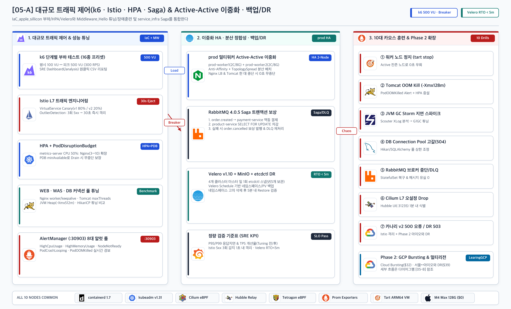
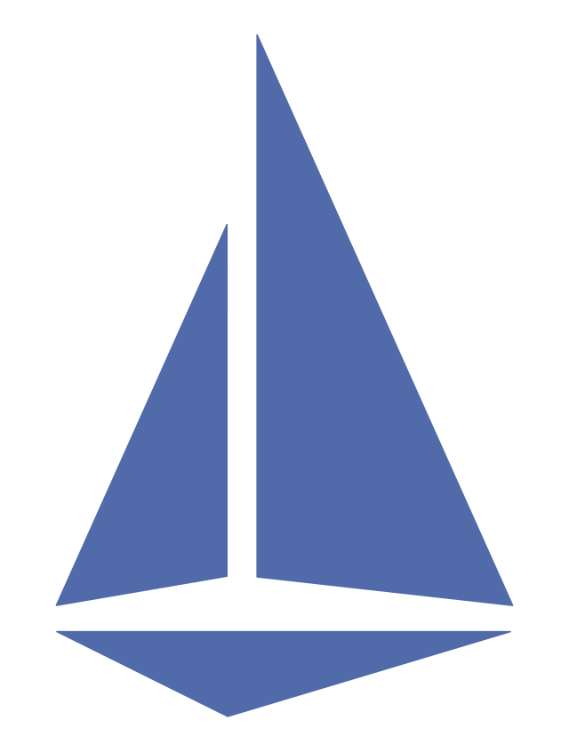
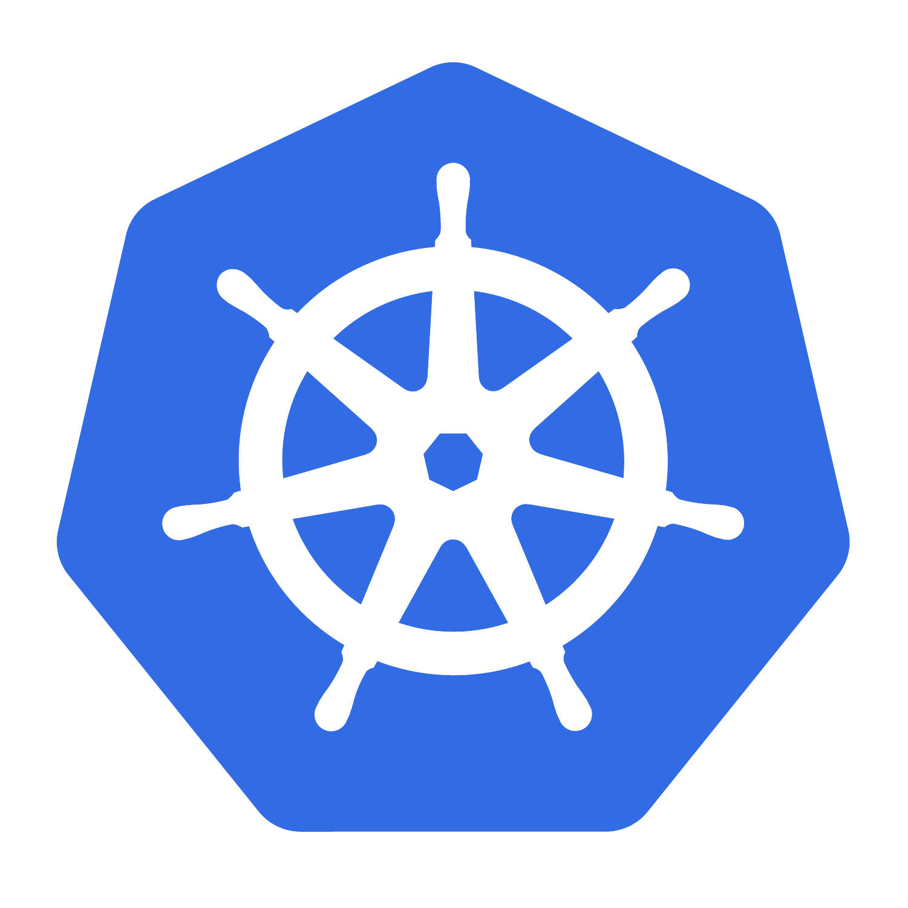
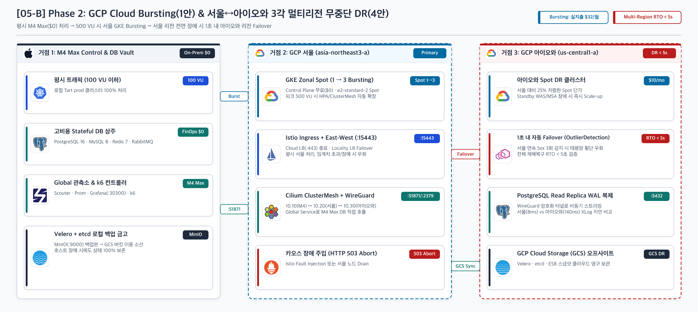

# [제안 5안] 대규모 트래픽 제어(k6 · Istio · HPA · Saga) & 무중단 백업/DR(Velero → GCP Bursting)

> **결합 대상**: `IaC_apple_sillicon` (k6 16종 · HPA · PDB · Istio Canary/Breaker · Velero/etcd) + `Middleware_Hello` (WEB/WAS/DB 튜닝 · 10대 장애 시나리오) + `service_infra` (RabbitMQ 4.0 Saga 보상) + `LearingGCP` 제1·4안  
> **검증 무대**: `staging` (성능 벤치마크·카오스 주입) → `prod` (`prod-worker1`/`worker2` Active-Active HA)



---

## 1. 레포지토리 결합 구조 (As-Is → To-Be)

기존 레포지토리들에서는 부하 생성기(`k6` 16종 on `IaC`), 미들웨어 튜닝/장애 훈련(`ab`/`wrk` + `docker stop` 10대 시나리오 on `Middleware_Hello`), 분산 트랜잭션 보상(`RabbitMQ 4.0 Saga` on `service_infra`)이 서로 다른 앱을 대상으로 동작했다. 이를 통합 트래픽 제어·내결함성·재해복구 아키텍처로 결합한다.

| 엔지니어링 영역 | As-Is (`IaC` / `MW` / `service`) | 한계점 | To-Be (`vol1_Infra` 통합 검증 체계) |
|---|---|---|---|
| **부하 생성 & 분석** | `IaC`: `nginx`/`httpbin` 대상 `k6` 16종<br>`MW`: `ab`/`wrk` 수동 스크립트 | `Tomcat HA`·`8-MSA`에 대해 `SRE Dashboard` 시계열 분석 불가 | `SRE Dashboard (/analysis)`가 Track A/B 통합 엔드포인트에 `100→500 VU` `k6` 부하를 실행하고 HPA·Hubble·P99 통합 추적 |
| **L7 트래픽 제어** | `IaC`: `dev` 클러스터 `Istio` (`httpbin v1/v2`)<br>`MW`: `Nginx` `Round Robin` | WAS·MSA 장애 격리(Circuit Breaker)와 오토스케일 연계 부족 | `Istio VirtualService`(Canary `80/20`) + `DestinationRule OutlierDetection`(3회 5xx → `30s` 격리) + `HPA/PDB` 결합 |
| **성능 튜닝** | `MW`: Nginx/Tomcat/JVM/MySQL 개별 튜닝 (`performance-tuning.md`) | 분산 환경 E2E 병목 측정 부재 | 튜닝 전/후 P95·P99·TPS를 `k6` CSV와 `Scouter XLog`·`Jaeger`로 정량 비교 |
| **분산 데이터 정합성** | `service`: `RabbitMQ 4.0.5` Saga 이벤트 | 장애 주입 시 보상 트랜잭션 검증 미흡 | 카오스 시나리오(`payment`/`broker` 강제 중단) 중 보상 발행(`order.cancelled`) 및 DLQ 재처리 검증 |
| **백업 / DR** | `IaC`: `etcdctl` 스냅샷 + `Velero` (`MinIO :9000`) | M4 Max 호스트 물리 장애 시 복구 수단 없음 | Phase 1 `MinIO` `RTO < 5m` 복구 검증 + Phase 2 `GCS` 오프사이트 이중화 및 서울↔아이오와 `RTO < 5s` DR |

---

## 2. 명시적 기술 스택 명세

| 계층 | 아이콘 | 기술 및 버전 | 원본 레포 | 실행 위치 (Cluster/Node) | 주요 설정 수치 | 역할 및 동작 근거 |
|---|:---:|---|---|---|---|---|
| **Load Generator** |  | **Grafana k6** + **stress-ng** | `IaC_apple_sillicon` | macOS Host → K8s Job | 평시 `100 VU` / 피크 `500 VU (300 RPS)` | SRE Dashboard(`/analysis`) 16종 프리셋 실행, Before/After CSV 리포팅 |
| **Traffic Control** |  | **Istio (`VirtualService` / `DestinationRule`)** | `IaC` + `LearingGCP` | `dev` / `prod` / GCP EW | Canary `80/20`, `consecutive5xxErrors: 3`, `30s` Eject | 장애 파드 3회 연속 5xx 시 `30초` 즉시 격리(Circuit Breaker) 및 Fault Injection |
| **Autoscaling** |  | **metrics-server** · **HPA** · **PDB** | `IaC_apple_sillicon` | `dev`, `staging`, `prod` | CPU `50%` 타깃 (`Nginx 3→10`, `FastAPI 2→6`) | 부하 급증 시 자동 스케일아웃, 스케일다운·노드 Drain 시 `PDB minAvailable` 보장 |
| **MW / DB Tuning** |  | **Nginx 1.24** · **Tomcat 10** · **MySQL 8.0** · **PG 16.6** | `MW` + `service` | `prod-worker1`, `worker2` | `JVM -Xms256m -Xmx512m`, `maxThreads`, `keepalive` | 커넥션 풀(HikariCP/SQLAlchemy) 및 WAS 스레드 튜닝 전후 처리량 비교 |
| **Async / Saga** |  | **RabbitMQ 4.0.5** (`aio-pika 9.5.1`) | `service_infra` | `prod` StatefulSet | `:5672` AMQP, DLQ 활성화 | `order.created`→`payment`→`product` 단계 실패 시 보상 트랜잭션(`order.cancelled`) 자동 발행 |
| **HA Placement** |  | **Multi-Worker TopologySpread** | `IaC` + `MW` | `prod-worker1`, `prod-worker2` | 2-Node Active-Active (`8 GB`×2) | 한 워커 노드 `tart stop prod-worker2` 시에도 잔존 워커로 무중단 처리 |
| **Backup / DR** |  | **Velero (`v1.10.0`)** + **MinIO (`:9000`)** + **`etcdctl`** | `IaC_apple_sillicon` | `platform` + 전 Master | 일 1회 `etcd` 스냅샷(5개 보관), Bucket `velero-backups` | 네임스페이스 고의 삭제 후 `RTO < 5분` 내 리소스·PV 원복 검증 |
| **Alerting** |  | **AlertManager (`:30903`)** + **8대 PrometheusRule** | `IaC_apple_sillicon` | `platform-worker1` | Webhook (`webhook-logger.yaml`) | `HighCpuUsage`, `PodCrashLooping`, `PodOOMKilled`, `NodeNotReady` 경보 발송 |

---

## 3. 컴포넌트 간 장애 대응 및 Phase 2 Bursting / 멀티리전 Failover 흐름



| 번호 | Caller / 트리거 | Callee / 반응 대상 | 프로토콜 / 메커니즘 | 임계치 / 조건 | K8s 리소스 / 설정 | 동작 설명 |
|---|---|---|---|---|---|---|
| **①** | **k6 (`POST /api/tests/run`)** | **Nginx / Kong / FastAPI** | HTTPS (`:443`) | `100 → 500 VU` | `SRE Dashboard` (Node.js `execa`/`ssh2`) | 16종 프리셋(부하·CPU/메모리 스트레스·스케일링) 실행 및 5초 간격 HPA 수집 |
| **②** | **Istio Envoy Proxy** | **Faulty App Pod (`v2` / 서울 GKE)** | L7 HTTP Circuit Breaker | 연속 `5xx` 3회 (`10s` 내) | `DestinationRule` (`outlierDetection`, `LocalityLb`) | 불량 파드 `30초` 제외; Phase 2 서울 리전 503 장애 시 `1초 내` 미국 아이오와 우회(`RTO < 5s`) |
| **③** | **HPA Controller** | **ReplicaSet (`nginx`/`MSA`/`GCP Spot`)** | `metrics.k8s.io` (15s) | CPU 평균 사용률 `> 50%` | `HorizontalPodAutoscaler`, `PodDisruptionBudget` | 파드 자동 증설; Node Drain 시 `PDB`가 최소 가용 파드 수 이하 감축 차단 |
| **④** | **order-service** ↔ **payment / product** | **RabbitMQ 4.0.5 (`:5672`)** | AMQP Saga Choreography | 결제 실패 또는 재고 부족 | `aio-pika` Exchange/DLQ (`definitions.json`) | 비관적 락 재고 차감 실패 시 `order.cancelled` 발행 → 결제 환불 및 DLQ 적재 |
| **⑤** | **Velero Controller** | **MinIO (`:9000`) → Phase 2 GCS** | S3 API / CSI Snapshot | 일 1회 `Schedule` / 수동 백업 | `velero-values.yaml`, `15-install-backup.sh` | K8s YAML 객체 + PV 스냅샷 백업 및 `etcdctl snapshot save` 제어 플레인 보전 후 GCS 오프사이트 소산 |

---

## 4. 10대 카오스 & 장애 대응 훈련 시나리오 (`Middleware_Hello` + `IaC` 통합)

| 번호 | 장애 시나리오 | 재현 방법 (Chaos Injection) | 1차 탐지 도구 | 자동 복구 / 목표 RTO | 런북 검증 지표 |
|---|---|---|---|---|---|
| **1** | **워커 노드 전면 장애** | `tart stop prod-worker2` | `AlertManager` (`NodeNotReady`), SRE UI | Nginx/Istio가 `prod-worker1`로 즉시 우회 (**0초 중단**) | 5xx 오류율 `< 0.1%` |
| **2** | **Tomcat OOM Kill** | `-Xmx128m` 축소 후 k6 대용량 할당 | `PodOOMKilled` Alert + `Scouter` Heap 그래프 | K8s 재기동(liveness) + HPA 증설 | 복구 `RTO < 30s` |
| **3** | **JVM GC Storm / 지연** | Old Gen 포화 부하(`jstat`/XLog 관찰) | `Scouter Client` XLog 분포 (수평선 지연 스파이크) | G1GC 튜닝 & Heap 증설 전후 P99 비교 | P99 지연 감소율 |
| **4** | **DB Connection Pool 고갈** | Slow Query 삽입(`SLEEP(5)`) + 동시 접속 | `502`/`504` 급증, `PostgreSQL/MySQL Exporter` | HikariCP / SQLAlchemy Pool 크기 산정 및 Circuit Breaker | 5xx 차단 및 Pool 정상화 |
| **5** | **RabbitMQ 브로커 장애** | `kubectl delete pod rabbitmq-0` | `Notification` DLQ 적재, Jaeger Error Span | StatefulSet PVC 재연결 + unacked 메시지 재처리 | 메시지 유실 `0건` |
| **6** | **Cilium L7 정책 오설정** | `allow-nginx-to-httpbin.yaml` 메서드 오류 | `Hubble UI (:31235)` `DROPPED` 실시간 캡처 | Hubble에서 정책 차단 1분 내 식별 후 GitOps 롤백 | `MTTD < 1m` |
| **7** | **컨테이너 이미지 오염 배포** | `:latest` / `CRITICAL CVE` 포함 매니페스트 적용 | `OPA Gatekeeper` 거부 + `Trivy Operator` | 배포 단계 사전 차단 (`ArgoCD SyncFailed` 알림) | 침해 차단 `100%` |
| **8** | **네임스페이스 고의 삭제** | `kubectl delete ns ecommerce` | `Velero` + `AlertManager` | `velero restore create` 실행 | **전체 복구 `RTO < 5m`** |
| **9** | **Control Plane etcd 손상** | `etcd` 데이터 디렉토리 훼손 | `kube-apiserver` 응답 불가 | `etcdctl snapshot restore` (`15-install-backup.sh`) | 클러스터 정상화 |
| **10** | **카나리 v2 / 리전 장애** | `v2` 500 주입 또는 서울 `503 Abort 100%` | Grafana + `Istio OutlierDetection` | `3회` 5xx 감지 후 `v1` 또는 **미국 아이오와** 자동 우회 | 자동 격리 `< 1s` (`RTO < 5s`) |

---

## 5. 검증 명령어 (macOS 호스트 실행)

```bash
# 1. dev/staging 클러스터 HPA & PDB 상태 확인
kubectl --kubeconfig kubeconfig/dev.yaml get hpa,pdb -A

# 2. etcdctl 스냅샷 생성 및 Velero 백업 실행
./scripts/install/15-install-backup.sh
velero --kubeconfig kubeconfig/platform.yaml backup create drill-$(date +%Y%m%d) --include-namespaces ecommerce

# 3. SRE Operations Dashboard에서 16종 부하·스케일링 테스트 실행 확인
cd dashboard && npm run dev   # → http://localhost:5173/analysis
```

---

## 6. 추후 GCP 확장 연계 (`LearingGCP` 제1안 · 제4안)

- **Cloud Bursting (`LearingGCP` 제1안 — 총 `\$42`, 실지출 `\$32/월`)**: 평시(`100 VU`) 트래픽은 M4 Max(`\$0`)에서 100% 처리한다. `k6 500 VU` 초과 시 GCP `asia-northeast3-a` Zonal GKE Spot(`e2-standard-2` `1→3대`, CP `\$0`)이 자동 스케일아웃되고 `Cilium ClusterMesh(:2379)`와 `Istio East-West(:15443)`가 초과 트래픽만 클라우드로 분산한다.
- **서울 ↔ 아이오와 3각 멀티리전 DR (`LearingGCP` 제4안 — 총 `\$49`, 실지출 `\$39/월`)**:
  - **Primary**: GCP 서울(`asia-northeast3`, RTT `~8ms`), **Secondary DR**: GCP 아이오와(`us-central1`, 서울 대비 Spot 단가 ~25% 저렴, RTT `~140ms`), **Control Tower**: M4 Max.
  - 서울 리전 전면 503 장애 주입 시 Istio `OutlierDetection`이 **1초 내(`RTO < 5s`) 아이오와로 트래픽을 자동 Failover**하며, 태평양 횡단 지연 변화를 `Scouter XLog`와 Grafana로 정량 비교한다. `PostgreSQL Read Replica` WAL 스트리밍 및 `GCS` 오프사이트 백업이 WireGuard(`:51871`)를 통해 상시 동기화된다.
