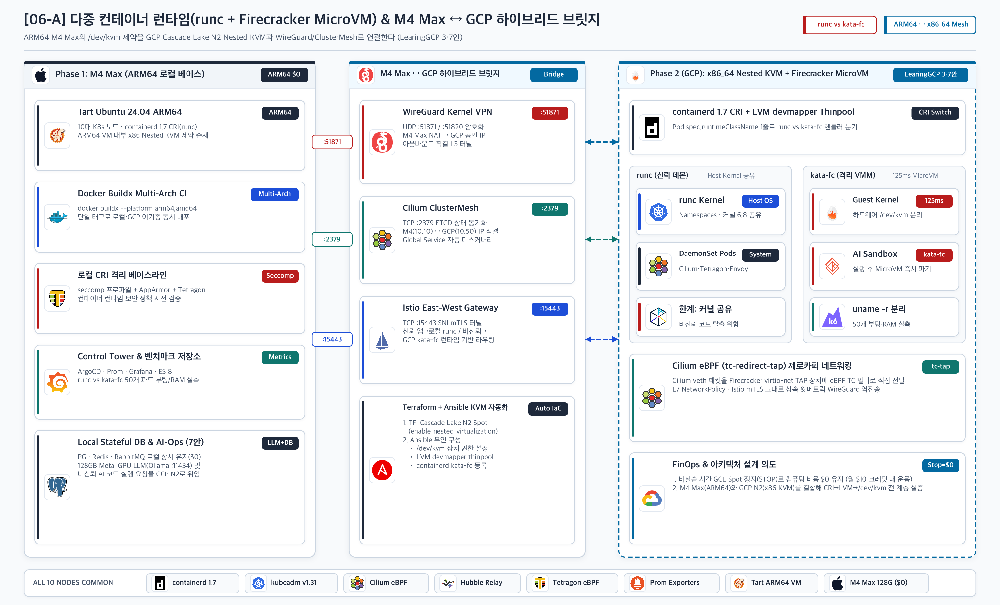
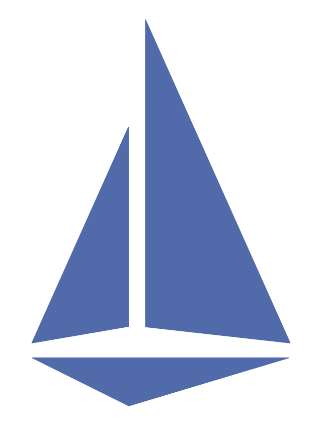
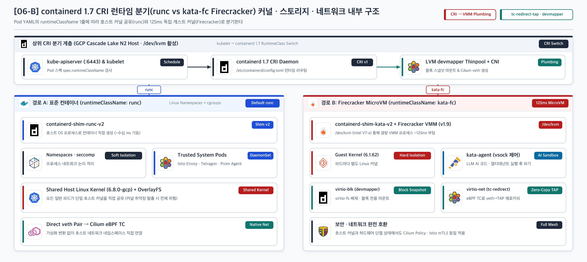

# [제안 6안] 다중 컨테이너 런타임(runc + Firecracker MicroVM) & M4 Max ↔ GCP 하이브리드 브릿지

> **결합 대상**: `IaC_apple_sillicon` (Tart ARM64 VM · containerd 1.7 · Cluster 관제) + `devsecops` (Terraform · Ansible 자동화 · Multi-Arch) + `LearingGCP` 제3·7안 (GCP N2 Nested KVM · Kata Firecracker `kata-fc` · Hybrid Local LLM `:11434` · WireGuard + ClusterMesh)  
> **구조 성격**: Phase 1 (M4 Max ARM64 기반 로컬 베이스라인 & LLM 호스트) + Phase 2 (GCP x86_64 Nested KVM MicroVM 확장 연결)



---

## 1. 아키텍처 배경 및 레포지토리 결합 구조 (As-Is → To-Be)

Apple Silicon(M4 Max, `ARM64`) macOS 호스트의 `Tart Hypervisor` 내부 Ubuntu 24.04 ARM64 VM 위에서는 **표준 컨테이너(`runc`)**와 eBPF/seccomp 보안이 원활히 동작하지만, AWS Lambda/Fargate에 쓰이는 `x86_64` `/dev/kvm` 중첩 가상화(Nested KVM) 기반 **Firecracker MicroVM (`kata-fc`)** 은 하드웨어 아키텍처 제약으로 로컬 VM 내부에 직접 구축하기 어렵다.

이를 해결하기 위해 로컬 호스트 제약을 회피하지 않고 **Phase 1(M4 Max 기반 `seccomp`/`Tetragon` + Multi-Arch 빌드 + 관제 + 128GB 로컬 LLM)** 과 **Phase 2(GCP Cascade Lake N2 Nested KVM `/dev/kvm` 위 `runc` vs `kata-fc` 런타임 이원화)** 를 단일 `Cilium ClusterMesh` 메시로 연결한다.

| 계층 | As-Is (`IaC` / `devsecops`) | 로컬 ARM64 제약 | To-Be (`vol1_Infra` 하이브리드 브릿지) |
|---|---|---|---|
| **컨테이너 런타임** | `containerd 1.7` (`runc` 단독) | 호스트 Linux 커널 공유 → 커널 탈출(Container Escape) 취약점 노출 가능 | 신뢰 데몬(`Envoy`, `Cilium`, `Exporter`)은 **`runc`**, 비신뢰·AI 생성 코드·멀티테넌트 파드는 **`runtimeClassName: kata-fc`** (독립 게스트 커널)로 분기 |
| **빌드 아키텍처** | `IaC`: `linux/arm64` 이미지 중심 | GCP `x86_64` N2/GKE 노드에서 ARM64 전용 이미지 실행 불가 | `docker buildx build --platform linux/arm64,linux/amd64` 단일 매니페스트 태그 푸시로 이기종 클러스터 동시 배포 |
| **네트워크 연결** | M4 Max 내부 `softnet` 폐쇄망 | NAT 환경의 Mac과 클라우드 노드 간 L3 Pod IP 직결 불가 | `WireGuard (:51871/:51820)` 아웃바운드 터널 + `Cilium ClusterMesh (:2379)` (`10.10.0.0/16` ↔ `10.50.0.0/16`) 직접 통신 |
| **가상화 / 스토리지** | 일반 OverlayFS (`runc`) | Firecracker는 `virtio-fs` 대신 블록 디바이스 전용 격리 필요 | Phase 2 Ansible이 `LVM devmapper thinpool`(`virtio-blk`) + `tc-redirect-tap` eBPF 제로카피 네트워킹 자동 구성 |
| **AI Sandbox 연계** | 로컬 단독 실험 | 비신뢰 LLM 생성 코드 실행 시 호스트 보안 위험 | M4 Max 128GB Metal GPU(`Ollama/vLLM :11434`) 추론 결과를 WireGuard 너머 GCP N2 `kata-fc` MicroVM에서 격리 실행 후 파기 (`LearingGCP` 7안) |

---

## 2. 명시적 기술 스택 명세

| 계층 | 아이콘 | 기술 및 버전 | 원본 레포 | 실행 위치 | 포트 / 장치 | 역할 및 세부 스펙 |
|---|:---:|---|---|---|---|---|
| **Phase 1: VM** |  | **Tart Hypervisor** + **Ubuntu 24.04 ARM64** | `IaC_apple_sillicon` | macOS Host (M4 Max) | softnet NAT | 10대 K8s 노드 구동, `kubeadm v1.31` 제어/빌드/DB/관제 허브 (`\$0`) |
| **Phase 1: Build** |  | **Docker Buildx Multi-Arch** | `IaC` + `LearingGCP` | macOS Host | OCI Manifest List | `linux/arm64` + `linux/amd64` 이미지 동시 빌드 및 Harbor/Docker Hub 적재 |
| **Phase 1: Local AI** |  | **Ollama / vLLM Metal** (`128GB Unified GPU`) | `LearingGCP` (7안) | macOS Host (M4 Max) | `:11434` (HTTP API) | 클라우드 A100 비용 `\$0`으로 32B~70B LLM 상시 서빙, 생성 코드를 N2 샌드박스로 전달 |
| **Phase 2: KVM Node** |  | **GCE `n2-standard-4` Spot** (Cascade Lake) | `LearingGCP` (3안) | GCP `asia-northeast3-a` | `/dev/kvm` (`~\$0.045/h`) | `enable_nested_virtualization = true` 활성 x86_64 KVM 워커 (4 vCPU/16 GB) |
| **Phase 2: IaC** |  | **Terraform** + **Ansible Playbook** | `devsecops` + `LearingGCP` | macOS Host → GCP | SSH / GCE API | GCP N2 생성 후 `/dev/kvm` 권한, `LVM devmapper thinpool`, `kata-fc` 자동 등록 |
| **CRI Switch** |  | **containerd `1.7` CRI** | `IaC` + `LearingGCP` | 전 노드 + GCP N2 | `config.toml` Shim | `runtimeClassName` 필드에 따라 `shim-runc-v2` vs `shim-kata-v2` 분기 |
| **Isolated VMM** |  | **Firecracker VMM (`v1.9`)** + **Kata (`kata-v2`)** | `LearingGCP` (3·7안) | GCP N2 (`kata-fc` 파드) | `vsock`, Guest Kernel `6.1` | 파드별 독립 Linux 커널을 `~125ms` 만에 부팅해 하드웨어 수준 VMM 격리 |
| **Kata Agent** |  | **Kata Containers Runtime (`kata-agent`)** | `LearingGCP` (3안) | GCP N2 MicroVM 내부 | `vsock` | 호스트-게스트 간 프로세스 실행·표준입출력·종료 파기 제어 |
| **Tap Plumbing** |  | **Cilium eBPF (`tc-redirect-tap`)** | `LearingGCP` (3안) | GCP N2 커널 | `veth` ↔ `virtio-net` TAP | eBPF TC 필터로 `veth` 패킷을 Firecracker TAP 장치로 제로카피 전달 |
| **L3 VPN Tunnel** |  | **WireGuard Kernel VPN** | `LearingGCP` | macOS/Master ↔ GCP | UDP `:51871` / `:51820` | M4 Max 사설 NAT에서 GCP 공인 IP로 아웃바운드 암호화 메시 연결 |
| **L7 Mesh Bridge** |  | **Istio East-West Gateway** | `IaC` + `LearingGCP` | `dev`/`prod` ↔ GCP | TCP `:15443` (SNI mTLS) | 신뢰 워크로드(`runc`)와 비신뢰 코드 실행 요청(`kata-fc`) 간 상호 TLS 라우팅 |

---

## 3. 컴포넌트 간 관계 및 `containerd` CRI 내부 분기 구조



| Caller (송신) | Callee (수신) | 프로토콜 / 메커니즘 | 방향 | 설정 파일 / CRD | 동작 설명 및 설계 목적 |
|---|---|---|---|---|---|
| **M4 Max AI-Ops / LLM (`:11434`)** | **GCP N2 `kube-apiserver`** | WireGuard(`:51871`) + mTLS(`:6443`) | 동기 API | `RuntimeClass` (`kata-fc`) | 비신뢰 외부 스크립트나 AI 생성 코드만 `runtimeClassName: kata-fc`로 GCP N2에 스케줄링 |
| **containerd `1.7` (`kubelet`)** | **`runc` vs `kata-fc` Shim** | CRI gRPC / `vsock` | 로컬 분기 | `/etc/containerd/config.toml` | 기본 Pod는 호스트 커널(`runc`), `kata-fc` Pod는 Firecracker VMM + `kata-agent` 생성 |
| **Cilium Agent (`veth`)** | **Firecracker `virtio-net` (`TAP`)** | eBPF `tc-redirect-tap` | 제로카피 L2/L3 | CNI Chain / `devmapper` | Firecracker VM이 일반 Kubernetes NetworkPolicy·Istio Envoy mTLS를 그대로 상속받음 |
| **GCP N2 Exporters** | **M4 Max `platform-worker1`** | Prometheus Remote Write (`:51871` 터널) | 비동기 Push | Grafana / ES 8 비교 대시보드 | 동시 50개 파드 기동 시 `runc` vs `kata-fc` 부팅 시간(ms)·RAM 오버헤드·KVM I/O 데이터 적재 |
| **Terraform / Ansible** | **GCP GCE API & N2 Instance** | Cloud API / SSH | 선언적 제어 | `enable_nested_virtualization` | 실습 시간 외 GCE Spot `STOP` 상태 유지 → 디스크 소액만 과금(컴퓨팅 `\$0`) |

---

## 4. `runc` vs `kata-fc` 런타임 이원화 비교 & FinOps 비용 모델

| 비교 항목 | 표준 런타임 (`runc`) | 격리 런타임 (`kata-fc` Firecracker) | 적용 대상 (`vol1_Infra`) |
|---|---|---|---|
| **커널 공유 여부** | **호스트 OS 커널 공유** (`6.8.0-gcp` 또는 VM 커널) | **파드당 독립 Guest Linux 커널 (`6.1.62-kata`)** 부팅 | `runc`: 인프라 데몬 / `kata-fc`: 비신뢰·AI 코드 |
| **격리 경계** | Linux `Namespace` + `cgroups` + `seccomp` + `Tetragon` | **하드웨어 VMM (`/dev/kvm`)** + 독립 커널 + `virtio-blk` | 커널 제로데이/컨테이너 탈출(Escape) 물리적 차단 |
| **부팅 속도 · 오버헤드** | ~수십 ms / 최소 메모리 오버헤드 | **~125 ms** MicroVM 부팅 / 게스트 커널 메모리 소폭 추가 | 50개 동시 파드 부팅 정량 벤치마크 대상 |
| **적용 YAML 차이** | 기본값 (명시 생략 또는 `runc`) | Pod `spec.runtimeClassName: kata-fc` 1줄 추가 | 애플리케이션 코드·Dockerfile 수정 불필요 |

- **Phase 2 FinOps 예산 (`LearingGCP` 제3·7안)**:
  - **Firecracker KVM 전용 (`제3안`)**: GCE `n2-standard-4` Spot 1대 + 스토리지·네트워크 총 `\$52` - `\$10` 크레딧 = **실지출 `\$42/월` (약 58,800원)** (비실습 시간 Spot Stop 시 추가 절감).
  - **Hybrid AI Gateway + Sandbox (`제7안`)**: GKE AI Edge Spot 1대(`\$12`) + GCE N2 온디맨드(`\$18`) + 네트워크/PD(`\$12`) 총 `\$42` - `\$10` 크레딧 = **실지출 `\$32/월` (약 44,800원)**, M4 Max GPU LLM(`\$0`) 결합.

---

## 5. 로컬 베이스라인 구축 (Phase 1) 및 GCP KVM 연동 검증 (Phase 2)

```bash
# [Phase 1: M4 Max 로컬 베이스라인 — 비용 $0]
# 1. Multi-Arch 이미지 빌드 준비 (arm64 로컬 + amd64 GCP 동시 지원)
docker buildx create --name multiarch-builder --use
docker buildx build --platform linux/arm64,linux/amd64 -t <repo>/ecommerce-order:1.0.0 --push .

# 2. 로컬 containerd CRI 런타임 핸들러 및 seccomp/Tetragon 상태 확인
sshpass -p admin ssh -o StrictHostKeyChecking=no admin@$(tart ip prod-worker1) \
  "sudo ctr --namespace k8s.io plugins ls && sudo crictl info | grep -A5 runtimes"
```

```bash
# [Phase 2: GCP N2 Nested KVM 확장 후 검증 (LearingGCP 3·7안)]
# 1. Firecracker KVM 장치 및 devmapper thinpool 확인 (GCP N2 노드)
ls -l /dev/kvm && lvs | grep thinpool

# 2. 동일 클러스터 내 runc 파드 vs kata-fc 파드 커널 분리 확인
kubectl exec pod-runc -- uname -r      # 호스트 커널 출력 (예: 6.8.0-gcp)
kubectl exec pod-kata-fc -- uname -r   # 독립 Guest 커널 출력 (예: 6.1.62-kata)
```
