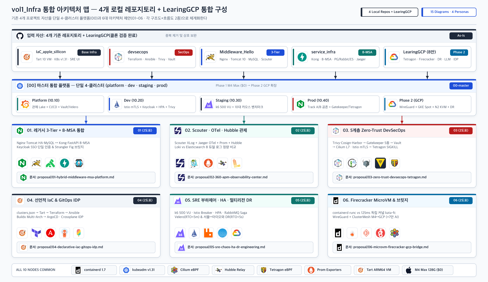

# vol1_Infra 통합 인프라 아키텍처 제안서 (Index)

본 디렉토리는 기존 4개 로컬 인프라·미들웨어·MSA·보안 프로젝트(`IaC_apple_sillicon`, `devsecops`, `Middleware_Hello`, `service_infra`)의 중복 컴포넌트를 제거하고, Apple Silicon M4 Max(128GB RAM) 단일 4-클러스터 Kubernetes 플랫폼으로 통합하는 설계 제안서를 수록한다. Phase 1에서 클라우드 비용 `\$0`으로 로컬 플랫폼을 완성한 뒤, Phase 2에서 [`LearingGCP`](https://github.com/iamywl/LearingGCP) 8대 안건을 적용해 GCP 하이브리드(GKE Spot · GCE N2 Nested KVM · 서울↔아이오와 멀티리전 DR · Crossplane IDP · Hybrid AI Gateway)로 확장한다.



---

## 1. 엔터프라이즈 4대 페르소나 설계·검수 기준 (Review Personas)

모든 제안서 본문과 15종 FigCraft 아키텍처 다이어그램(제안당 배치 구조도 + 실행/차단/장애복구 흐름도 2도표 체계)은 아래 4개 현업 엔지니어링 관점으로 설계·검증했다.

| 페르소나 | 검수 초점 | 본 제안서·다이어그램 적용 결과 |
|---|---|---|
| **P1. 수석 클라우드·시스템 아키텍트** | 하이브리드 경계 명확성, 단일 도표 과밀 방지 | CIDR(`10.10`~`10.40`, GCP `10.50`)·런타임(`runc` vs `kata-fc`) 경계 분리 및 제안당 **토폴로지(A) + 흐름도(B)** 2도표 분할 |
| **P2. 시니어 SRE & 미들웨어 리드** | 오픈소스 공식 아이콘 정확성, 장애·트래픽 추적성 | Scouter·Firecracker·Velero·Kata·Tetragon·Hubble·Cilium·Istio·Harbor·Trivy·OPA·Keycloak 등 전 도구 **공식 풀컬러 로고** 사용 및 `①~⑦` 번호 흐름 매칭 |
| **P3. 엔터프라이즈 테크니컬 디자이너** | 타이포그래피 위계, 절제된 배색, 여백 가독성 | 전 텍스트 **최소 `10.5pt` 이상**, `#FFFFFF` 카드 + `4px` 좌측 액센트 바 + 4대 시맨틱 팔레트(`#1E293B`/`#1D4ED8`/`#0F766E`/`#B91C1C`/`#0369A1`), 박스 내 장문 배제 |
| **P4. DevSecOps & 플랫폼 테크 리드** | 설정·포트·버전 실재성, 문서-도표 1:1 정합 | 실제 레포(`docker-compose.yml`, `requirements.txt`, `kong-config.yaml`, `clusters.json`, `LearingGCP`) 대조 완료 및 Caller→Callee 매트릭스 수록 |

---

## 2. 문서 및 다중 다이어그램 목록 (총 15종)

| 문서 | 제목 | 결합 레포 + `LearingGCP` 매핑 | 도표 A (배치 구조도) | 도표 B (동작·제어 흐름도) |
|---|---|---|---|---|
| **[00](./00-master-integration-roadmap.md)** | **마스터 통합 로드맵** | 전체 4개 레포 + `LearingGCP` 총괄 | [00-A: 4-클러스터 토폴로지](./assets/diagrams/00-master-integration-architecture.png) ([SVG](./assets/diagrams/00-master-integration-architecture.svg)) | [00-B: As-Is → To-Be 중복 제거](./assets/diagrams/00b-as-is-to-be-consolidation.png) ([SVG](./assets/diagrams/00b-as-is-to-be-consolidation.svg)) |
| **[01](./01-hybrid-middleware-msa-platform.md)** | **레거시 3-Tier(WEB/WAS/DB) + 8-MSA 통합** | `Middleware_Hello` + `service_infra` + `IaC` + `GCP 1·2안` | [01-A: Dual-Track 배포 구조](./assets/diagrams/01-proposal1-hybrid-middleware-msa.png) ([SVG](./assets/diagrams/01-proposal1-hybrid-middleware-msa.svg)) | [01-B: Ingress 분기·OIDC·Strangler 흐름](./assets/diagrams/01b-proposal1-request-sso-strangler-flow.png) ([SVG](./assets/diagrams/01b-proposal1-request-sso-strangler-flow.svg)) |
| **[02](./02-360-apm-observability-center.md)** | **Scouter × OpenTelemetry × Hubble 통합 관제 레이크** | `Middleware_Hello` + `service_infra` + `IaC` + `GCP 2안` | [02-A: 에이전트 → Lake · 오프로딩](./assets/diagrams/02-proposal2-360-apm-observability.png) ([SVG](./assets/diagrams/02-proposal2-360-apm-observability.svg)) | [02-B: 5단계 MTTR & Loki vs ES8 비교](./assets/diagrams/02b-proposal2-mttr-correlation-pipeline.png) ([SVG](./assets/diagrams/02b-proposal2-mttr-correlation-pipeline.svg)) |
| **[03](./03-zero-trust-devsecops-tetragon.md)** | **5계층 Zero-Trust DevSecOps & Tetragon SIEM** | `devsecops` + `IaC` + `Middleware_Hello` + `GCP 6안` | [03-A: 5계층 심층 방어 구조](./assets/diagrams/03-proposal3-zero-trust-devsecops.png) ([SVG](./assets/diagrams/03-proposal3-zero-trust-devsecops.svg)) | [03-B: 4대 침해 Kill-Chain 차단 흐름](./assets/diagrams/03b-proposal3-attack-block-sequence.png) ([SVG](./assets/diagrams/03b-proposal3-attack-block-sequence.svg)) |
| **[04](./04-declarative-iac-gitops-idp.md)** | **선언적 IaC 4단계 & Multi-Arch GitOps IDP** | `IaC` + `devsecops` + `service_infra` + `GCP 5·8안` | [04-A: 4단계 선언적 IaC 파이프라인](./assets/diagrams/04-proposal4-declarative-iac-gitops.png) ([SVG](./assets/diagrams/04-proposal4-declarative-iac-gitops.svg)) | [04-B: 환경 승격 & Crossplane 루프](./assets/diagrams/04b-proposal4-env-promotion-crossplane-idp.png) ([SVG](./assets/diagrams/04b-proposal4-env-promotion-crossplane-idp.svg)) |
| **[05](./05-sre-chaos-ha-dr-engineering.md)** | **SRE 트래픽 제어 · 카오스 · HA · 멀티리전 DR** | `IaC` + `Middleware_Hello` + `service_infra` + `GCP 1·4안` | [05-A: 부하·Breaker·Saga·DR 토폴로지](./assets/diagrams/05-proposal5-sre-chaos-ha-dr.png) ([SVG](./assets/diagrams/05-proposal5-sre-chaos-ha-dr.svg)) | [05-B: Bursting & 서울↔아이오와 Failover](./assets/diagrams/05b-proposal5-bursting-multiregion-failover.png) ([SVG](./assets/diagrams/05b-proposal5-bursting-multiregion-failover.svg)) |
| **[06](./06-microvm-firecracker-gcp-bridge.md)** | **다중 런타임(runc + Firecracker) & M4 ↔ GCP 브릿지** | `IaC` + `devsecops` + `GCP 3·7안` | [06-A: M4 ↔ GCP N2 & AI 샌드박스](./assets/diagrams/06-proposal6-microvm-gcp-bridge.png) ([SVG](./assets/diagrams/06-proposal6-microvm-gcp-bridge.svg)) | [06-B: containerd runc vs kata-fc 내부](./assets/diagrams/06b-proposal6-runc-vs-kata-firecracker-internals.png) ([SVG](./assets/diagrams/06b-proposal6-runc-vs-kata-firecracker-internals.svg)) |

---

## 3. 클러스터 · 리소스 배치 및 공통 포트 맵

### 3.1 `clusters.json` 기반 4-클러스터 리소스 할당 (10 VM · 21 vCPU · 68 GB RAM)

| 클러스터 | 노드 구성 (CPU / RAM / Disk) | Pod CIDR | Service CIDR | 핵심 배치 컴포넌트 |
|---|---|---:|---:|---|
| **`platform`** | `platform-master` (2C/4G/20G)<br>`platform-worker1` (3C/12G/20G)<br>`platform-worker2` (2C/8G/20G) | `10.10.0.0/16` | `10.96.0.0/16` | **worker1**: Scouter `2.20.0`, Jaeger, Prometheus/Grafana(`:30300`), AlertManager(`:30903`), Loki, Elasticsearch `8.17.0`, Hubble Relay(`:31235`)<br>**worker2**: Jenkins(`:30900`), ArgoCD `v2.13.2`(`:30800`), Harbor(`:30400`), Vault(`:8200`), Sealed Secrets, Velero/MinIO |
| **`dev`** | `dev-master` (2C/4G/20G)<br>`dev-worker1` (2C/8G/20G) | `10.20.0.0/16` | `10.97.0.0/16` | Istio Service Mesh(`STRICT mTLS`, Canary `80/20`, `OutlierDetection`), Cilium L7 Default-Deny, `metrics-server`+HPA, Trivy Operator, Keycloak(`:30880`) |
| **`staging`** | `staging-master` (2C/4G/20G)<br>`staging-worker1` (2C/8G/20G) | `10.30.0.0/16` | `10.98.0.0/16` | 배포 전 통합 검증, `metrics-server`+HPA, k6 `500 VU` 성능 벤치마크(Tuning 전/후 비교), 10대 카오스 시나리오 검증 |
| **`prod`** | `prod-master` (2C/4G/20G)<br>`prod-worker1` (2C/8G/20G)<br>`prod-worker2` (2C/8G/20G) | `10.40.0.0/16` | `10.99.0.0/16` | **Track A**: Nginx `1.24`, Tomcat 10(#1/#2 HA + Scouter Agent), MySQL `8.0`<br>**Track B**: Kong, 8-MSA(`FastAPI 0.115.6` + OTel), PostgreSQL `16.6.0`, Redis `7.4.2`, RabbitMQ `4.0.5`, ES `8.17.0`<br>**공통 보안**: OPA Gatekeeper(5종), Trivy Operator, Cilium L7 + Tetragon, Velero 백업 대상 |

### 3.2 노출 포트 맵 (NodePort & 내부 통신 포트)

| 서비스 | 클러스터 | 내부 서비스 도메인 | NodePort / 포트 | 프로토콜 | 출처 |
|---|---|---|---:|---|---|
| **SRE Operations Dashboard** | macOS Host | `localhost:5173` (UI) / `:3000` (API) | `5173` / `3000` | HTTP / SSH / WS | `IaC_apple_sillicon` |
| **Grafana** | `platform` | `grafana.monitoring.svc` | `30300` (`:3000`) | HTTP | `IaC_apple_sillicon` |
| **Harbor Registry** | `platform` | `harbor-core.harbor.svc` | `30400` (`:80`) | HTTP/HTTPS OCI | `IaC` + `devsecops` |
| **ArgoCD v2.13.2** | `platform` | `argocd-server.argocd.svc` | `30800` (`:443`) | HTTPS / gRPC | `IaC` + `service` |
| **Keycloak 24.0** | `dev` / `platform` | `keycloak.demo.svc` | `30880` (`:8080`) | HTTP / OIDC | `MW` + `IaC` |
| **Jenkins** | `platform` | `jenkins.jenkins.svc` | `30900` (`:8080`) | HTTP | `IaC_apple_sillicon` |
| **AlertManager** | `platform` | `alertmanager-operated.monitoring.svc` | `30903` (`:9093`) | HTTP | `IaC_apple_sillicon` |
| **Hubble UI / Relay** | `platform` / 전체 | `hubble-ui.kube-system.svc` | `31235` (`:80/:4245`) | HTTP / gRPC | `IaC_apple_sillicon` |
| **NGINX Ingress / Web** | `dev` / `prod` | `nginx-web.demo.svc` | `30080` (`:80/:443`) | HTTP / HTTPS | `IaC` + `MW` |
| **Scouter 2.20.0 Collector** | `platform` | `scouter-server.observability.svc` | `6100` / `6180` | UDP·TCP / HTTP | `Middleware_Hello` |
| **Jaeger / Prometheus / Loki / ES 8** | `platform` / `prod` | 각 네임스페이스 `.svc` | `4317` / `9090` / `3100` / `9200` | gRPC / HTTP | `service` + `IaC` |
| **Vault / Kong / RabbitMQ** | `platform` / `prod` | 각 네임스페이스 `.svc` | `8200` / `8000` / `5672` | HTTP / AMQP | `devsecops` + `service` |
| **WireGuard / ClusterMesh / Istio EW** | Phase 2 Bridge | M4 Host ↔ GCP External IP | `51871` (`51820`) / `2379` / `15443` | UDP / TCP / SNI mTLS | `LearingGCP` |

---

## 4. 다이어그램 소스 관리 (FigCraft MCP)

- **생성 스크립트**: [build_diagrams_via_figcraft_mcp.py](./scripts/build_diagrams_via_figcraft_mcp.py)
- **원본 프로젝트 파일**: [vol1-infra-proposals.figcraft](./assets/diagrams/vol1-infra-proposals.figcraft)
- **공식 아이콘 자산**: [assets/icons/](./assets/icons/) (CNCF Artwork · Scouter · Firecracker · Kata · Trivy · Tetragon · Hubble 공식 풀컬러 아이콘 수록)

```bash
# 전체 15종 다이어그램 재생성 (PNG scale=2 15장 + SVG 14장 + .figcraft 저장)
python3 proposal/scripts/build_diagrams_via_figcraft_mcp.py

# .figcraft 무결성 확인
.tools/bin/figcraft-cli info proposal/assets/diagrams/vol1-infra-proposals.figcraft
```
