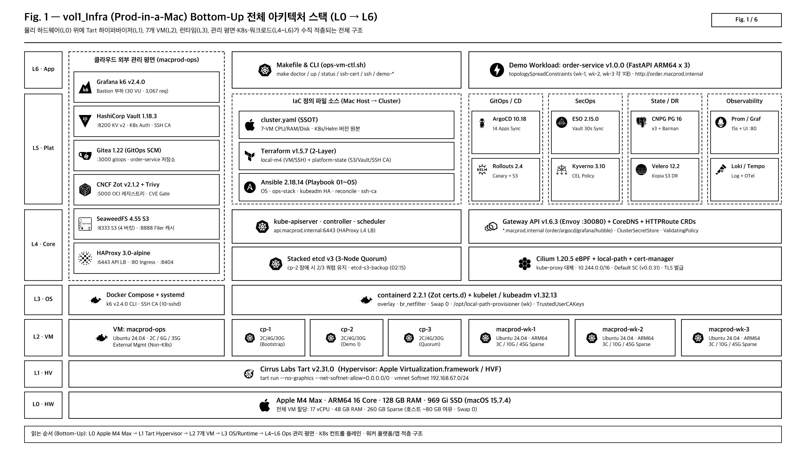
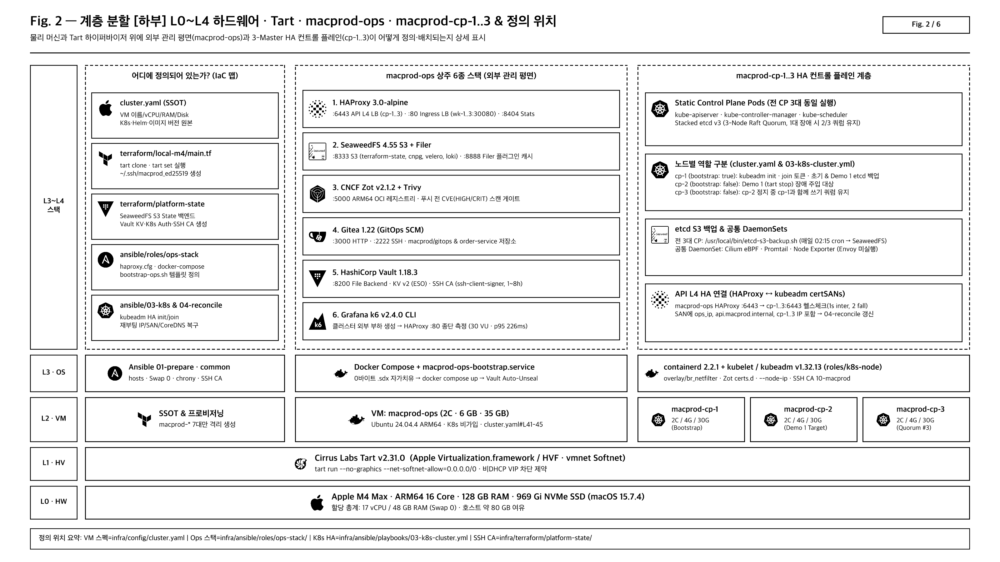
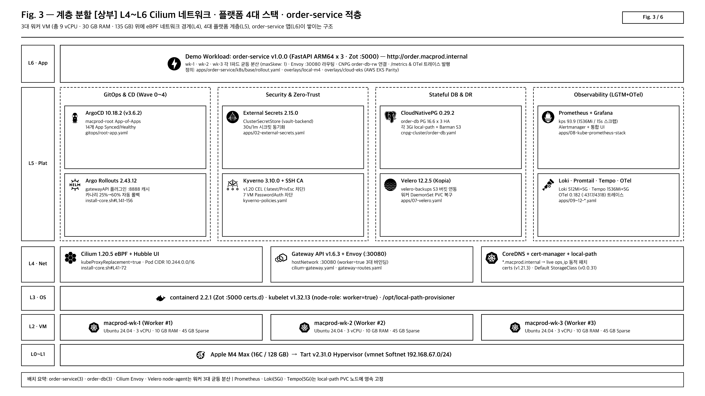
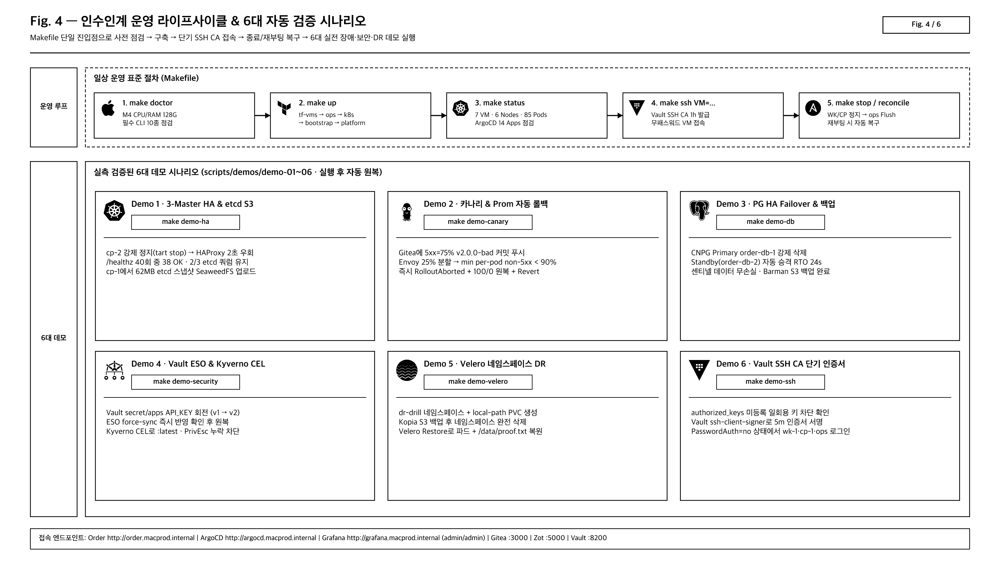
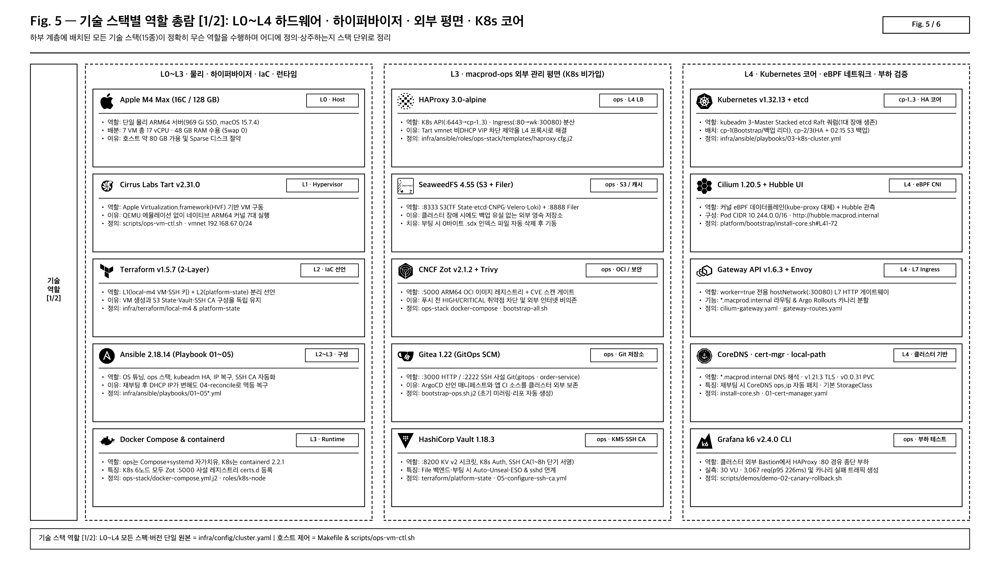
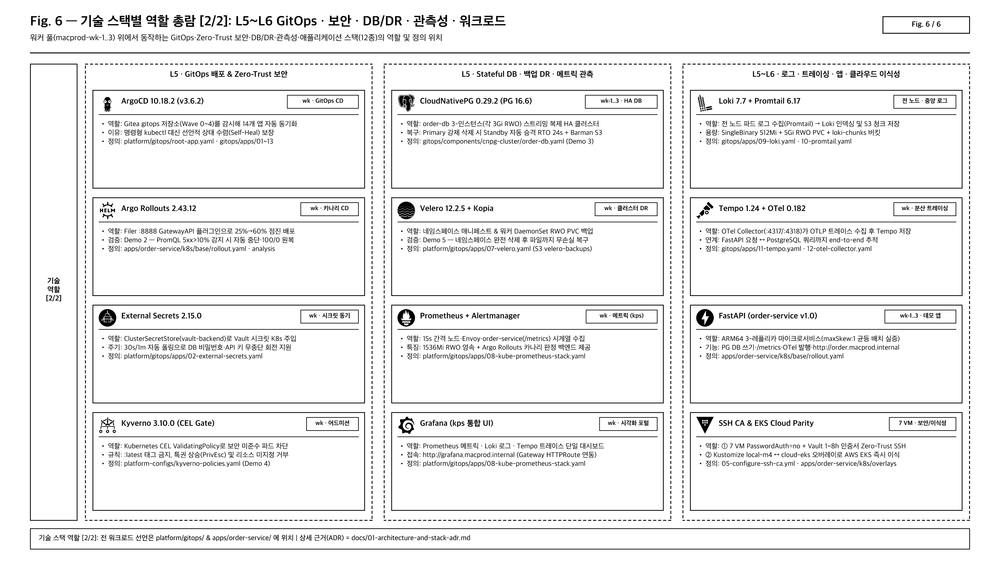

# 00. 인프라 인수인계 & 운영 가이드 (Handover Guide)

본 문서는 `vol1_Infra` (**안 A: 단일 HA 코어 `Prod-in-a-Mac`**)를 처음 인계받는 엔지니어가 **최하위 물리 하드웨어(L0) → 하이퍼바이저(L1) → 7개 VM 스펙 및 정의 파일 위치(L2) → 호스트 런타임/외부 관리 평면(L3) → 컨트롤 플레인·네트워크(L4) → 플랫폼 4대 스택(L5) → 워크로드·운영(L6)** 순으로 계층을 밟아 올라가며 구조를 완전히 이해하고, 즉시 실행·운영·장애 대응까지 수행할 수 있도록 정리한 마스터 가이드이다.

> 모든 다이어그램은 **논문 스타일(흰 바탕 · 검은 테두리 · 순수 검정 모노크롬 오픈소스 아이콘)의 PPT 16:9 와이드 슬라이드 규격(`1600×900` @ 2x PNG / SVG)** 으로 계층 분할(`6장`: [Fig. 1](./diagrams/slide-01-full-stack-architecture.png) ~ [Fig. 6](./diagrams/slide-06-tech-stack-roles-platform-app.png))되어 [docs/diagrams/](./diagrams/)에 저장되어 있으며, [build-handover-diagrams.py](../scripts/build-handover-diagrams.py)로 언제든 재생성할 수 있다.

---

## 1. Bottom-Up 계층 아키텍처 (하드웨어부터 서비스까지)

### Layer 0 → Layer 6 전체 적층 구조 & L0~L2 (물리 하드웨어 · Tart · 7-VM 스펙)



#### Layer 0 — 물리 하드웨어 & 호스트 OS
* **호스트 머신**: `Apple M4 Max` (`ARM64 / aarch64`, 16코어, `128 GB` 통합 메모리, NVMe SSD `969 Gi` 가용 / `1.8 Ti`, `macOS 15.7.4`).
* **자원 배분 총계**: 7개 VM에 총 **`17 vCPU · 48 GB RAM · 260 GB Sparse Disk`** 를 할당한다. 호스트 메모리는 약 **`80 GB` 여유(Swap 0)** 를 유지하며, Sparse 디스크 덕분에 실제 사용한 용량만 디스크를 점유한다.

#### Layer 1 — 하이퍼바이저 (`Cirrus Labs Tart v2.31.0` + `Apple Virtualization.framework`)
* **하이퍼바이저란?**
  단일 물리 Mac 위에서 CPU·메모리·디스크·네트워크를 가상화해 서로 격리된 여러 리눅스 커널(VM)을 동시에 실행하는 계층이다. 이 프로젝트의 **유일한 하이퍼바이저는 `Tart` (내부 Apple VZ 커널 API)** 이다.
* **왜 `Tart`인가?**
  `Tart v2.31.0`은 macOS 커널의 **`Apple Virtualization.framework (HVF)`** 하드웨어 가상화 가속을 직접 호출한다. QEMU/UTM 에뮬레이션이나 Docker Desktop 단일 리눅스 VM(컨테이너 기반 Kind)과 달리, **독립 리눅스 커널 7개를 `x86` 변환 손실 없는 네이티브 ARM64 속도로 구동**하므로 다중 `etcd` 쿼럼·커널 튜닝·`systemd`·네트워크 장애 주입을 프로덕션과 동일하게 검증할 수 있다.
* **가상 스위치 & 실행 특성** ([scripts/ops-vm-ctl.sh](../scripts/ops-vm-ctl.sh#L32)):
  ```bash
  tart run <vm> --no-graphics --net-softnet-allow=0.0.0.0/0
  ```
  * macOS `vmnet Softnet` 가상 스위치가 각 VM에 `192.168.67.0/24` 대역의 동적 DHCP IP를 부여한다.
  * **하이퍼바이저 L2 제약**: `vmnet Softnet`은 게스트 VM이 DHCP로 받은 IP 외의 비DHCP VIP와 Gratuitous ARP를 하이퍼바이저 수준에서 차단한다(따라서 이후 상위 Layer 3에서 `HAProxy`를 외부 LB로 둔다).

#### Layer 2 — 게스트 OS (`Ubuntu 24.04.4 LTS ARM64`) · IaC 프로비저닝 & 7-VM 상세 스펙
* **호스트 제어 CLI**: 호스트(`L0`) 위에서 `Makefile`, `Terraform v1.5.7`, `Ansible 2.18.14`, `kubectl`, `helm`, `jq`, `trivy`가 `Tart` 하이퍼바이저에 명령을 내려 VM을 생성·구성한다 ([ops-vm-ctl.sh](../scripts/ops-vm-ctl.sh) `doctor`로 점검).
* **타 프로젝트 VM 격리**: Terraform과 `ops-vm-ctl.sh`는 `cluster.yaml`에 정의된 `macprod-*` 7대만 제어하며 동일 Mac의 다른 Tart VM을 건드리지 않는다.
* **단일 진실 원천 (SSOT)**: 모든 VM 목록, vCPU, RAM, 디스크 크기, 부트스트랩 리더 여부는 [infra/config/cluster.yaml](../infra/config/cluster.yaml#L40-L78)에 정의되어 있다.
* **프로비저닝 흐름**: [cluster.yaml](../infra/config/cluster.yaml) → [infra/terraform/local-m4/main.tf](../infra/terraform/local-m4/main.tf#L60-L163) (`tart clone` / `tart set --cpu --memory --disk-size` / `~/.ssh/macprod_ed25519` 키 생성) → [scripts/ops-vm-ctl.sh](../scripts/ops-vm-ctl.sh) (`tart run` 및 `hosts.ini` / `generated.yml` 생성) → [common 역할](../infra/ansible/roles/common/tasks/main.yml) (`/etc/hosts`, `swapoff -a`, `chrony`, `unattended-upgrades` 비활성화) → [05-configure-ssh-ca.yml](../infra/ansible/playbooks/05-configure-ssh-ca.yml) (`TrustedUserCAKeys` + `10-macprod-ssh-ca.conf`로 패스워드 로그인 차단).

| VM 이름 | vCPU | RAM | Disk | 역할 & 개별 차이점 | 상주 핵심 기술스택 | 스펙/역할 정의 파일 위치 |
|---|---:|---:|---:|---|---|---|
| **`macprod-ops`** | 2 | 6 GB (`6144 MB`) | 35 GB | **클라우드 외부 관리 평면 & Bastion** (K8s 미가입, 백업·레지스트리·Git·Vault 격리) | `HAProxy 3.0`, `SeaweedFS 4.55`, `Zot v2.1.2`, `Gitea 1.22`, `Vault 1.18.3` (+SSH CA), `k6 v2.4.0` | [cluster.yaml#L41-45](../infra/config/cluster.yaml#L41-L45), [ops-stack](../infra/ansible/roles/ops-stack/tasks/main.yml) |
| **`macprod-cp-1`** | 2 | 4 GB (`4096 MB`) | 30 GB | **Bootstrap Leader (`bootstrap: true`)**, `kubeadm init` 실행, `.kube/config` 추출, **초기/데모 `etcd` S3 백업 실행** | `containerd 2.2.1`, `kubeadm/kubelet v1.32.13`, `apiserver`, `controller`, `scheduler`, `etcd #1`, `etcd-s3-backup` cron, `Cilium/Promtail/node-exporter` | [cluster.yaml#L46-51](../infra/config/cluster.yaml#L46-L51), [03-k8s-cluster.yml](../infra/ansible/playbooks/03-k8s-cluster.yml#L11-L94), [k8s-ha-cluster](../infra/ansible/roles/k8s-ha-cluster/tasks/main.yml) |
| **`macprod-cp-2`** | 2 | 4 GB (`4096 MB`) | 30 GB | **HA Control Plane #2 (`bootstrap: false`)**, `Demo 1` 강제 정지(`tart stop`) 장애 주입 대상 | `cp-1`과 동일한 Control Plane Static Pods(`etcd #2`), `etcd-s3-backup` cron (`02:15`), 공통 DaemonSets | [cluster.yaml#L52-57](../infra/config/cluster.yaml#L52-L57), [03-k8s-cluster.yml#L20-L82](../infra/ansible/playbooks/03-k8s-cluster.yml#L20-L82) |
| **`macprod-cp-3`** | 2 | 4 GB (`4096 MB`) | 30 GB | **HA Control Plane #3 (`bootstrap: false`)**, `cp-2` 장애 시 `cp-1 + cp-3`로 `2/3 etcd` 쿼럼 유지 | `cp-1`과 동일한 Control Plane Static Pods(`etcd #3`), `etcd-s3-backup` cron (`02:15`), 공통 DaemonSets | [cluster.yaml#L58-63](../infra/config/cluster.yaml#L58-L63), [03-k8s-cluster.yml#L20-L82](../infra/ansible/playbooks/03-k8s-cluster.yml#L20-L82) |
| **`macprod-wk-1`** | 3 | 10 GB (`10240 MB`) | 45 GB | **Worker Pool #1** (`node-role.kubernetes.io/worker=true`), Envoy `:30080` 수신, `/opt/local-path-provisioner` | `containerd 2.2.1`, `kubelet v1.32.13`, `Cilium Envoy :30080`, `order-service` x1, `order-db` x1 + K8s 플랫폼/관측성 파드 분산 | [cluster.yaml#L64-68](../infra/config/cluster.yaml#L64-L68), [install-core.sh](../platform/bootstrap/install-core.sh), [gitops/apps/](../platform/gitops/apps/) |
| **`macprod-wk-2`** | 3 | 10 GB (`10240 MB`) | 45 GB | **Worker Pool #2** (`worker=true`), Envoy `:30080` 수신, `/opt/local-path-provisioner` | `wk-1`과 동일(Envoy `:30080`, `order-service` x1, `order-db` x1, Velero `node-agent`, `Promtail`, 플랫폼/관측성 파드 분산) | [cluster.yaml#L69-73](../infra/config/cluster.yaml#L69-L73), [rollout.yaml](../apps/order-service/k8s/base/rollout.yaml) |
| **`macprod-wk-3`** | 3 | 10 GB (`10240 MB`) | 45 GB | **Worker Pool #3** (`worker=true`), Envoy `:30080` 수신, `/opt/local-path-provisioner` | `wk-1`과 동일(Envoy `:30080`, `order-service` x1, `order-db` x1, Velero `node-agent`, `Promtail`, 플랫폼/관측성 파드 분산) | [cluster.yaml#L74-78](../infra/config/cluster.yaml#L74-L78), [order-db.yaml](../platform/gitops/components/cnpg-cluster/order-db.yaml) |

---

### 계층 분할 [하부] — Layer 3~4: IaC 정의 매핑 · `macprod-ops` 외부 평면 · `macprod-cp-1..3` HA 컨트롤 플레인



* **외부 관리 평면 배치 이유 (`macprod-ops`, `2C / 6 GB / 35 GB`)**: Terraform State, `etcd` 스냅샷, PG WAL 백업, Git 저장소, OCI 레지스트리, 시크릿 Vault를 Kubernetes **바깥(`macprod-ops`)** 에 두어 부트스트랩 순환 의존성과 클러스터 장애 시 백업 동반 유실 문제를 제거한다.
* **정의 파일**: [infra/ansible/roles/ops-stack/tasks/main.yml](../infra/ansible/roles/ops-stack/tasks/main.yml), [docker-compose.yml.j2](../infra/ansible/roles/ops-stack/templates/docker-compose.yml.j2), [haproxy.cfg.j2](../infra/ansible/roles/ops-stack/templates/haproxy.cfg.j2), [bootstrap-ops.sh.j2](../infra/ansible/roles/ops-stack/templates/bootstrap-ops.sh.j2), [platform-state/main.tf](../infra/terraform/platform-state/main.tf).
* **기동 보장 (`macprod-ops-bootstrap.service`)**: VM 부팅 시 `docker.service` 이후 자동 실행되어 `0바이트 .sdx` 정리 → `docker compose up -d` → Vault JSON 헬스 대기 및 Auto-Unseal → S3 버킷 4종(`terraform-state`, `cnpg-backups`, `velero-backups`, `loki-chunks`)·Gitea 저장소·Rollouts 플러그인(`:8888/assets/gatewayapi-plugin-linux-arm64`) 캐싱을 보장한다.
* **3-Master HA 컨트롤 플레인 (`cp-1..3`, 각 `2C / 4 GB / 30 GB`)**: [kubeadm-config.yaml.j2](../infra/ansible/roles/k8s-ha-cluster/templates/kubeadm-config.yaml.j2)로 `addon/kube-proxy`를 건너뛰고(`skipPhases`), `controlPlaneEndpoint: api.macprod.internal:6443`와 전 CP SAN을 발급해 3-노드 Stacked `etcd` 클러스터를 구성한다([03-k8s-cluster.yml](../infra/ansible/playbooks/03-k8s-cluster.yml)).

---

### 계층 분할 [상부] — Layer 4~6: Cilium 네트워크 · 4대 플랫폼 스택 · `macprod-wk-1..3` 워크로드



* **Layer 4 (CNI · DNS · Ingress 경계)**: [install-core.sh](../platform/bootstrap/install-core.sh)가 `Gateway API v1.6.3` CRD → `Cilium 1.20.5`(`kubeProxyReplacement: true`, Pod CIDR `10.244.0.0/16`, `worker=true` 전용 `hostNetwork :30080` Envoy) → `CoreDNS` `*.macprod.internal` hosts 패치 → `local-path-provisioner v0.0.31` → `macprod-gateway`([cilium-gateway.yaml](../platform/bootstrap/cilium-gateway.yaml)) → `ArgoCD`/`Argo Rollouts`를 설치한다.
* **Layer 5~6 배치 원칙 (`wk-1..3`, 각 `3C / 10 GB / 45 GB`)**:
  * **3대 워커 균등 분산**: `Cilium Envoy :30080`, `order-service` × `3` (`topologySpreadConstraints: maxSkew: 1` in [rollout.yaml](../apps/order-service/k8s/base/rollout.yaml#L41-L47)), `order-db` PostgreSQL `16.6` × `3` (CNPG 기본 anti-affinity + 각 `3Gi local-path` PVC), `Velero node-agent` DaemonSet.
  * **StatefulSet PVC 고정**: `Prometheus` (`1536Mi`), `Loki` (`SingleBinary`, `512Mi` + `5Gi` PVC), `Tempo` (`1536Mi` + `5Gi` PVC)는 `local-path` `ReadWriteOnce` 특성상 최초 스케줄링된 워커 노드의 `/opt/local-path-provisioner` 디스크에 영속 바인딩된다. (`kubectl get pods -A -o wide`로 실시간 위치 확인)
* **GitOps 의존성 순서 ([root-app.yaml](../platform/gitops/root-app.yaml) & [apps/](../platform/gitops/apps/))**: `Wave 0~4`를 통해 `cert-manager` → `external-secrets` / `kyverno` / `cloudnative-pg` → `platform-configs` / `cnpg-cluster` → `velero` / `kube-prometheus-stack` / `loki` / `promtail` / `tempo` / `otel-collector` → `order-service` 순서로 자동 배포된다.

---

## 2. 처음 실행하는 방법 (사전 점검 → Zero-to-Ready)

### Step 1. 사전 도구 점검 (`make doctor`)
```bash
cd /Users/ywlee/sideproejct/INFRA/vol1_Infra
make doctor
```
> `[MISSING]`이 있으면 Homebrew(`tart`, `terraform`, `ansible`, `helm`, `kubectl`, `sshpass`, `jq`, `trivy`) 및 `pip3 install pyyaml`을 설치한다.

### Step 2. 백지 상태에서 일괄 구축 (`make up`) 또는 단계별 실행
```bash
make up
```
| 순서 | `Makefile` 타깃 | 실행 대상 | 수행 작업 |
|---|---|---|---|
| **1** | `make tf-vms` | [infra/terraform/local-m4](../infra/terraform/local-m4/main.tf) | 7개 Tart VM 생성·기동, `~/.ssh/macprod_ed25519` 키 주입, `hosts.ini`·`generated.yml` 생성 |
| **2** | `make ansible-all` | `01-prepare-all` → `02-ops-node` → `03-k8s-cluster` | OS 튜닝, `macprod-ops` 6종 스택, 3-Master HA K8s 부트스트랩 및 `.kube/config` 추출 |
| **3** | `make bootstrap` | [platform/bootstrap/install-core.sh](../platform/bootstrap/install-core.sh) | Gateway API, Cilium eBPF, CoreDNS, `local-path`, ArgoCD, Argo Rollouts 설치 |
| **4** | `make platform` | [scripts/bootstrap-all.sh](../scripts/bootstrap-all.sh) | Layer-2 Terraform(S3 State, Vault KV/K8s Auth/**SSH CA**), [05-configure-ssh-ca.yml](../infra/ansible/playbooks/05-configure-ssh-ca.yml), `order-service:v1.0.0` Zot 푸시/Trivy 스캔, Gitea GitOps 14앱 동기화 |

### Step 3. 구축 완료 검증 (`make status`)
```bash
make status
KUBECONFIG=.kube/config kubectl -n argocd get applications
```
정상 기준: `7 VM running` · `6 Nodes Ready` · `ArgoCD 14/14 Synced / Healthy` · `non_ready=0`.

---

## 3. 일상 운영 라이프사이클 & 6대 자동 검증 시나리오



| 상황 | 실행 명령 | 내부 동작 설명 |
|---|---|---|
| **상태 점검** | `make status` | `tart` VM 7대 상태/IP + `kubectl get nodes` + `kubectl get pods -A` 출력 |
| **SSH CA 단기 인증서 접속** | `make ssh-cert` / `make ssh VM=<이름>` | Vault `ssh-client-signer`로 `macprod_user_ed25519-cert.pub`(기본 `1h`, 최대 `8h`) 서명 발급 및 `.runtime/ssh/config` 최신화 → 만료 시 자동 재발급 후 접속 |
| **안전 종료 (작업 마감)** | `make stop` | Worker/CP VM 먼저 정지 후 `macprod-ops` Docker Compose를 25초 유예로 Flush 종료하고 마지막에 `macprod-ops` 정지 |
| **재기동 & IP 드리프트 복구** | `make reconcile` | 7대 부팅 & SSH 대기 → IP 인벤토리 갱신 → `/etc/hosts`, HAProxy, Vault HCL·K8s Auth, API SAN, `Zot certs.d`, `.kube/config`, `CoreDNS`, `Cilium`, Vault Auto-Unseal, SeaweedFS `.sdx` 치유, `/readyz` 대기, `05-configure-ssh-ca.yml` 동기화 |
| **전체 환경 파기** | `make destroy` | Layer-1 Terraform으로 `macprod-*` 7개 VM 삭제 및 `.runtime`, `.kube` 정리 |

---

## 4. 디렉터리 구조 및 수정 포인트 매핑

| 영역 | 경로 | 역할 및 수정 시점 |
|---|---|---|
| **단일 진실 원천 (SSOT)** | [infra/config/cluster.yaml](../infra/config/cluster.yaml) | VM 대수/CPU/RAM/디스크, K8s·Helm·컨테이너 버전, SSH 경로 일괄 수정 |
| **진입점 CLI** | [Makefile](../Makefile) | 운영·구축·SSH·데모 전체 단축 명령 정의 |
| **VM 수명주기 / SSH CA** | [scripts/ops-vm-ctl.sh](../scripts/ops-vm-ctl.sh) | `doctor`, `ensure-vm`, `start-all`, `stop-all`, `ssh-cert`, `ssh`, `status` |
| **Day-2 부트스트랩** | [scripts/bootstrap-all.sh](../scripts/bootstrap-all.sh) | 인벤토리 재생성(`refresh-inventory`), S3 Terraform 적용·SSH CA·앱 빌드·Gitea 푸시(`sync-platform`) |
| **Layer-1 IaC** | [infra/terraform/local-m4/](../infra/terraform/local-m4/main.tf) | 로컬 Tart VM 생성 및 SSH/인벤토리 렌더링 |
| **Layer-2 IaC (S3 State)** | [infra/terraform/platform-state/](../infra/terraform/platform-state/main.tf) | SeaweedFS S3 백엔드, Vault KV·K8s Auth·SSH CA(`ssh-client-signer`), K8s 네임스페이스 거버넌스 |
| **Cloud Parity IaC** | [infra/terraform/cloud-aws-eks/](../infra/terraform/cloud-aws-eks/main.tf) | AWS EKS Graviton(ARM64) 이식용 참조 Terraform 모듈 |
| **Ops 호스트 스택** | [infra/ansible/roles/ops-stack/](../infra/ansible/roles/ops-stack/tasks/main.yml) | `haproxy.cfg.j2`, `docker-compose.yml.j2`, `vault.hcl.j2`, `bootstrap-ops.sh.j2` |
| **K8s 노드 & HA 클러스터** | [roles/k8s-node](../infra/ansible/roles/k8s-node/tasks/main.yml) · [roles/k8s-ha-cluster](../infra/ansible/roles/k8s-ha-cluster/tasks/main.yml) | 커널/sysctl/`containerd`/`kubelet` 설정, 3-Master `kubeadm` HA, `etcd-s3-backup` |
| **재부팅 / SSH CA 플레이북** | [04-reconcile-ip-drift.yml](../infra/ansible/playbooks/04-reconcile-ip-drift.yml) · [05-configure-ssh-ca.yml](../infra/ansible/playbooks/05-configure-ssh-ca.yml) | DHCP IP 드리프트 멱등 복구 및 전 VM `TrustedUserCAKeys`/`PasswordAuthentication no` 강제 |
| **Day-1 CNI/GitOps** | [platform/bootstrap/install-core.sh](../platform/bootstrap/install-core.sh) | Gateway API, Cilium, Envoy, `local-path`, ArgoCD, Argo Rollouts |
| **GitOps App-of-Apps** | [platform/gitops/root-app.yaml](../platform/gitops/root-app.yaml) & [apps/](../platform/gitops/apps/) | ArgoCD `Wave 0~4` 12개 플랫폼·관측성·DB·앱 Release 정의 (`01~13`) |
| **플랫폼 컴포넌트** | [platform/gitops/components/](../platform/gitops/components/) | `cert-manager` Issuer, `Gateway HTTPRoute`, `Kyverno` CEL, `Vault ClusterSecretStore`, `order-db` (`PG 16 x 3`) |
| **데모 앱 (FastAPI)** | [apps/order-service/](../apps/order-service/) | `app/main.py`, `Dockerfile`(ARM64), Kustomize `base/` · `overlays/local-m4` · `overlays/cloud-eks` |
| **데모 & 부하 스크립트** | [scripts/demos/](../scripts/demos/) & [tests/k6/canary-load.js](../tests/k6/canary-load.js) | `demo-01..06` 자동 데모 및 `k6` 부하 스크립트 |
| **PPT 16:9 슬라이드 생성기** | [scripts/build-handover-diagrams.py](../scripts/build-handover-diagrams.py) | FigCraft MCP로 논문 스타일(순수 흑백 모노크롬) 6장 PNG/SVG 슬라이드 재생성 (`docs/diagrams/`) |

---

## 4-1. 계층별 기술 스택 역할 총람 (Tech Stack Role Catalog)

각 계층에 배치된 개별 기술 스택이 **무슨 역할을 담당하는지**, **왜 이 위치에 두었는지**, **실제 정의·설정 파일이 어디 있는지** 한눈에 확인한다.



### [1/2] L0~L4 인프라 · 하이퍼바이저 · 외부 관리 평면(`macprod-ops`) · K8s 코어 & 네트워크
| 계층 | 기술 스택 | 핵심 역할 및 채택 이유 | 상주 VM / 정의 위치 |
|---|---|---|---|
| **L0** | **Apple M4 Max** | ARM64 16코어 · 128 GB RAM 단일 물리 서버 (`969 Gi SSD`). 7 VM 합계 `17 vCPU · 48 GB` 수용 후 약 `80 GB` 여유 유지 | 물리 호스트 (`macOS 15.7.4`) |
| **L1** | **Cirrus Labs Tart v2.31.0** | `Apple Virtualization.framework (HVF)` 호출 하이퍼바이저. QEMU 에뮬레이션 없이 네이티브 ARM64 리눅스 VM 7대 구동 (`vmnet 192.168.67.0/24`) | Mac 호스트 / [ops-vm-ctl.sh](../scripts/ops-vm-ctl.sh) |
| **L2** | **Terraform v1.5.7** | **L1 (`local-m4`)**로 Tart VM 7대·SSH 키 생성, **L2 (`platform-state`)**로 SeaweedFS S3 백엔드에 Vault·SSH CA·네임스페이스 선언 | [local-m4/main.tf](../infra/terraform/local-m4/main.tf), [platform-state/main.tf](../infra/terraform/platform-state/main.tf) |
| **L2~L3** | **Ansible 2.18.14** | OS 튜닝(Swap 0), `macprod-ops` 구축, `kubeadm` HA 클러스터링, 재부팅 IP 복구(`04`), SSH CA 강제(`05`) 멱등 자동화 | [playbooks/01~05](../infra/ansible/playbooks/04-reconcile-ip-drift.yml) |
| **L3** | **Docker Compose & containerd** | `ops` VM은 Compose + `systemd` 자가치유로 6종 관리 서비스 구동; K8s 6노드는 `containerd 2.2.1` + `Zot :5000 certs.d` 미러 사용 | [docker-compose.yml.j2](../infra/ansible/roles/ops-stack/templates/docker-compose.yml.j2), [k8s-node](../infra/ansible/roles/k8s-node/tasks/main.yml) |
| **L3 (`ops`)** | **HAProxy 3.0-alpine** | Tart `vmnet`의 비DHCP VIP 차단 제약을 대체하는 외부 L4 로드밸런서 (`:6443` K8s API HA, `:80` Envoy Ingress, `:8404` Stats) | `macprod-ops` / [haproxy.cfg.j2](../infra/ansible/roles/ops-stack/templates/haproxy.cfg.j2) |
| **L3 (`ops`)** | **SeaweedFS 4.55 (S3 + Filer)** | `:8333` S3(`terraform-state`, `cnpg-backups`, `velero-backups`, `loki-chunks`) 및 `:8888` Filer 바이너리 캐시. 부팅 시 0바이트 `.sdx` 자가치유 | `macprod-ops` / [bootstrap-ops.sh.j2](../infra/ansible/roles/ops-stack/templates/bootstrap-ops.sh.j2) |
| **L3 (`ops`)** | **CNCF Zot v2.1.2 + Trivy** | `:5000` ARM64 사설 OCI 이미지 레지스트리 및 푸시 전 `HIGH/CRITICAL` CVE 스캔 게이트 | `macprod-ops` / [bootstrap-all.sh](../scripts/bootstrap-all.sh) |
| **L3 (`ops`)** | **Gitea 1.22** | `:3000` HTTP / `:2222` SSH 사설 Git 저장소(`macprod/gitops`, `order-service`). ArgoCD 선언과 앱 소스를 클러스터 외부 보존 | `macprod-ops` / [bootstrap-ops.sh.j2](../infra/ansible/roles/ops-stack/templates/bootstrap-ops.sh.j2) |
| **L3 (`ops`)** | **HashiCorp Vault 1.18.3** | `:8200` 중앙 KMS (KV v2 시크릿, K8s Auth) 및 **SSH CA (`ssh-client-signer`)** 1~8시간 단기 인증서 서명, 부팅 Auto-Unseal | `macprod-ops` / [05-configure-ssh-ca.yml](../infra/ansible/playbooks/05-configure-ssh-ca.yml) |
| **L4** | **Kubernetes v1.32.13 + etcd** | `kubeadm` 기반 3-Master HA 컨트롤 플레인(`cp-1` 리더, `cp-2/3` 쿼럼). Stacked `etcd` 매일 `02:15` S3 자동 스냅샷 백업 | `cp-1..3`, `wk-1..3` / [03-k8s-cluster.yml](../infra/ansible/playbooks/03-k8s-cluster.yml) |
| **L4** | **Cilium 1.20.5 + Hubble UI** | `kube-proxy`를 대체하는 eBPF 커널 네트워크(Pod CIDR `10.244.0.0/16`) 및 L3/L4/L7 트래픽 가시화(`hubble.macprod.internal`) | 전 K8s 노드 / [install-core.sh](../platform/bootstrap/install-core.sh) |
| **L4** | **Gateway API v1.6.3 + Envoy** | 워커 전용(`worker=true`) `hostNetwork :30080` 바인딩 L7 게이트웨이. `*.macprod.internal` 라우팅 및 카나리 트래픽 분할 | `wk-1..3` / [cilium-gateway.yaml](../platform/bootstrap/cilium-gateway.yaml) |
| **L4** | **CoreDNS · cert-manager · local-path** | `*.macprod.internal` 동적 DNS(`ops_ip`), TLS 인증서 자동 발급(`v1.21.3`), 워커 로컬 RWO 스토리지(`v0.0.31`) 동적 프로비저닝 | K8s 내부 / [install-core.sh](../platform/bootstrap/install-core.sh), [01-cert-manager.yaml](../platform/gitops/apps/01-cert-manager.yaml) |
| **L3~L6** | **Grafana k6 v2.4.0** | `macprod-ops` Bastion에서 HAProxy `:80` 경유 실트래픽 부하(`30 VU · 3,067 req`) 및 카나리 오류 시나리오 검증 | `macprod-ops` / [canary-load.js](../tests/k6/canary-load.js) |



### [2/2] L5~L6 GitOps · 보안 · DB/DR · 관측성 · 워크로드
| 계층 | 기술 스택 | 핵심 역할 및 채택 이유 | 상주 VM / 정의 위치 |
|---|---|---|---|
| **L5** | **ArgoCD 10.18.2 (`v3.6.2`)** | `macprod-root` App-of-Apps(`Wave 0~4`)로 Gitea 선언 14개 애플리케이션을 자동 Sync/Healthy 수렴 | `wk-1..3` / [root-app.yaml](../platform/gitops/root-app.yaml) |
| **L5** | **Argo Rollouts 2.43.12** | SeaweedFS Filer `:8888` Gateway API 플러그인으로 `25%→60%` 카나리 배포 및 Prometheus 5xx 감지 시 자동 롤백 | `wk-1..3` / [rollout.yaml](../apps/order-service/k8s/base/rollout.yaml) |
| **L5** | **External Secrets 2.15.0** | `ClusterSecretStore(vault-backend)`로 Vault 시크릿을 `30s/1m` 주기로 Kubernetes `Secret`에 안전하게 동기화 | `wk-1..3` / [02-external-secrets.yaml](../platform/gitops/apps/02-external-secrets.yaml) |
| **L5** | **Kyverno 3.10.0** | Kubernetes CEL 기반 `ValidatingPolicy`로 `:latest` 이미지 태그, 권한 상승(`PrivEsc`), 리소스 제한 누락 차단 | `wk-1..3` / [kyverno-policies.yaml](../platform/gitops/components/platform-configs/kyverno-policies.yaml) |
| **L5** | **CloudNativePG 0.29.2 (`PG 16.6`)** | 3-인스턴스(`3Gi local-path`) 스트리밍 복제 HA DB. Primary 장애 시 자동 Failover(RTO `24s`) 및 Barman S3 백업 | `wk-1..3` / [order-db.yaml](../platform/gitops/components/cnpg-cluster/order-db.yaml) |
| **L5** | **Velero 12.2.5 + Kopia** | 네임스페이스 리소스와 워커 DaemonSet `local-path` RWO PVC 데이터를 SeaweedFS `velero-backups` S3로 백업·복원 | `wk-1..3` / [07-velero.yaml](../platform/gitops/apps/07-velero.yaml) |
| **L5** | **Prometheus + Alertmanager** | `kube-prometheus-stack 93.9` (`15s` 스크랩, `1536Mi` PVC) 시계열 메트릭 수집 및 Rollouts 카나리 판정 메트릭 제공 | `wk-1..3` / [08-kube-prometheus-stack.yaml](../platform/gitops/apps/08-kube-prometheus-stack.yaml) |
| **L5** | **Grafana** | `http://grafana.macprod.internal`에서 메트릭(Prometheus) · 로그(Loki) · 분산 트레이스(Tempo) 통합 관제 UI 제공 | `wk-1..3` / [08-kube-prometheus-stack.yaml](../platform/gitops/apps/08-kube-prometheus-stack.yaml) |
| **L5** | **Loki 7.7 + Promtail 6.17** | 전 노드 컨테이너 로그를 `Promtail` DaemonSet으로 수집해 `Loki`(`512Mi` + `5Gi` + S3 청크)에 인덱싱 저장 | `wk-1..3` + 전 노드 / [09-loki.yaml](../platform/gitops/apps/09-loki.yaml), [10-promtail.yaml](../platform/gitops/apps/10-promtail.yaml) |
| **L5** | **Tempo 1.24 + OTel 0.182** | `OTel Collector`(`:4317/:4318`)가 수집한 OTLP 트레이스를 `Tempo`(`1536Mi` + `5Gi` PVC)에 저장해 end-to-end 추적 | `wk-1..3` / [11-tempo.yaml](../platform/gitops/apps/11-tempo.yaml), [12-otel-collector.yaml](../platform/gitops/apps/12-otel-collector.yaml) |
| **L6** | **FastAPI (`order-service v1.0.0`)** | ARM64 3-레플리카(`maxSkew: 1` 워커 3대 분산) 실증 데모 API. CNPG DB 쓰기, `/metrics` & OTel 트레이스 발행 | `wk-1..3` / [rollout.yaml](../apps/order-service/k8s/base/rollout.yaml) |
| **L2~L6** | **Vault SSH CA & EKS Cloud Parity** | 전 7 VM `PasswordAuth=no` + 1~8h 단기 SSH 인증서 운영 & Kustomize `local-m4`/`cloud-eks` 오버레이로 AWS EKS 즉시 이식 | 전 VM / [05-configure-ssh-ca.yml](../infra/ansible/playbooks/05-configure-ssh-ca.yml), [cloud-aws-eks](../infra/terraform/cloud-aws-eks/main.tf) |

---

## 5. 접속 엔드포인트 · 계정 · S3 버킷 치트시트

```bash
OPS_IP=$(cat .runtime/vm-ips/macprod-ops.ip)
```

브라우저에서 도메인으로 열려면 `/etc/hosts`에 아래 한 줄을 추가하고, CLI 검증만 한다면 `curl -H "Host: ..."`를 사용한다.

```text
<OPS_IP>  api.macprod.internal ops.macprod.internal gitea.macprod.internal zot.macprod.internal s3.macprod.internal vault.macprod.internal grafana.macprod.internal argocd.macprod.internal order.macprod.internal hubble.macprod.internal
```

| 서비스 | URL (도메인 / 포트) | 인증 정보 및 조회 명령 |
|---|---|---|
| **Order Service API** | `http://order.macprod.internal` (`/api/v1/version`, `/healthz`, `/api/v1/orders`) | 인증 없음 (내부 `Vault`에서 `API_KEY` 동적 주입) |
| **ArgoCD UI** | `http://argocd.macprod.internal` | 사용자 `admin` / 비밀번호: `KUBECONFIG=.kube/config kubectl -n argocd get secret argocd-initial-admin-secret -o jsonpath='{.data.password}' \| base64 -d; echo ""` |
| **Grafana UI** | `http://grafana.macprod.internal` | `admin` / `admin` ([08-kube-prometheus-stack.yaml](../platform/gitops/apps/08-kube-prometheus-stack.yaml#L38-L39)) |
| **Hubble UI** | `http://hubble.macprod.internal` | 인증 없음 (Cilium L3/L4/L7 플로우 관제) |
| **Kubernetes API** | `https://<OPS_IP>:6443` | `.kube/config` (`make up` / `make reconcile` 자동 갱신) |
| **Gitea (GitOps SCM)** | `http://<OPS_IP>:3000` (`gitops`, `order-service`) | `macprod` / `MacprodGitOps2026!` |
| **CNCF Zot Registry** | `http://<OPS_IP>:5000` (`apps/order-service:v1.0.0`) | 사설 레지스트리 (노드 `containerd` `certs.d` 등록됨) |
| **HashiCorp Vault** | `http://<OPS_IP>:8200` | `root_token` 및 Unseal 키: `make ssh VM=macprod-ops CMD="sudo cat /opt/macprod/vault/init.json"` |
| **SeaweedFS S3 / Filer** | S3 `http://<OPS_IP>:8333` · Filer `http://<OPS_IP>:8888` | `macprod-s3-admin` / `macprod-s3-secret-2026` |
| **HAProxy Stats UI** | `http://<OPS_IP>:8404/stats` | Kubernetes API(`6443`) 및 Worker Ingress(`30080`) 백엔드 헬스 모니터링 |

### SeaweedFS S3 버킷 용도
* `terraform-state`: Layer-2 `platform-state` 원격 상태 파일 + `etcd` 스냅샷(`etcd-backups/`)
* `cnpg-backups`: `CloudNativePG` `order-db` Basebackup 및 Barman WAL 아카이브
* `velero-backups`: `Velero` (`Kopia`) 네임스페이스 및 `local-path` PVC 스냅샷
* `loki-chunks`: Loki 오브젝트 스토리지 확장용 버킷 (+ Filer `/assets/`로 `gatewayapi-plugin-linux-arm64` 캐싱 겸용)

---

## 6. 6대 검증 데모 & 장애 진단 치트시트

```bash
make demo-ha        # Demo 1: cp-2 강제 중지 무중단 & 62MB etcd S3 백업
make demo-canary    # Demo 2: v2.0.0-bad 75% 5xx 푸시 -> Prom 감지 자동 롤백 & Revert 복구
make demo-db        # Demo 3: PG Primary 강제 삭제 -> Standby 승격(RTO ~24s) & S3 백업
make demo-security  # Demo 4: Vault->ESO 시크릿 회전(v1->v2) & Kyverno :latest/PrivEsc 차단
make demo-velero    # Demo 5: dr-drill 네임스페이스+PVC 백업 -> 삭제 -> S3 복구
make demo-ssh       # Demo 6: Vault SSH CA 5분 단기 인증서 발급 & 비등록 키·패스워드 인증 차단 검증
```

* 세부 실행 절차는 [02. Demo 실행 가이드 (Runbook)](./02-demo-runbook.md), 스택 선택 이유는 [01. 아키텍처 및 기술 스택 선정 근거 (ADR)](./01-architecture-and-stack-adr.md), 실측 해결된 `25건`의 버그는 [03. 트러블슈팅 & 버그 로그](./03-troubleshooting-buglog.md), 실시간 웹 UI·CLI 캡처 증빙 16종은 [04. 실측 검증 & 캡처 증빙](./04-verification-evidence.md)을 참고한다.

1. **재부팅 직후 `kubectl` 연결 실패 / VM 접속 불가** → `make reconcile` 실행.
2. **`ExternalSecret` 오류 / SSH 인증서 서명 실패** → Vault `sealed` 여부 확인 (`curl -s http://$(cat .runtime/vm-ips/macprod-ops.ip):8200/v1/sys/health | jq '{initialized, sealed}'`) 후 `make reconcile`.
3. **`CloudNativePG` Standby S3 복구 정체 (`InternalError`)** → SeaweedFS 빈 `.sdx` 여부 확인(`Bug #22`), `bootstrap-ops.sh` 또는 `make reconcile`로 자가치유.
4. **Argo Rollouts 플러그인 크래시** → `curl -sI http://$(cat .runtime/vm-ips/macprod-ops.ip):8888/assets/gatewayapi-plugin-linux-arm64` (`200 OK`) 확인 (`Bug #17`).
