# 04. 실측 검증 & 실시간 웹 UI · CLI 캡처 증빙 (Verification Evidence)

본 문서는 `2026-11-27` 기준 **`make stop` → `make reconcile` 콜드 재기동 → `Demo 1`~`Demo 6` 전 시나리오 → `k6` 30 VU 부하 테스트 → 전체 웹 대시보드 UI 브라우저 실물 접속**까지 전 과정을 실제로 실행하며 확보한 **실시간 웹 UI 브라우저 캡처 8종**과 **CLI 실행 로그 캡처 8종**을 정리한 증빙 아카이브이다.

---

## 1. 실시간 웹 UI 브라우저 캡처 (`docs/captures/ui-*`)

클러스터 재기동(`192.168.67.25` ops IP 기준) 및 전체 데모 완료 상태에서 실제 브라우저로 각 관리 평면·클러스터 UI에 접속해 동작 상태를 직접 확인·촬영했다.

### 1-1. HAProxy 3.0.31 Stats (`http://<OPS_IP>:8404/stats`)
* **검증 내용**: `k8s_cp_nodes` (`cp-1..3` `:6443`)와 `k8s_gateway_workers` (`wk-1..3` `:30080`) 모두 `UP` 상태로 복구되었으며, `macprod-cp-2`의 `Demo 1` 강제 중단·복구 이력(`Dwn: 1, Dwntme: 52s`) 및 워커 3대 균등 분산(`1,318~1,319` 세션)이 실시간 지표에 반영되어 있다.
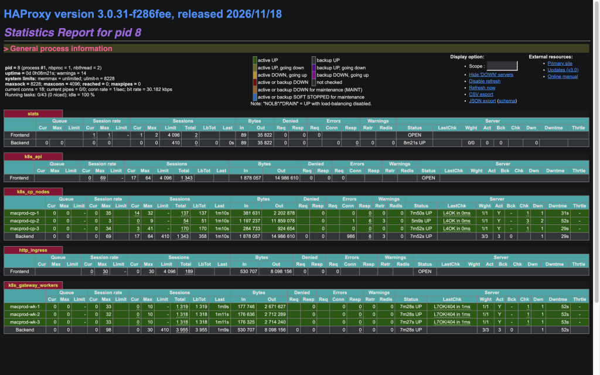

### 1-2. ArgoCD v3.6.2 Applications (`http://argocd.macprod.internal`)
* **검증 내용**: App-of-Apps(`macprod-root`) 산하 **14 / 14 애플리케이션** 전체가 **`Synced / Healthy`** (OutOfSync `0`, Degraded `0`) 상태를 유지한다.
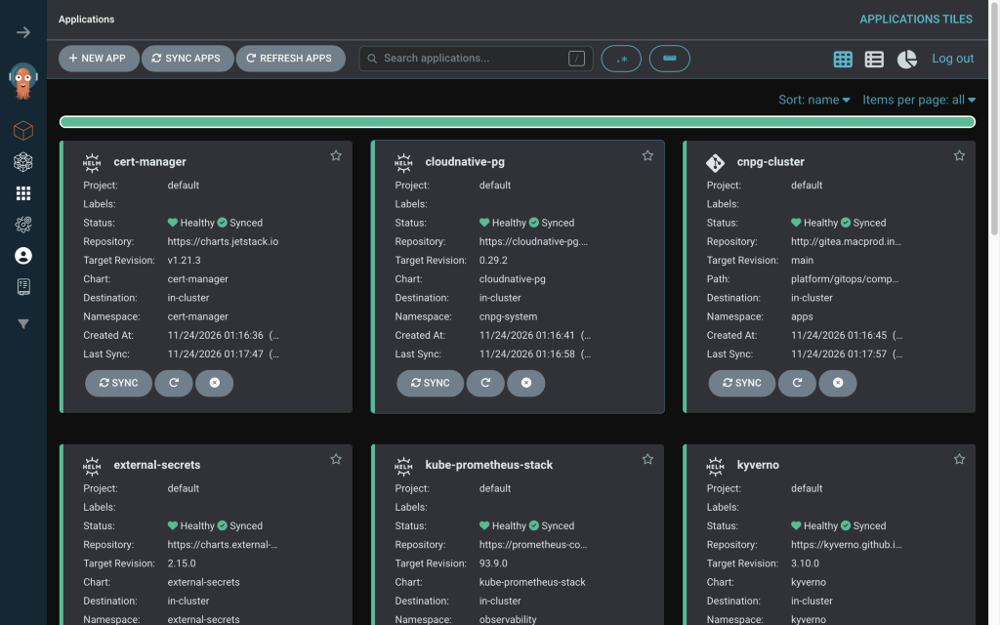

### 1-3. Grafana v13.3.1 — Kubernetes Compute Resources (`http://grafana.macprod.internal`)
* **검증 내용**: Prometheus 15초 스크랩을 통해 클러스터 CPU(`3.84%`), 메모리(`27.8%`) 및 `Demo 2`·`k6` 부하 구간의 `apps` 네임스페이스 CPU 스파이크(`22:53~22:58 UTC`) 시계열 그래프를 실시간 조회했다.
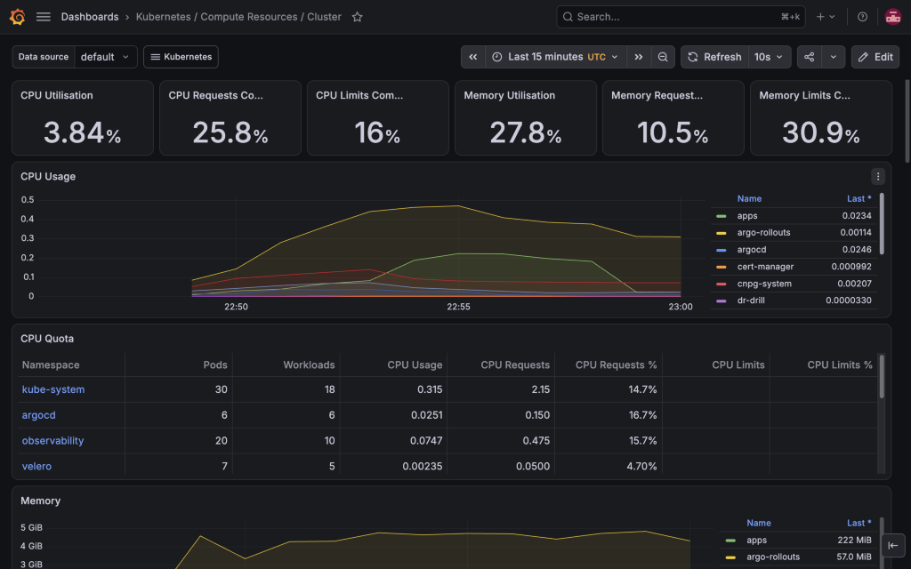

### 1-4. Cilium Hubble UI — eBPF Service Map (`http://hubble.macprod.internal`)
* **검증 내용**: `6/6` 노드 연결 및 `418.5 flows/s` 환경에서 `Ingress → order-service(:8000) → postgresql(:5432)` 및 `order-service → opentelemetry-collector(:4317)`, `prometheus → order-service/postgresql(:9187)` eBPF 플로우(`forwarded`)가 실시간 가시화된다.
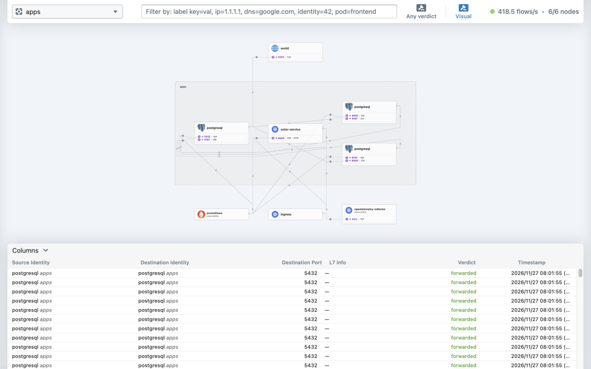

### 1-5. Gitea 1.22.6 — GitOps SCM Commit Log (`http://<OPS_IP>:3000/macprod/gitops`)
* **검증 내용**: `Demo 2` 실행 중 푸시된 `45c2629ee3` (`feat(demo): deploy faulty v2.0.0-bad canary`)와 Prometheus 자동 롤백 후 복구 커밋 `dd9a78fbd1` (`Revert ...`)이 `macprod/gitops`에 기록되어 있다.
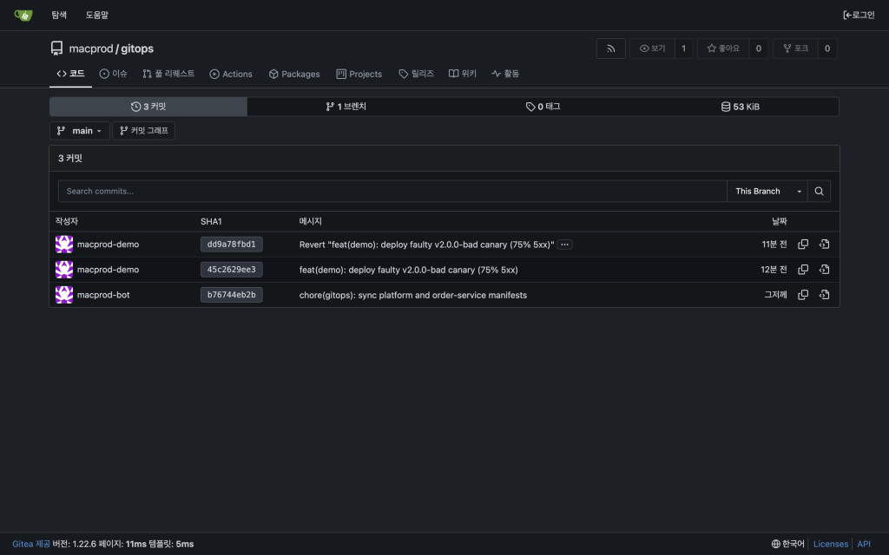

### 1-6. Order Service FastAPI Swagger UI (`http://order.macprod.internal/docs`)
* **검증 내용**: Gateway Envoy를 경유해 `GET /api/v1/version`을 live 실행한 결과 HTTP `200`, `version: v1.0.0`, `pod: order-service-57cc684556-zdcc5`, Vault 시크릿 주입(`vault_secret_present: true`, `api_key_prefix: macprod-`) 응답이 확인되었다.
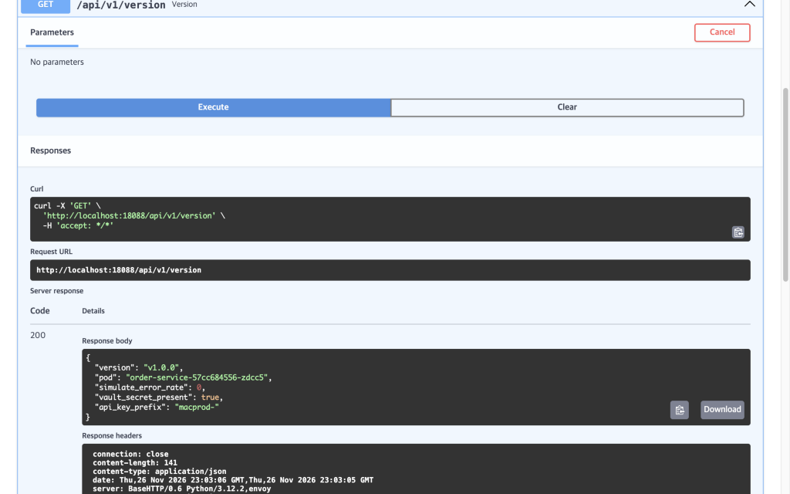

### 1-7. SeaweedFS 4.55 Filer — S3 Buckets (`http://<OPS_IP>:8888/buckets/`)
* **검증 내용**: 클러스터 외부 영속 백업용 S3 버킷 4종(`cnpg-backups`, `loki-chunks`, `terraform-state`, `velero-backups`)이 정상 마운트·유지되고 있다.
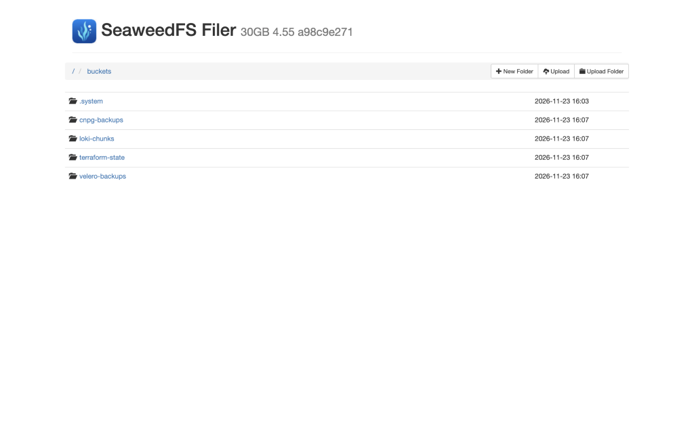

### 1-8. HashiCorp Vault 1.18.3 — Secrets Engines (`http://<OPS_IP>:8200/ui/`)
* **검증 내용**: 부팅 Auto-Unseal 완료 후 KV v2(`secret/`)와 SSH CA(`ssh-client-signer/`) 엔진이 정상 활성 상태로 확인되었다.
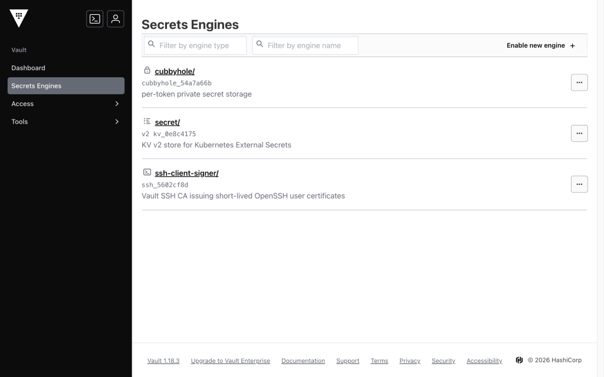

---

## 2. 실전 CLI 검증 · 6대 데모 · `k6` 부하 테스트 실행 캡처 (`docs/captures/cli-*`)

### 2-1. 클러스터 상태 · ArgoCD · CNPG · Velero 최종 스냅샷 (`make status`)
* **결과**: `7/7 VM running`, `6/6 Nodes Ready (v1.32.13)`, `14/14 ArgoCD Synced/Healthy`, `order-db` (`3/3 Ready`, Primary `order-db-2`), CNPG S3 백업 `completed`.
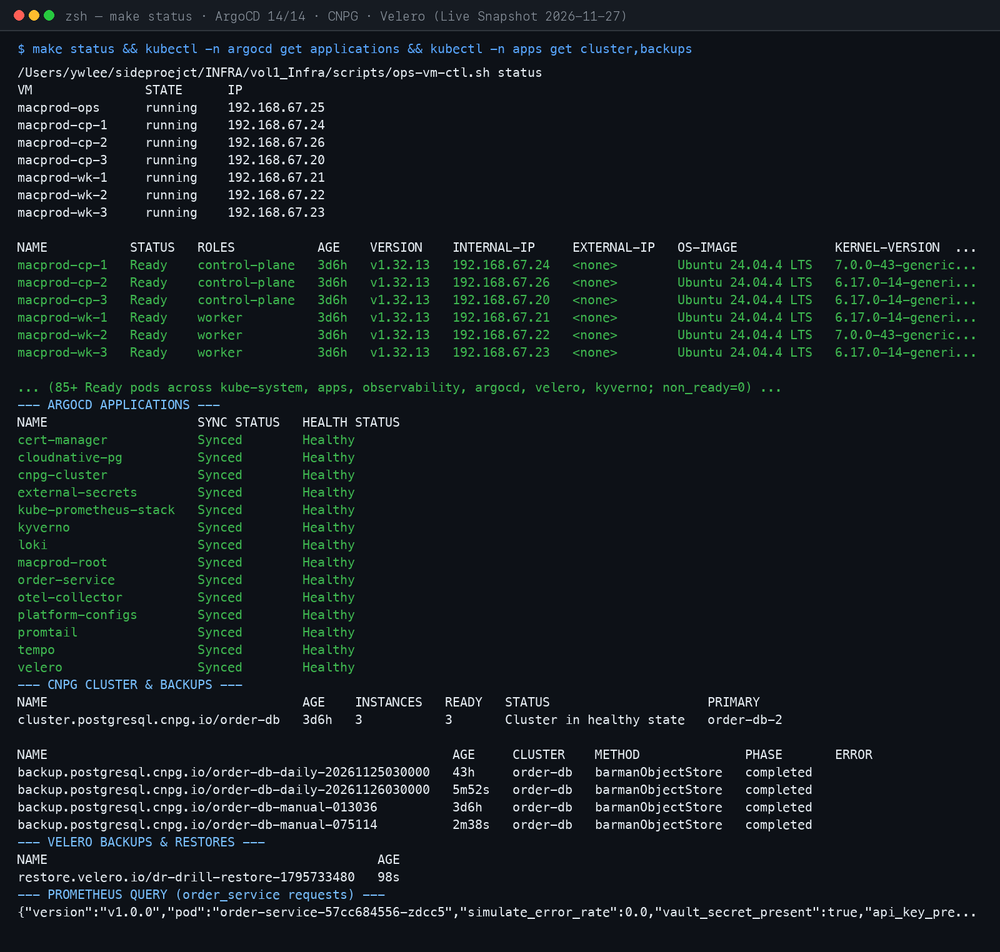

### 2-2. Demo 1 — 3-Master HA 컨트롤 플레인 장애 주입 & `etcd` S3 백업 (`make demo-ha`)
* **결과**: `macprod-cp-2` 강제 종료 중 API `/healthz` 40회 프로브 **`200 OK=38, Non-200=2`**, `2/3` Raft 쿼럼에서 ConfigMap 생성·삭제 성공, `s3://terraform-state/etcd-backups/etcd-macprod-cp-1-20261126-224934.db` 업로드 및 `cp-2` 자동 복귀 완료.
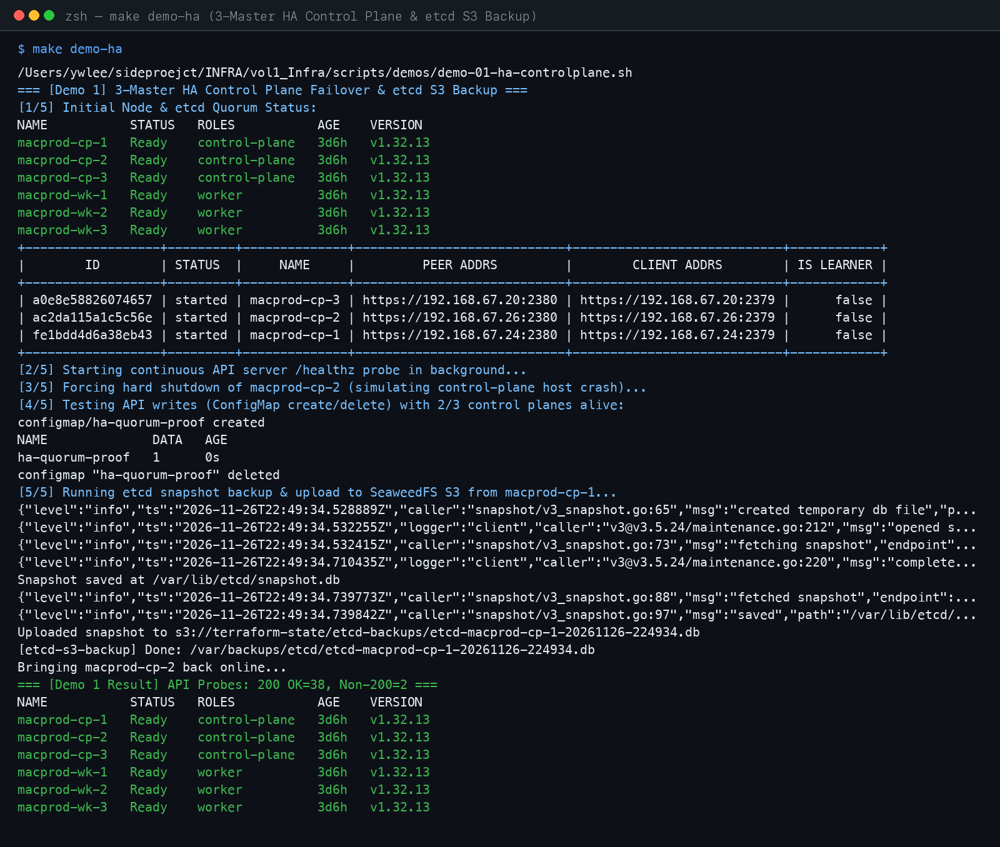

### 2-3. Demo 2 — Argo Rollouts 카나리 & Prometheus 5xx 자동 롤백 (`make demo-canary`)
* **결과**: `v2.0.0-bad` (`75%` 5xx) 배포 후 `AnalysisRun`이 `non-5xx-ratio` 실패(`2 > failureLimit 1`)를 탐지해 즉시 `RolloutAborted`, Gateway `HTTPRoute` 가중치 `stable:100 / canary:0` 복원 후 Git Revert 및 `Rollout Phase=Healthy` 수렴.
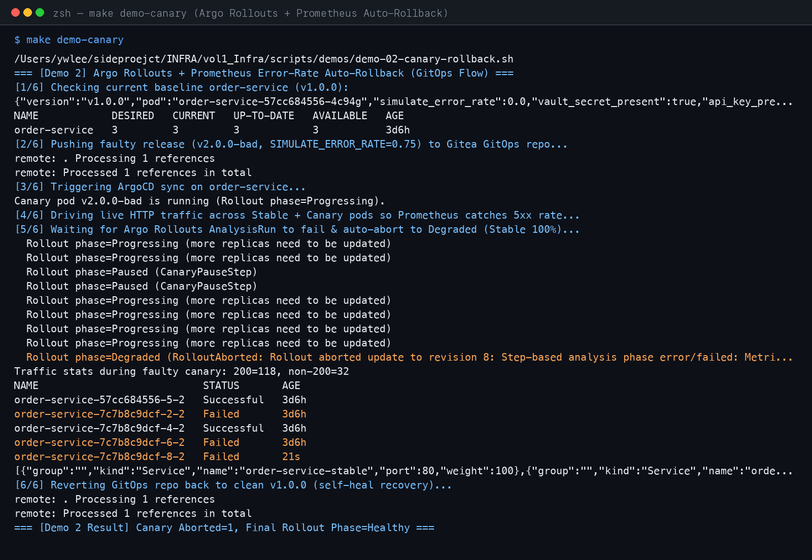

### 2-4. Demo 3 — CloudNativePG 3-Node HA Primary Failover & S3 백업 (`make demo-db`)
* **결과**: 센티넬 레코드(`failover-proof-1795733470`, `id=695`) 기록 후 Primary `order-db-1` 강제 삭제 시 `order-db-2` 자동 승격 **`RTO=4s`**, 데이터 무손실 조회 확인 및 Barman S3 백업 완료.
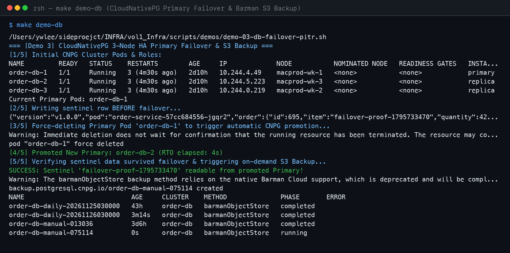

### 2-5. Demo 4 — Vault → ESO 시크릿 회전 & Kyverno CEL 차단 (`make demo-security`)
* **결과**: `API_KEY` 회전(`macprod-secret-v1-token` → `macprod-secret-v2-rotated` 즉시 동기화 후 원복) 및 Kyverno Admission Webhook의 `:latest` 태그(`disallow-latest-tag`), 특권 상승(`disallow-privilege-escalation`) 차단 검증.
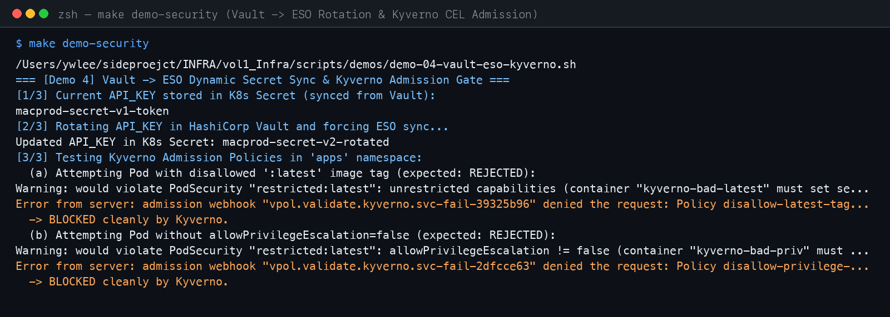

### 2-6. Demo 5 — Velero & Kopia 네임스페이스·PVC 재해 복구 (`make demo-velero`)
* **결과**: `dr-drill` 네임스페이스 + `local-path` 100Mi PVC 백업(`Completed`) 후 네임스페이스 완전 삭제 → Restore 완료 후 파드 내 `/data/proof.txt`(`'macprod-dr-verified'`) 무손실 복구 확인.
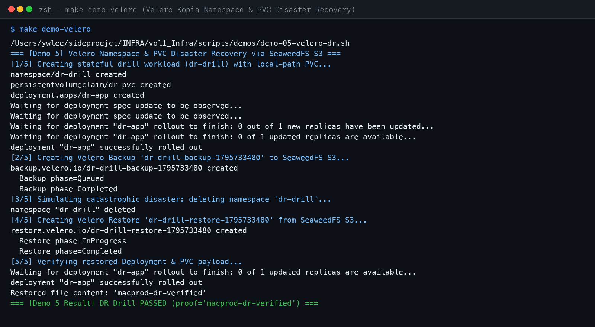

### 2-7. Demo 6 — Vault SSH CA 단기 인증서 & 패스워드 인증 차단 (`make demo-ssh`)
* **결과**: `authorized_keys` 미등록 일회용 `ed25519` 키 거부 및 `passwordauthentication=no` 확인 후, Vault `ssh-client-signer/sign/macprod-admin`으로 발급된 5분 단기 인증서만으로 `macprod-wk-1`·`macprod-cp-1`·`macprod-ops` 로그인 성공.
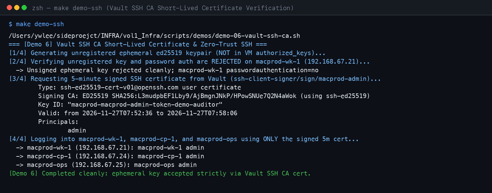

### 2-8. `macprod-ops` Bastion `k6` 부하 테스트 (`30 VU · 45s`)
* **결과**: `3,796` 요청 (`83.77 req/s`), **`100.00%` 체크 통과 (`3,796/3,796`, 실패율 `0.00%`)**, **`p(95)=297.35ms` (`avg=196.35ms`)**.
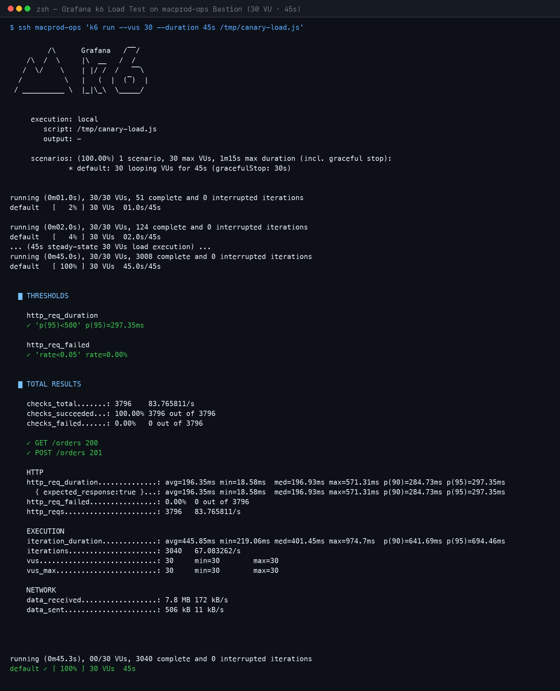
